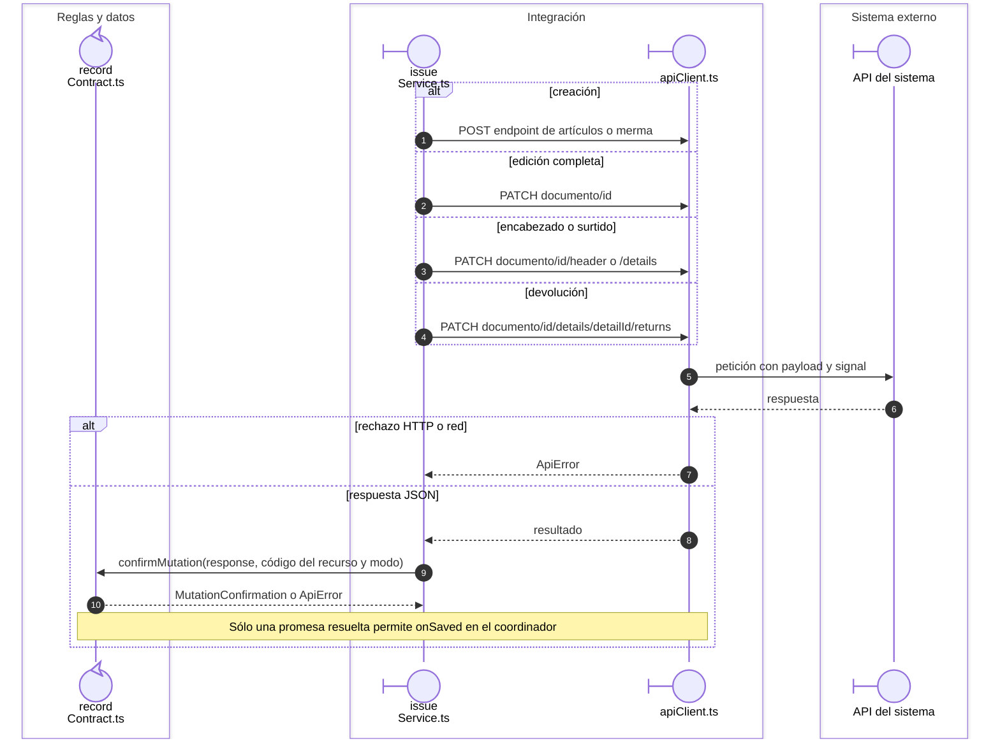

# Salida: transporte de escritura y devolución

Continúa `SEQ-027`, `SEQ-016` y `SEQ-032`. El guardado general y la devolución
comparten transporte y confirmación, con endpoints y payloads específicos.

## Endpoint y confirmación de la operación

**Identificador:** `DIA-VUE-SEQ-045`. **Pregunta:** ¿Cuándo confirma el servicio una creación, edición, surtido o devolución?

**Lectura visual:** [roles y callbacks](../00-reading-and-roles.md).

## Fuentes de los participantes

[issueService.ts](../../../../../src/modules/issues/services/issueService.ts),
[recordContract.ts](../../../../../src/shared/http/recordContract.ts),
[apiClient.ts](../../../../../src/shared/http/apiClient.ts).
