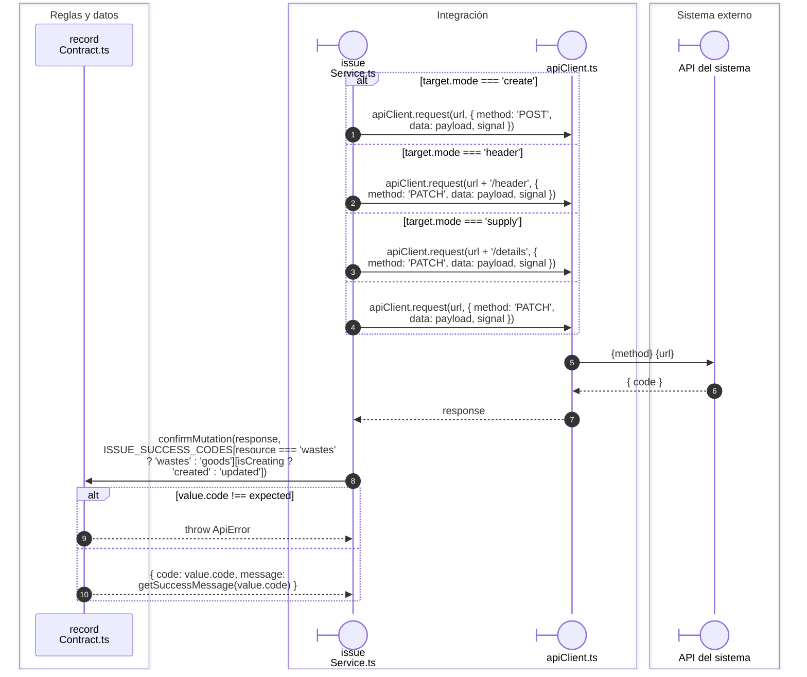
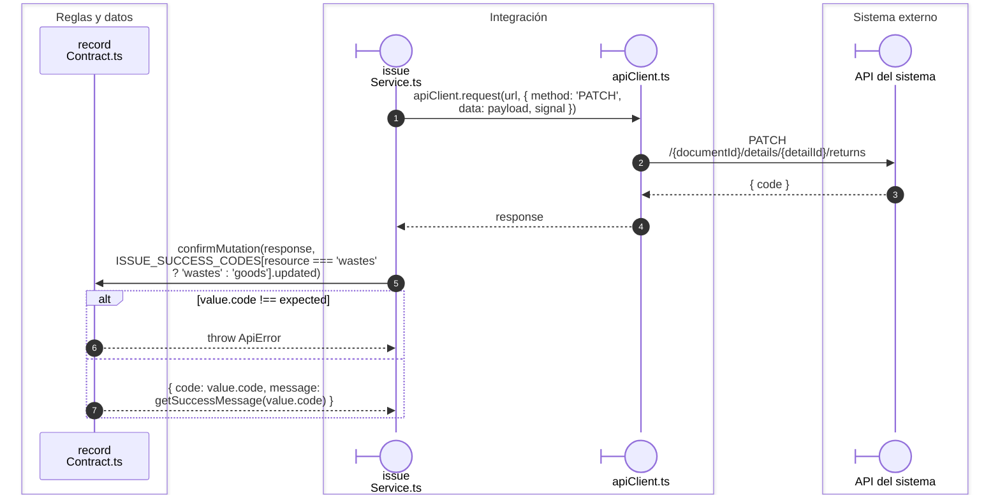

# Salida: transporte de escritura y devolución

## Endpoint y confirmación de la operación

**Identificador:** `DIA-VUE-SEQ-045`.

## returnDetail(options)

**Identificador:** `DIA-VUE-SEQ-052`.

## Fuentes de los participantes

[issueService.ts](../../../../../src/modules/issues/services/issueService.ts),
[recordContract.ts](../../../../../src/shared/http/recordContract.ts),
[apiClient.ts](../../../../../src/shared/http/apiClient.ts).

## Secuencias relacionadas

[DIA-VUE-SEQ-027](01-issue-open-save.md#escritura-de-creación-edición-y-encabezado), [DIA-VUE-SEQ-016](02-issue-supply.md#secuencia-aplicada), [DIA-VUE-SEQ-032](03-issue-return.md#ejecución-del-callback-y-resultado).
