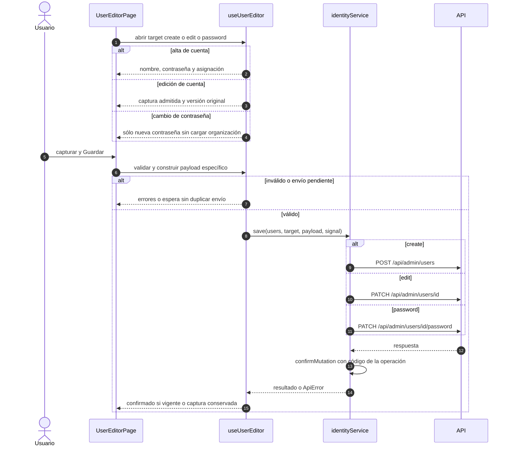

# Cuenta, edición y contraseña

## Escenario y contratos

**Casos relacionados:** CU-IDA-06/07/08.

**Fuente técnica:** useUserEditor.ts e identityService.save. El diagrama describe el código Vue y sus fronteras. La API es un participante externo; sus transacciones internas no se atribuyen al navegador.

## Secuencia aplicada

**Identificador:** `DIA-VUE-SEQ-006`. Mensajes numerados; líneas continuas = invocación/solicitud, discontinuas = respuesta o resultado. Las ramas representan decisiones reales; no son ejecuciones simultáneas.

## Reglas y recuperación

Edición no vuelve a enviar personId/contraseña. Password sólo envía clave y expectedVersion. La autorización y el almacenamiento seguro de credenciales pertenecen a la API.

## Evidencia

identityTest.ts y records.spec.ts. La [matriz por caso](../../../testing/04-use-case-coverage.md) identifica alcance y límites, y el [registro CP](../../../testing/03-test-cases.md) concreta datos y oráculos críticos.
