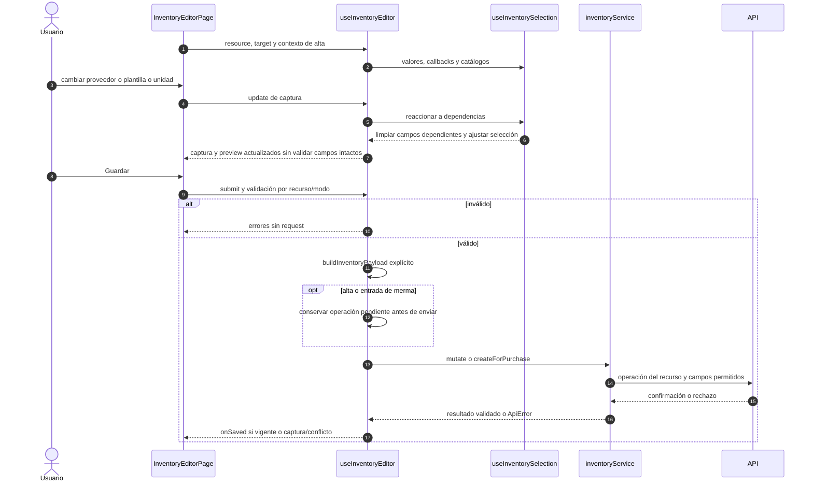

# Selección dependiente y escritura de inventario

## Escenario y contratos

**Casos relacionados:** CU-ALM-02/03/05/10/11/12/13/18/19/21.

**Fuente técnica:** useInventoryEditor.ts, useInventorySelection.ts, formModel.ts e inventoryService.ts. El diagrama describe el código Vue y sus fronteras. La API es un participante externo; sus transacciones internas no se atribuyen al navegador.

## Secuencia aplicada

**Identificador:** `DIA-VUE-SEQ-007`. Mensajes numerados; líneas continuas = invocación/solicitud, discontinuas = respuesta o resultado. Las ramas representan decisiones reales; no son ejecuciones simultáneas.

## Reglas y recuperación

El recurso fija reglas; Consumibles omite medidas, edición preserva identidad/stock y el ajuste conserva versión/motivo. La recuperación de merma se detalla en las siguientes secuencias y no se resuelve como un reintento genérico.

## Evidencia

inventoryFormTest.ts, inventoryListTest.ts y warehouse.spec.ts. La [matriz por caso](../../../testing/04-use-case-coverage.md) identifica alcance y límites, y el [registro CP](../../../testing/03-test-cases.md) concreta datos y oráculos críticos.
