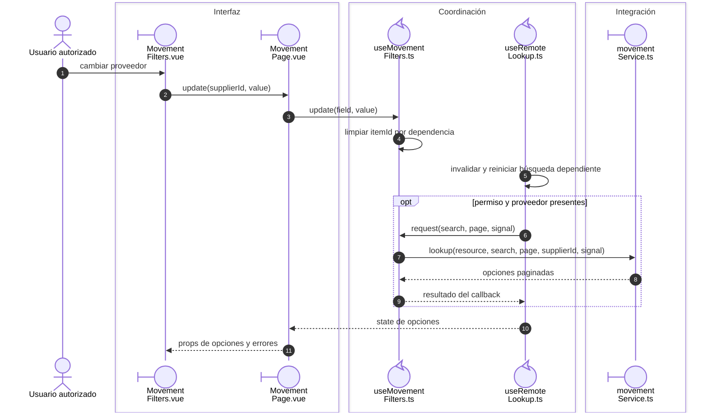
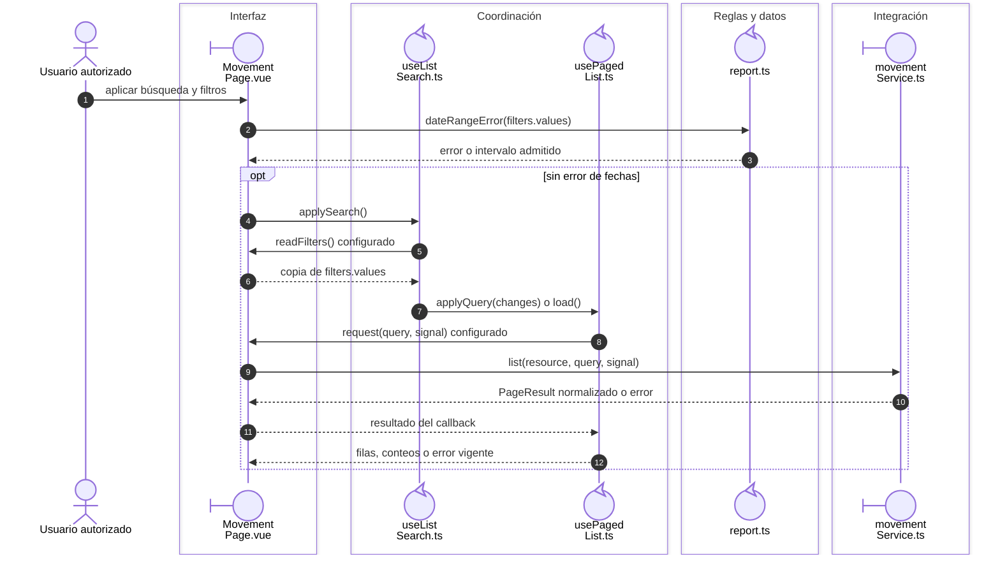

# Movimientos: filtros dependientes e historial

## Escenario y fuente

CU-ALM-07/15/23 y reportes asociados. Fuentes: `useMovementFilters`, `MovementPage`,
`movementService` y `useRemoteLookup`. Se consulta el historial del recurso fijo;
esta pantalla no escribe movimientos.

## Secuencia aplicada

**Identificador:** `DIA-VUE-SEQ-023`. Las dependencias de proveedor y artículo se
resuelven antes de aplicar la consulta. Mensajes numerados; no implica escritura.

**Lectura visual:** [líneas de vida, números y mensajes](../../diagram-reading.md#secuencias).

El tipo de movimiento se limita a la lista admitida. La identidad del material y de
la merma no se intercambian. Exportar utiliza los filtros aplicados, no una captura
incompleta del panel. Las [descargas](02-reports.md) conservan su proceso separado.
Evidencia: `movementFiltersTest.ts`, `movementServiceTest.ts` y `movements.spec.ts`.

## Aplicación de criterios y consulta

**Identificador:** `DIA-VUE-SEQ-050`. La consulta utiliza filtros aplicados, después de comprobar el intervalo de fechas.

## Fuentes de los participantes

[MovementFilters.vue](../../../../../src/modules/movements/components/MovementFilters.vue),
[MovementPage.vue](../../../../../src/modules/movements/pages/MovementPage.vue),
[useMovementFilters.ts](../../../../../src/modules/movements/composables/useMovementFilters.ts),
[useListSearch.ts](../../../../../src/shared/composables/useListSearch.ts),
[useRemoteLookup.ts](../../../../../src/shared/composables/useRemoteLookup.ts),
[usePagedList.ts](../../../../../src/shared/composables/usePagedList.ts),
[report.ts](../../../../../src/shared/report.ts),
[movementService.ts](../../../../../src/modules/movements/services/movementService.ts).
