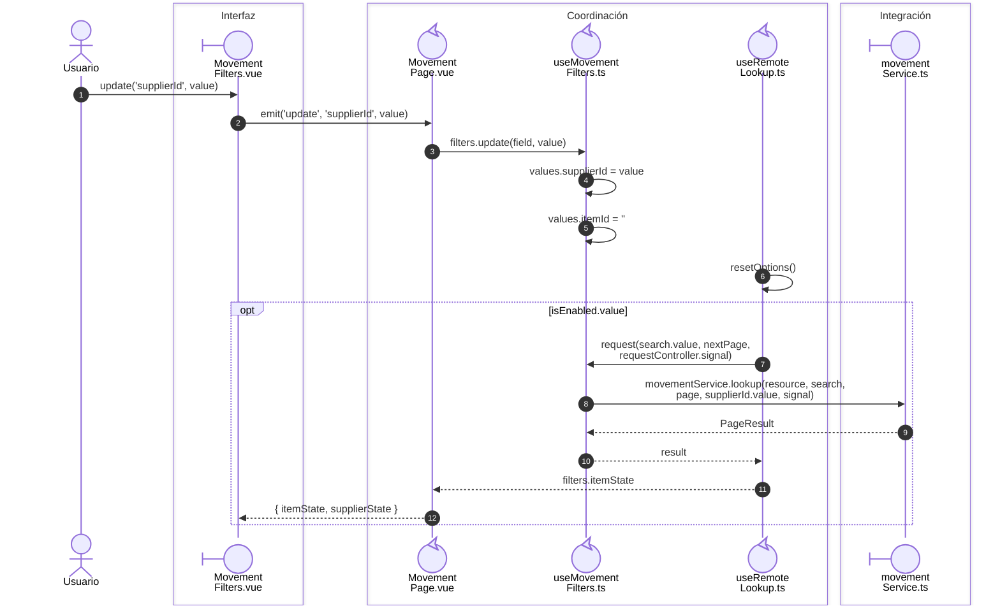
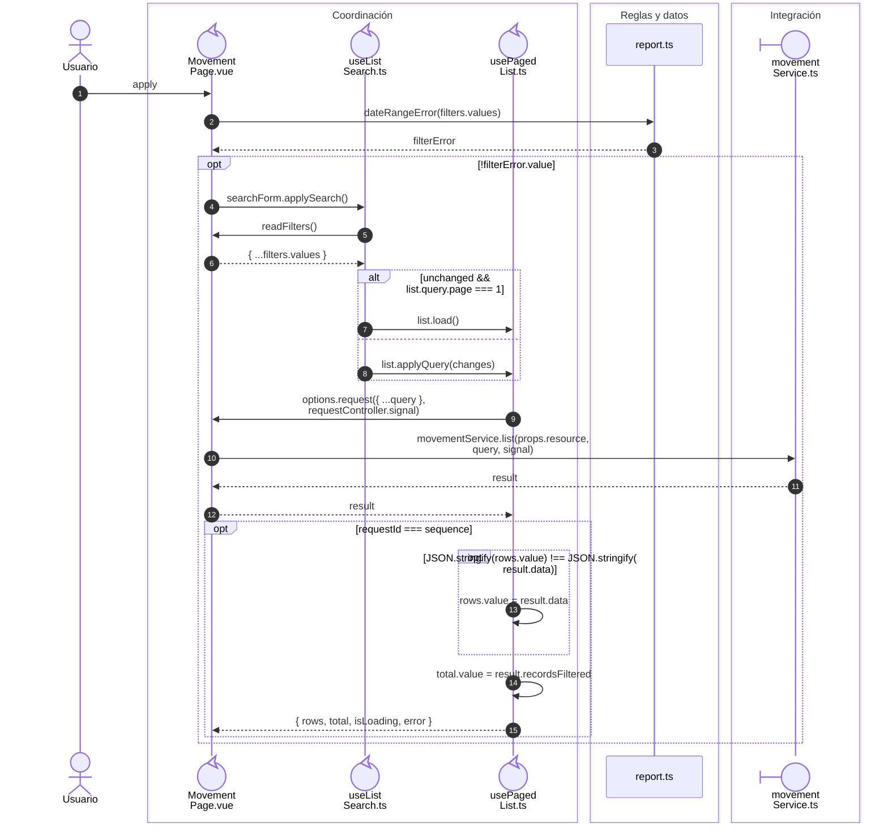

# Movimientos: filtros dependientes e historial

## Secuencia aplicada

**Identificador:** `DIA-VUE-SEQ-023`.

## Aplicación de criterios y consulta

**Identificador:** `DIA-VUE-SEQ-050`.

## Fuentes de los participantes

[MovementFilters.vue](../../../../../src/modules/movements/components/MovementFilters.vue),
[MovementPage.vue](../../../../../src/modules/movements/pages/MovementPage.vue),
[useMovementFilters.ts](../../../../../src/modules/movements/composables/useMovementFilters.ts),
[useListSearch.ts](../../../../../src/shared/composables/useListSearch.ts),
[useRemoteLookup.ts](../../../../../src/shared/composables/useRemoteLookup.ts),
[usePagedList.ts](../../../../../src/shared/composables/usePagedList.ts),
[report.ts](../../../../../src/shared/report.ts),
[movementService.ts](../../../../../src/modules/movements/services/movementService.ts).
