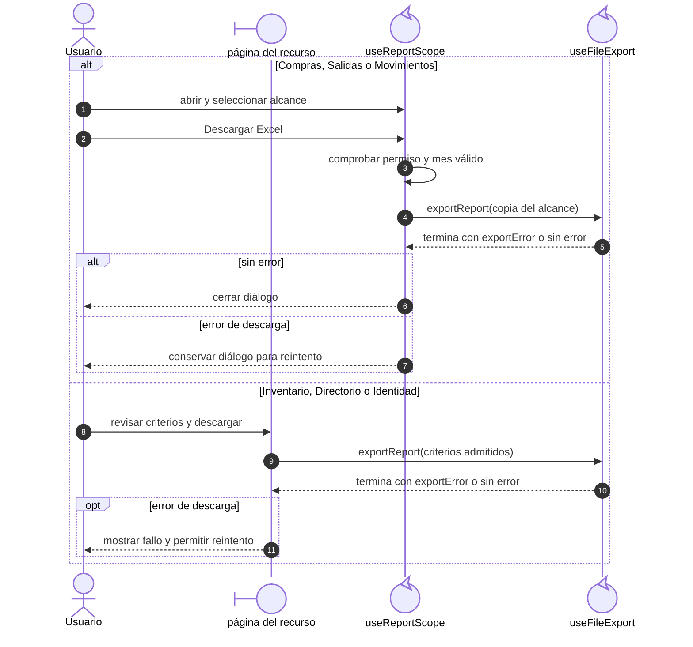
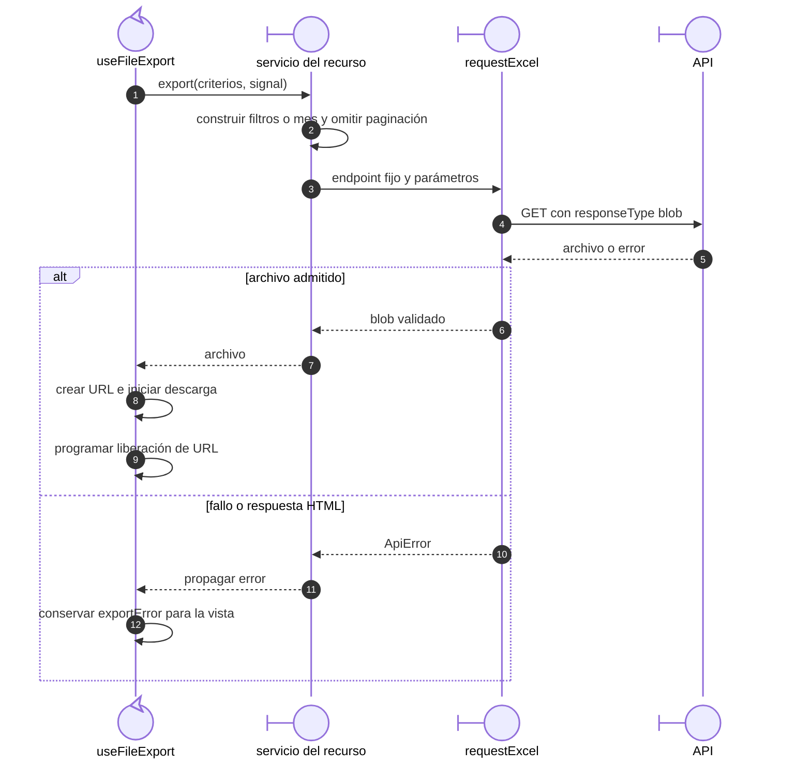

# Reportes: alcance, archivo y error recuperable

## Escenario y contratos

**Casos relacionados:** CU de reporte de cada familia; RF-VUE-013.

**Fuente técnica:** useReportScope.ts, useFileExport.ts, servicio del recurso y requestExcel.ts.

## Selección del alcance y resultado visible

**Identificador:** `DIA-VUE-SEQ-018`. La descarga compartida se detalla en la figura siguiente.

**Lectura visual:** [líneas de vida, números y mensajes](../../diagram-reading.md#secuencias).

Un mes inválido detiene la operación antes de llamar al exportador; el usuario puede
corregirlo sin abandonar el diálogo. Cada descarga utiliza los criterios admitidos
por ese reporte, no necesariamente todos los filtros que aparecen en la tabla.

## Petición y descarga compartida

**Identificador:** `DIA-VUE-SEQ-033`. Amplía la llamada a `useFileExport` de ambas ramas anteriores.

## Reglas y recuperación

Los módulos con descarga directa usan useFileExport sin diálogo de alcance. Personas bloquea el filtro de rol no admitido por su API de exportación. El contenido real de XLSX requiere sistema, no un blob simulado.

## Evidencia

reportScopeTest.ts, inventoryReportTest.ts, records.spec.ts y application.spec.ts. La [matriz por caso](../../../../testing/04-use-case-coverage.md) identifica alcance y límites, y el [registro CP](../../../../testing/03-test-cases.md) concreta datos y oráculos críticos.
