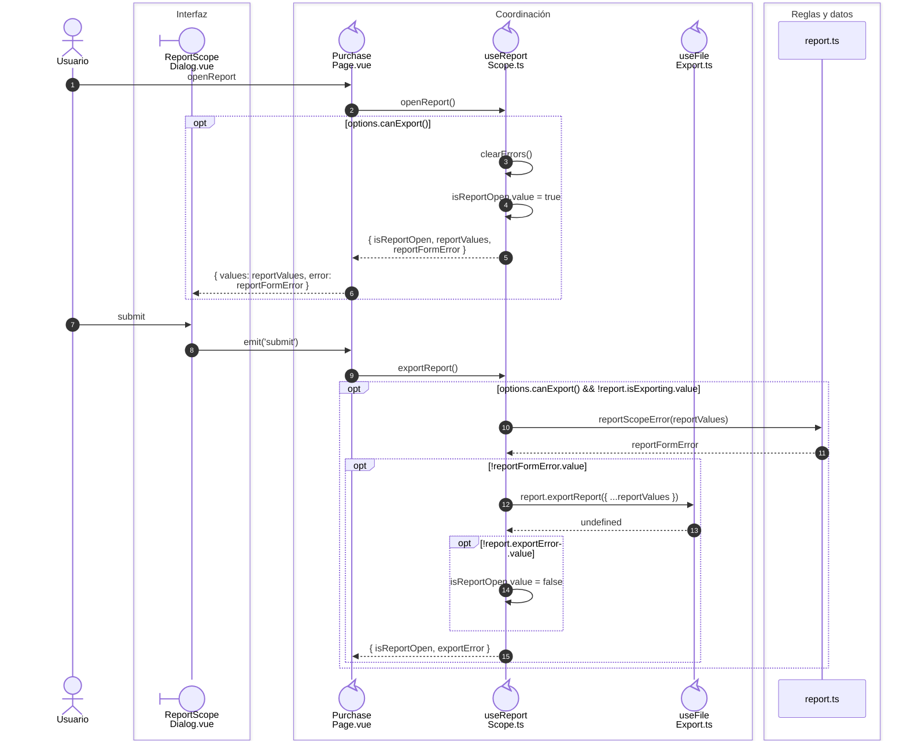
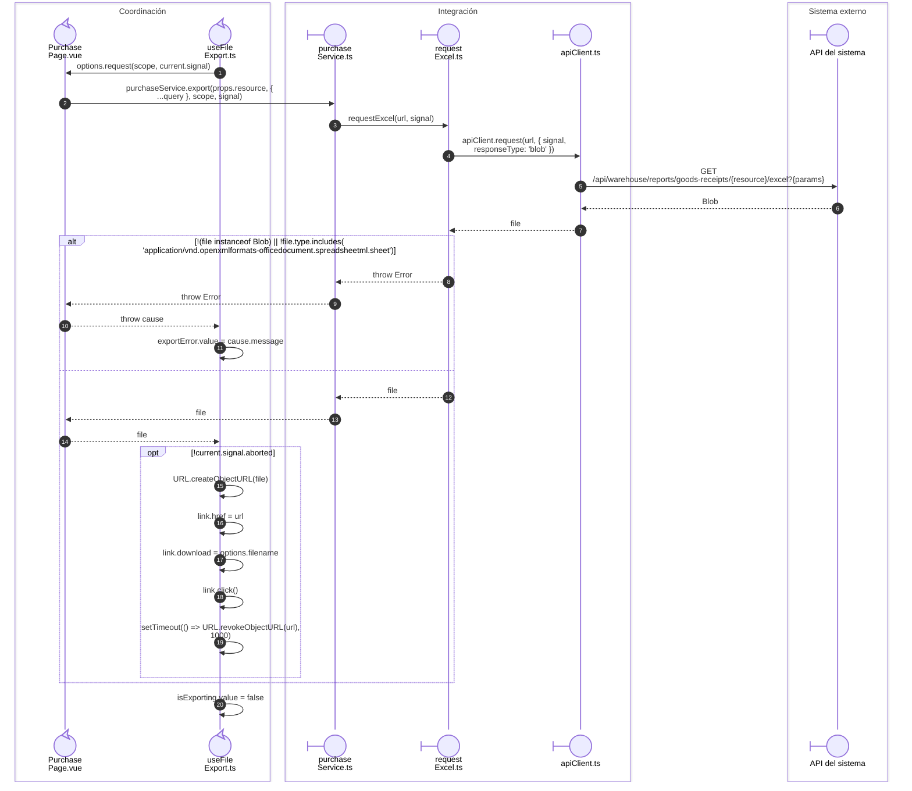
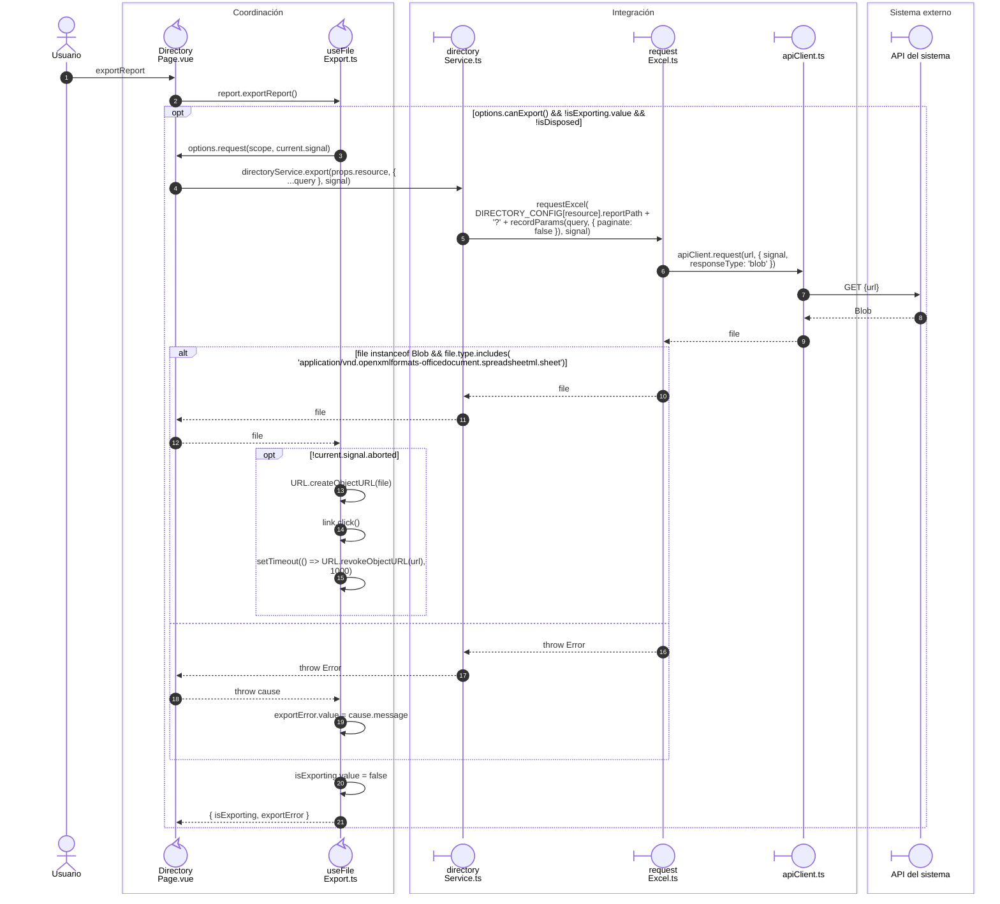

# Reportes: alcance, archivo y error recuperable

**Casos relacionados:** CU de reporte de cada familia; RF-VUE-013.

## Selección del alcance y resultado visible

**Identificador:** `DIA-VUE-SEQ-018`.

## Petición y descarga compartida

**Identificador:** `DIA-VUE-SEQ-033`.

## Descarga directa de Directorio

**Identificador:** `DIA-VUE-SEQ-046`.

## Fuentes de los participantes

[ReportScopeDialog.vue](../../../../../src/shared/components/ReportScopeDialog.vue),
[PurchasePage.vue](../../../../../src/modules/purchases/pages/PurchasePage.vue),
[useReportScope.ts](../../../../../src/shared/composables/useReportScope.ts),
[useFileExport.ts](../../../../../src/shared/composables/useFileExport.ts),
[report.ts](../../../../../src/shared/report.ts),
[DirectoryPage.vue](../../../../../src/modules/directory/pages/DirectoryPage.vue),
[directoryService.ts](../../../../../src/modules/directory/services/directoryService.ts),
[purchaseService.ts](../../../../../src/modules/purchases/services/purchaseService.ts),
[requestExcel.ts](../../../../../src/shared/http/requestExcel.ts),
[apiClient.ts](../../../../../src/shared/http/apiClient.ts).
