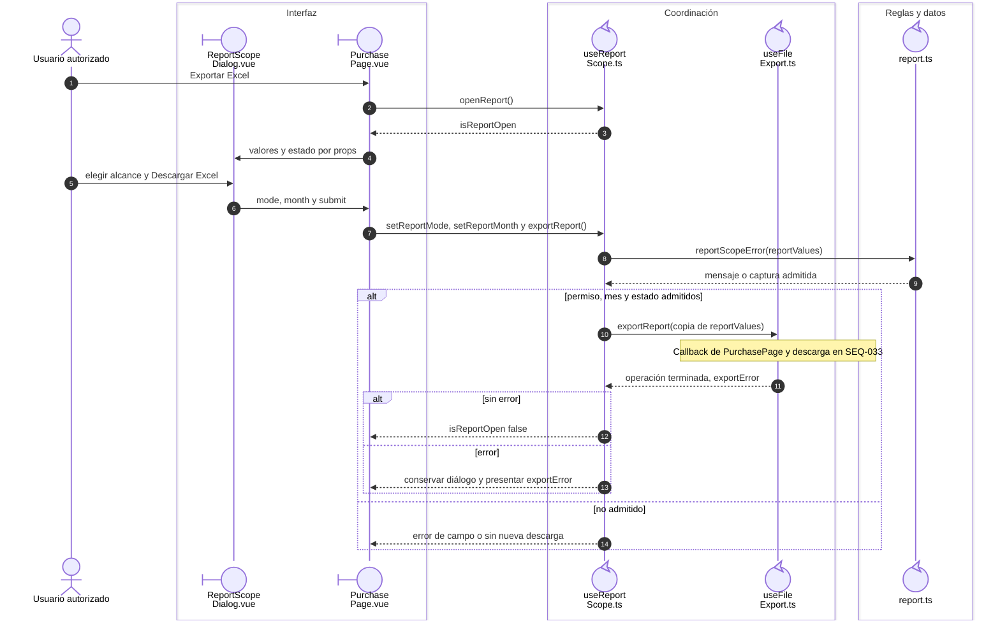
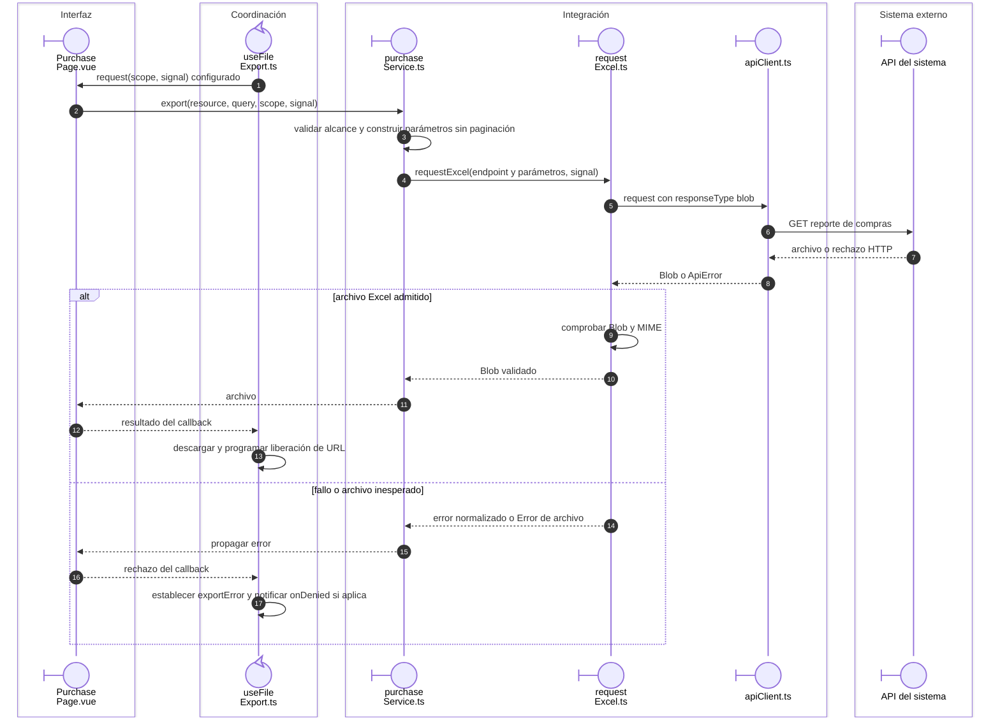
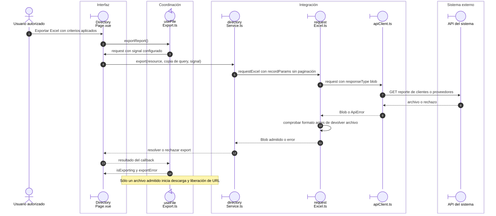

# Reportes: alcance, archivo y error recuperable

## Escenario y contratos

**Casos relacionados:** CU de reporte de cada familia; RF-VUE-013.

## Selección del alcance y resultado visible

**Identificador:** `DIA-VUE-SEQ-018`. La primera figura desarrolla Compras; Salidas y Movimientos reutilizan el mismo
contrato de `useReportScope`. La descarga se amplía en `SEQ-033`.

**Lectura visual:** [líneas de vida, números y mensajes](../../diagram-reading.md#secuencias).

Un mes inválido detiene la operación antes de llamar al exportador; el usuario puede
corregirlo sin abandonar el diálogo. Cada descarga utiliza los criterios admitidos
por ese reporte, no necesariamente todos los filtros que aparecen en la tabla.

## Petición y descarga compartida

**Identificador:** `DIA-VUE-SEQ-033`. Amplía la llamada a `useFileExport` configurada por `PurchasePage`.
Las descargas directas usan el mismo exportador, con el servicio de su recurso.

## Descarga directa de Directorio

**Identificador:** `DIA-VUE-SEQ-046`. **Pregunta:** ¿Cómo se descarga un reporte sin
abrir el selector de alcance? **Fuente:** `DirectoryPage`, `directoryService` y
los mismos adaptadores compartidos de archivo y HTTP.

| Descarga directa | Propietario del callback configurado en useFileExport | Servicio |
| --- | --- | --- |
| Clientes y proveedores | `DirectoryPage.vue`. | `directoryService.export`. |
| Personas y cuentas | `IdentityPage.vue`. | `identityService.export`; Personas rechaza el filtro de rol no admitido. |
| Materiales, consumibles y mermas | `useInventoryReport.ts`, compuesto por `useInventory.ts`. | `inventoryReportService.export`, con `inventoryScope`. |

## Reglas y recuperación

Los módulos con descarga directa usan useFileExport sin diálogo de alcance. Personas bloquea el filtro de rol no admitido por su API de exportación. El contenido real de XLSX requiere sistema, no un blob simulado.

## Evidencia

reportScopeTest.ts, inventoryReportTest.ts, records.spec.ts y application.spec.ts. La [matriz por caso](../../../../testing/04-use-case-coverage.md) identifica alcance y límites, y el [registro CP](../../../../testing/03-test-cases.md) concreta datos y oráculos críticos.

## Fuentes de los participantes

[ReportScopeDialog.vue](../../../../../src/shared/components/ReportScopeDialog.vue),
[PurchasePage.vue](../../../../../src/modules/purchases/pages/PurchasePage.vue),
[useReportScope.ts](../../../../../src/shared/composables/useReportScope.ts),
[useFileExport.ts](../../../../../src/shared/composables/useFileExport.ts),
[report.ts](../../../../../src/shared/report.ts),
[DirectoryPage.vue](../../../../../src/modules/directory/pages/DirectoryPage.vue),
[directoryService.ts](../../../../../src/modules/directory/services/directoryService.ts),
[purchaseService.ts](../../../../../src/modules/purchases/services/purchaseService.ts),
[requestExcel.ts](../../../../../src/shared/http/requestExcel.ts),
[apiClient.ts](../../../../../src/shared/http/apiClient.ts).
