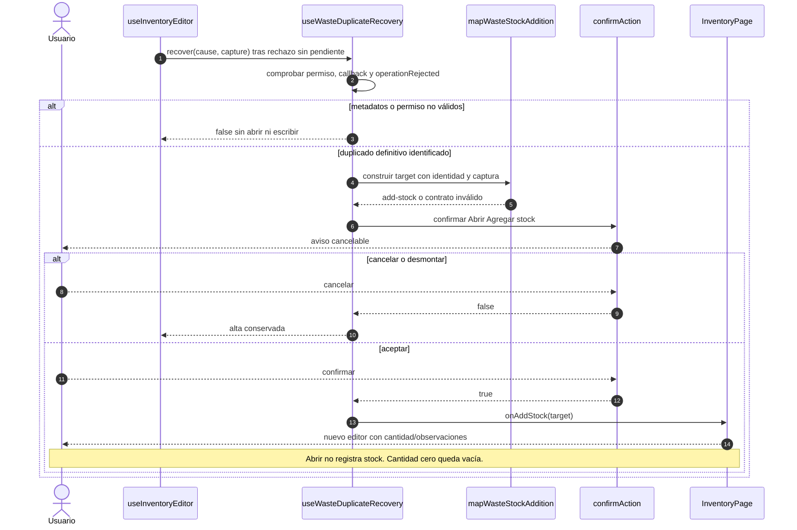

# Merma duplicada: apertura de una entrada

## Escenario y contratos

**Casos relacionados:** CU-ALM-10 A2 y CU-ALM-13.

**Fuente técnica:** useWasteDuplicateRecovery.ts y wasteStockAdditionMapper.ts. El diagrama describe el código Vue y sus fronteras. La API es un participante externo; sus transacciones internas no se atribuyen al navegador.

## Secuencia aplicada

**Identificador:** `DIA-VUE-SEQ-009`. Mensajes numerados; líneas continuas = invocación/solicitud, discontinuas = respuesta o resultado. Las ramas representan decisiones reales; no son ejecuciones simultáneas.

## Reglas y recuperación

Guardar el editor de entrada inicia otra operación con su propia clave y revisión. El ajuste absoluto no reemplaza esta entrada.

## Evidencia

wasteDuplicateRecoveryTest.ts y warehouse.spec.ts. La [matriz por caso](../../../testing/04-use-case-coverage.md) identifica alcance y límites, y el [registro CP](../../../testing/03-test-cases.md) concreta datos y oráculos críticos.
