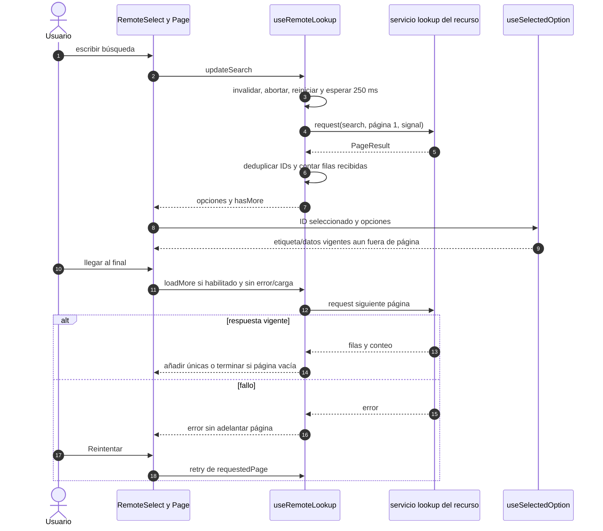

# Búsqueda, paginación y selección remota

## Escenario y contratos

**Casos relacionados:** RD-VUE-006; RN-VUE-003/005; soporte de captura.

**Fuente técnica:** useRemoteLookup.ts, useSelectedOption.ts y RemoteSelect.vue. El diagrama describe el código Vue y sus fronteras. La API es un participante externo; sus transacciones internas no se atribuyen al navegador.

## Secuencia aplicada

**Identificador:** `DIA-VUE-SEQ-010`. Mensajes numerados; líneas continuas = invocación/solicitud, discontinuas = respuesta o resultado. Las ramas representan decisiones reales; no son ejecuciones simultáneas.

## Reglas y recuperación

Cambiar dependencia reinicia búsqueda/opciones; desmontar limpia timer y aborta/invalida. La selección pertenece al consumidor y no autoriza el registro ni fabrica su ID.

## Evidencia

remoteLookupTest.ts, selectedOptionTest.ts y selectCreation.spec.ts. La [matriz por caso](../../../testing/04-use-case-coverage.md) identifica alcance y límites, y el [registro CP](../../../testing/03-test-cases.md) concreta datos y oráculos críticos.
