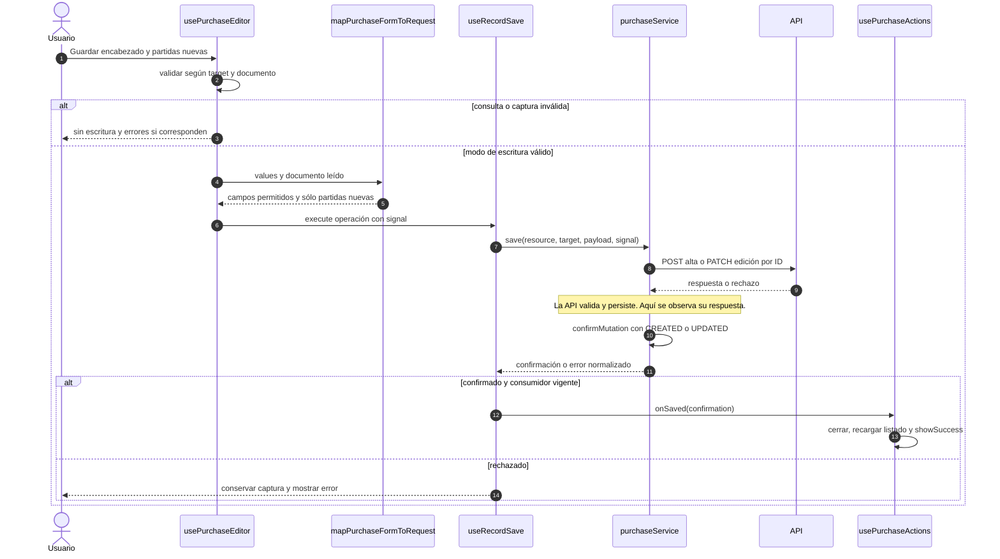

# Compra: alta y edición confirmadas

## Escenario y contratos

**Casos relacionados:** CU-ENT-02/03/08/09.

**Fuente técnica:** usePurchaseEditor.ts, purchaseRequestMapper.ts, purchaseService.save y usePurchaseActions.handleSaved. El diagrama describe el código Vue y sus fronteras. La API es un participante externo; sus transacciones internas no se atribuyen al navegador.

## Secuencia aplicada

**Identificador:** `DIA-VUE-SEQ-012`. Mensajes numerados; líneas continuas = invocación/solicitud, discontinuas = respuesta o resultado. Las ramas representan decisiones reales; no son ejecuciones simultáneas.

## Reglas y recuperación

Las observaciones de encabezado se incluyen en lectura y escritura admitida; el historial de corrección no se sustituye por ese texto. La compra no contabiliza otra vez el alta contextual de un artículo.

## Evidencia

purchaseTest.ts, purchases.spec.ts y recordContractTest.ts. La [matriz por caso](../../../testing/04-use-case-coverage.md) identifica alcance y límites, y el [registro CP](../../../testing/03-test-cases.md) concreta datos y oráculos críticos.
