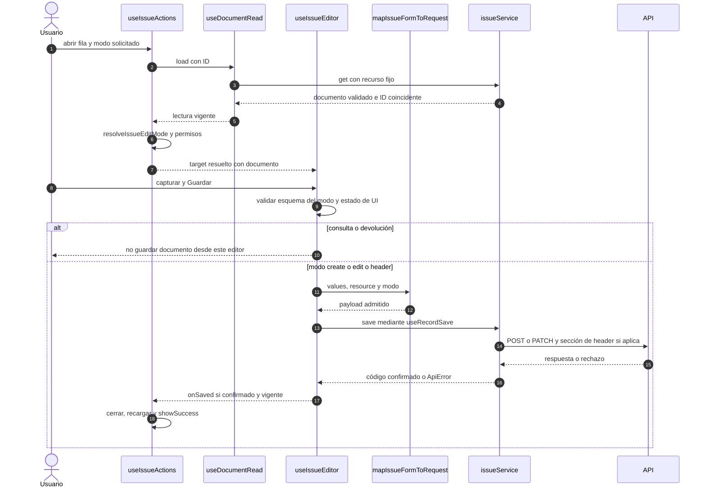

# Salida: apertura, modos y escritura

## Escenario y contratos

**Casos relacionados:** CU-SAL-02/03/04/09/10/11/16/17/18.

**Fuente técnica:** useIssueActions.ts, useIssueEditor.ts, issueRules.ts e issueRequestMapper.ts. El diagrama describe el código Vue y sus fronteras. La API es un participante externo; sus transacciones internas no se atribuyen al navegador.

## Secuencia aplicada

**Identificador:** `DIA-VUE-SEQ-015`. Mensajes numerados; líneas continuas = invocación/solicitud, discontinuas = respuesta o resultado. Las ramas representan decisiones reales; no son ejecuciones simultáneas.

## Reglas y recuperación

La selección dependiente de encabezado pertenece a useIssueHeaderSelection. Editar después de surtir no reescribe detalles protegidos. La API conserva la decisión definitiva de estado/pertenencia.

## Evidencia

issueTest.ts e issues.spec.ts. La [matriz por caso](../../../testing/04-use-case-coverage.md) identifica alcance y límites, y el [registro CP](../../../testing/03-test-cases.md) concreta datos y oráculos críticos.
