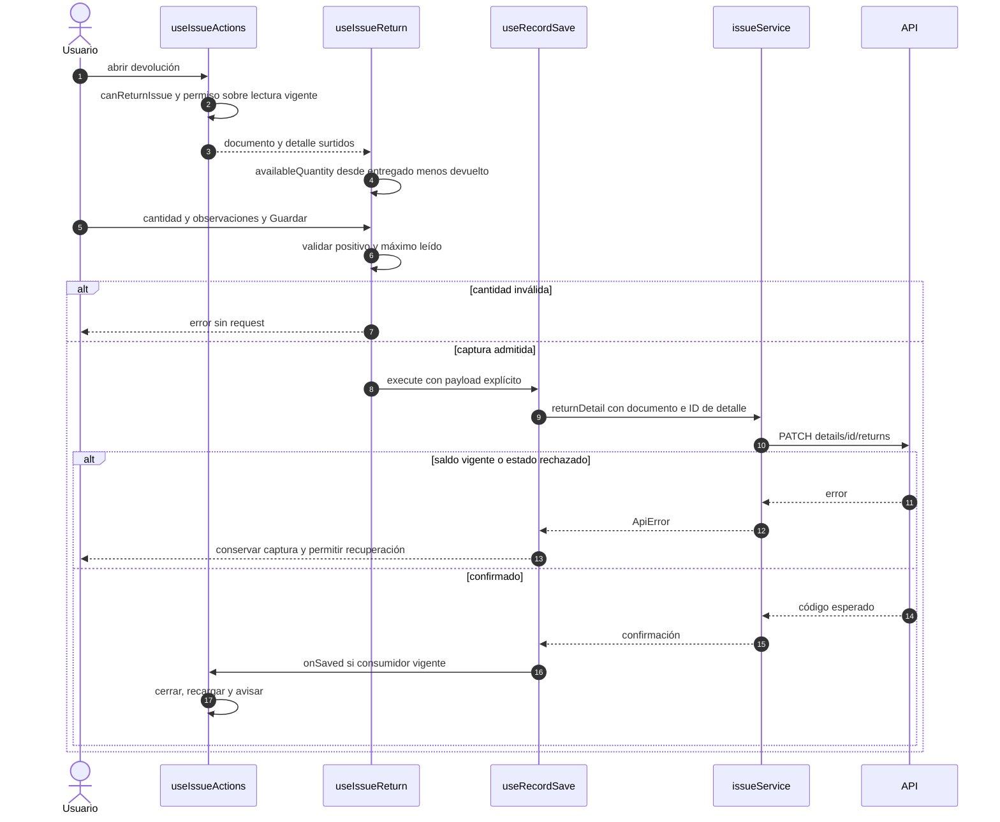

# Salida: devolución por saldo leído

## Escenario y contratos

**Casos relacionados:** CU-SAL-06/13/20.

**Fuente técnica:** useIssueReturn.ts, getIssueReturnableQuantity e issueService.returnDetail. El diagrama describe el código Vue y sus fronteras. La API es un participante externo; sus transacciones internas no se atribuyen al navegador.

## Secuencia aplicada

**Identificador:** `DIA-VUE-SEQ-017`. Mensajes numerados; líneas continuas = invocación/solicitud, discontinuas = respuesta o resultado. Las ramas representan decisiones reales; no son ejecuciones simultáneas.

## Reglas y recuperación

La frontera local usa el saldo leído y no reserva inventario. La API comprueba el saldo vigente, la pertenencia del detalle y el movimiento inverso; la solicitud no reutiliza el guardado general de documento.

## Evidencia

issueTest.ts, issues.spec.ts y CP-VUE-ISS-002-02/03. La [matriz por caso](../../../testing/04-use-case-coverage.md) identifica alcance y límites, y el [registro CP](../../../testing/03-test-cases.md) concreta datos y oráculos críticos.
