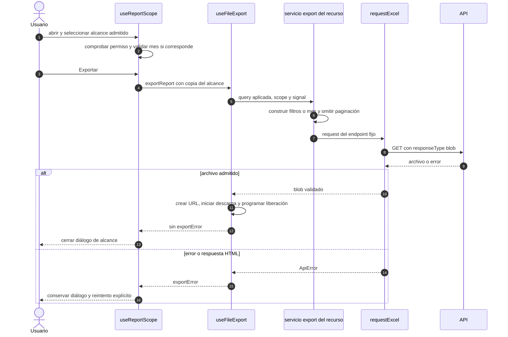

# Reportes: alcance, archivo y error recuperable

## Escenario y contratos

**Casos relacionados:** CU de reporte de cada familia; RF-VUE-013.

**Fuente técnica:** useReportScope.ts, useFileExport.ts, servicio del recurso y requestExcel.ts. El diagrama describe el código Vue y sus fronteras. La API es un participante externo; sus transacciones internas no se atribuyen al navegador.

## Secuencia aplicada

**Identificador:** `DIA-VUE-SEQ-018`. Mensajes numerados; líneas continuas = invocación/solicitud, discontinuas = respuesta o resultado. Las ramas representan decisiones reales; no son ejecuciones simultáneas.

## Reglas y recuperación

Los módulos con descarga directa usan useFileExport sin diálogo de alcance. Personas bloquea el filtro de rol no admitido por su API de exportación. El contenido real de XLSX requiere sistema, no un blob simulado.

## Evidencia

reportScopeTest.ts, inventoryReportTest.ts, records.spec.ts y application.spec.ts. La [matriz por caso](../../../testing/04-use-case-coverage.md) identifica alcance y límites, y el [registro CP](../../../testing/03-test-cases.md) concreta datos y oráculos críticos.
