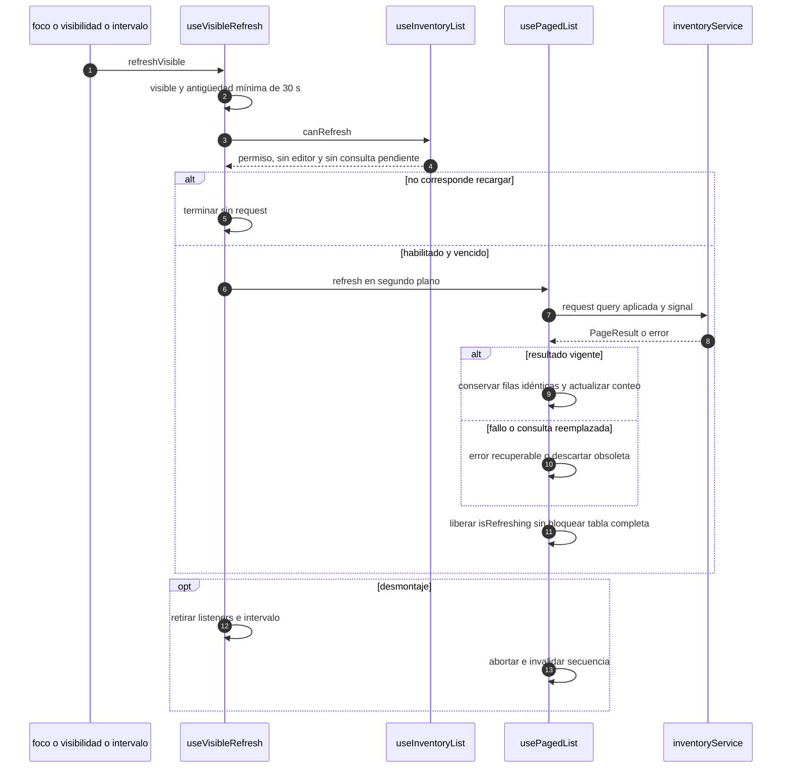

# Recarga visible sin solapamiento

## Escenario y contratos

**Casos relacionados:** RN-VUE-003/005; consultas de CU-ALM y listados.

**Fuente técnica:** useVisibleRefresh.ts, useInventoryList.ts y usePagedList.ts. El diagrama describe el código Vue y sus fronteras. La API es un participante externo; sus transacciones internas no se atribuyen al navegador.

## Secuencia aplicada

**Identificador:** `DIA-VUE-SEQ-019`. Mensajes numerados; líneas continuas = invocación/solicitud, discontinuas = respuesta o resultado. Las ramas representan decisiones reales; no son ejecuciones simultáneas.

## Reglas y recuperación

El intervalo no determina por sí solo una carga periódica incondicional. Pausas, visibilidad, antigüedad y petición vigente pertenecen al contrato del consumidor.

## Evidencia

listInteractionTest.ts, inventoryListTest.ts y pruebas de recarga del navegador. La [matriz por caso](../../../testing/04-use-case-coverage.md) identifica alcance y límites, y el [registro CP](../../../testing/03-test-cases.md) concreta datos y oráculos críticos.
