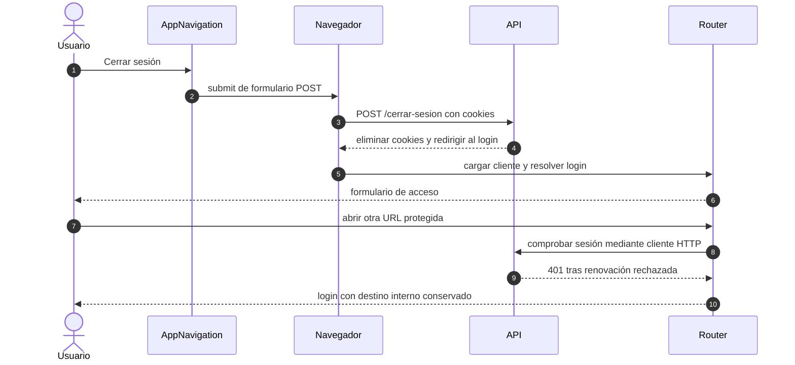

# Cierre de sesión y acceso posterior

## Escenario y contratos

**Casos relacionados:** CU-AUT-02.

**Fuente técnica:** AppNavigation.vue, Router y sessionRecovery.spec.ts. El diagrama describe el código Vue y sus fronteras. La API es un participante externo; sus transacciones internas no se atribuyen al navegador.

## Secuencia aplicada

**Identificador:** `DIA-VUE-SEQ-020`. Mensajes numerados; líneas continuas = invocación/solicitud, discontinuas = respuesta o resultado. Las ramas representan decisiones reales; no son ejecuciones simultáneas.

## Reglas y recuperación

El cierre elimina el acceso de ese navegador. No se afirma revocación central de cualquier copia previa del token. Una navegación completa recrea la instancia de sesión del cliente.

## Evidencia

sessionRecovery.spec.ts y application.spec.ts. La [matriz por caso](../../../testing/04-use-case-coverage.md) identifica alcance y límites, y el [registro CP](../../../testing/03-test-cases.md) concreta datos y oráculos críticos.
