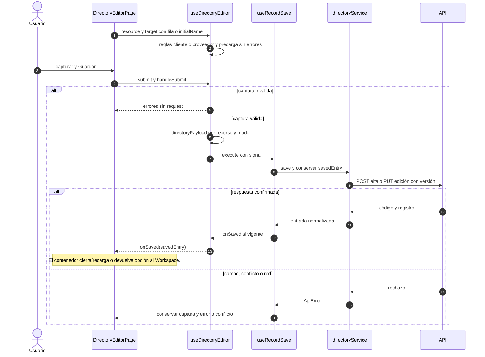

# Directorio: alta, edición y retorno de opción

## Escenario y fuente

CU-CAT-02/03/06/07. Fuentes: `useDirectoryEditor`, `directoryPayload`,
`directoryService.save` y `DirectoryCreationPage`. Clientes/Proveedores conservan
campos y permisos propios; la confirmación puede cerrar una página o devolver una opción.

## Secuencia aplicada

**Identificador:** `DIA-VUE-SEQ-022`. Mensajes numerados y ramas de modo/respuesta.

La selección del origen sólo acepta el registro confirmado y activo conforme al
consumidor. Abrir/cancelar el auxiliar no guarda el formulario principal. Las
[secuencias de alta contextual](../development/design-and-construction-patterns/09-contextual-creation.md)
identifican cada Workspace y callback. Evidencia: `directoryTest.ts`, `records.spec.ts`
y `selectCreation.spec.ts`.
