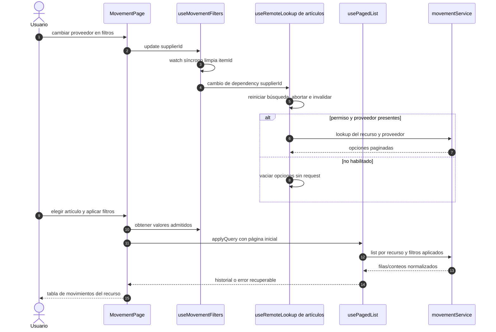

# Movimientos: filtros dependientes e historial

## Escenario y fuente

CU-ALM-07/15/23 y reportes asociados. Fuentes: `useMovementFilters`, `MovementPage`,
`movementService` y `useRemoteLookup`. Se consulta el historial del recurso fijo;
esta pantalla no escribe movimientos.

## Secuencia aplicada

**Identificador:** `DIA-VUE-SEQ-023`. Las dependencias de proveedor y artículo se
resuelven antes de aplicar la consulta. Mensajes numerados; no implica escritura.

El tipo de movimiento se limita a la lista admitida. La identidad del material y de
la merma no se intercambian. Exportar utiliza los filtros aplicados, no una captura
incompleta del panel. Las [descargas](19-reports.md) conservan su proceso separado.
Evidencia: `movementFiltersTest.ts`, `movementServiceTest.ts` y `movements.spec.ts`.
