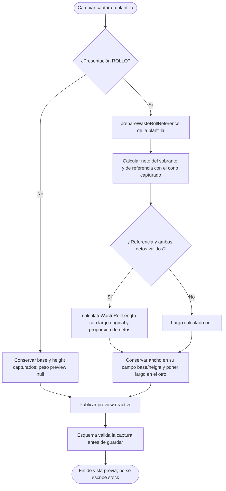

# Merma: selección de referencia y vista previa

## Escenario y fuente

CU-ALM-10; fuentes: `previewWaste` en `formModel.ts` y funciones públicas
`prepareWasteRollReference`, `calculateWasteNetWeight` y `calculateWasteRollLength`.
Esta vista describe una actividad de cálculo del cliente. El servidor vuelve a
validar/recalcular los valores que persiste.

## Actividad

**Identificador:** `DIA-VUE-ACT-001`. **Notación:** `flowchart` como aproximación de
actividad; flechas = flujo de cálculo, rombos = decisiones, no UML de actividad nativo.

La vista previa no crea un movimiento. El payload conserva pesos de captura y campos
admitidos; no envía netos/muestras derivados como autoridad. Una operación incierta
recupera su cuerpo guardado y no recalcula otro cuerpo con la misma clave.
`inventoryFormTest.ts` y `warehouse.spec.ts` comprueban representantes; el estado
persistido requiere API/base reales.
