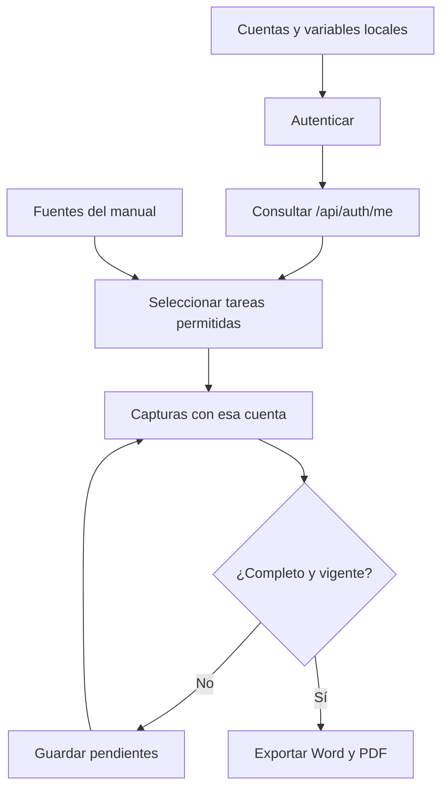

# 6. Accesos y funcionamiento del generador de manuales

## Producto documental

El generador inicia sesión, consulta `/api/auth/me` y selecciona tareas y capturas
con los mismos permisos que consume Vue. Una cuenta con varias asignaciones
activas recibe la unión de sus funciones. El generador no concede permisos.

Cada edición contiene recorrido inicial, tareas permitidas, advertencias,
recuperación e índice propio. Las fuentes comunes están en `docs/user-manual`.
La configuración, ejecución y recuperación se explican en el
[procedimiento por cuenta](07-manual-accounts-and-files.md).

## Perfiles y áreas

| Perfiles de referencia | Acceso o área |
| --- | --- |
| `sistemas-admin` | Acceso completo: incluye ajustes, catálogos, usuarios, surtido y devolución. |
| `almacen-auxiliar`, `almacen-coordinador` | Inventario, compras y salidas de todas las áreas, con surtido y devolución. Altas de clientes/proveedores desde selectores; sin páginas de Directorio, ajustes administrativos, Usuarios o Catálogos. |
| `impresion-coordinador`, `impresion-operador` | Impresión. |
| `taller-herreria-coordinador`, `taller-herreria-operador` | Taller/Herrería: clave `workshop_3d`, nombre TALLER 3D. |
| `acabados-coordinador`, `acabados-operador` | Acabados. |
| `router-coordinador`, `router-operador` | Router. |
| `pt-coordinador`, `pt-operador` | PT/TRÁFICO. |
| `instalaciones-coordinador`, `instalaciones-instalador` | Instalaciones; el segundo rol es Instalador. |

Los perfiles operativos consultan Almacén y consultan o registran solicitudes
para sus áreas autorizadas. No reciben instrucciones de surtido, devolución,
modificación de inventario, costos, compras ni administración. El recorrido
comprueba también una salida surtida para verificar la ausencia de devolución.

Auxiliar y Coordinador de Almacén tienen los mismos permisos funcionales para
Materiales, Consumibles y Mermas. Las restricciones por estado de cada documento
siguen aplicándose. El índice de cada edición indica su alcance detectado.

## Responsabilidades de la herramienta

| Fuente | Responsabilidad |
| --- | --- |
| [profiles.mjs](../../scripts/manual/profiles.mjs) | Perfiles de referencia, configuración y lectura local de credenciales. La demostración calcula permisos con las políticas existentes. |
| [model.mjs](../../scripts/manual/model.mjs) | Capítulos, permisos y evaluación de bloques de tareas. |
| [publication.mjs](../../scripts/manual/publication.mjs) | Índice personalizado, fuentes filtradas, huellas de acceso y validación. |
| [manuals.mjs](../../scripts/manuals.mjs) | Selección de perfiles, capturas y exportación con el motor común. |
| [profileManuals.spec.ts](../../tests/manual-profiles/profileManuals.spec.ts) | Sesión aislada, control de escrituras y recuperación de capturas. |
| [captureRecipes.ts](../../tests/manual-profiles/captureRecipes.ts) | Recorridos visibles sin confirmar operaciones. |

**Identificador:** `DIA-VUE-MAN-001`. **Pregunta:** ¿cómo se obtiene una publicación
coherente con el acceso de una cuenta? **Fuentes:** archivos de la tabla anterior y
el exportador común. Las flechas expresan dependencia y orden del flujo documental;
el diagrama no representa operaciones de inventario.

## Garantías durante la captura

La autenticación crea una sesión nueva por cuenta. La contraseña no se escribe
en pantalla; cookies y tokens permanecen en memoria. No se guardan archivos de
sesión, trazas, video ni capturas automáticas de error de Playwright.

El navegador bloquea escrituras de negocio; permite la renovación de sesión.
Abrir formularios o agregar detalles a un borrador no los guarda. Al terminar se
comprueba de nuevo el acceso: si cambió, se interrumpe la publicación. Una imagen
requerida ausente deja el manual pendiente; no se sustituye por otra de administración.
