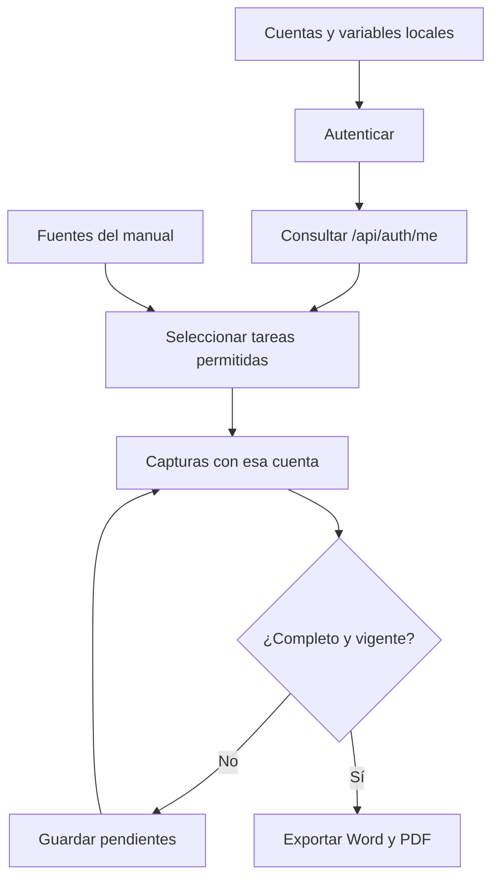

# 6. Manuales de inducción por acceso

## Producto documental

Cada cuenta de capacitación recibe un manual con recorrido inicial, tareas
permitidas, capturas propias, advertencias antes de confirmar cambios y recuperación
de errores. La fuente común se mantiene en `docs/user-manual`; el generador selecciona
capítulos y bloques de tareas a partir del acceso efectivo. Los documentos se
identifican por perfil y conservan una tabla de contenido propia.

El nombre del rol no basta para seleccionar contenido: la aplicación acumula
permisos de las asignaciones activas de rol y área. Una cuenta con varias
asignaciones recibe la unión de esas funciones. El generador utiliza `/api/auth/me`
y las mismas claves de permiso que consumen las páginas Vue. No concede permisos.

## Perfiles y áreas

| Perfiles de referencia | Alcance actual |
| --- | --- |
| `sistemas-admin` | Administración del sistema; acceso completo, incluidos ajustes, catálogos, usuarios, surtido y devolución. |
| `almacen-auxiliar`, `almacen-coordinador` | Gestión de inventario, compras, solicitudes, surtido y devolución; sin ajustes administrativos, usuarios o catálogos. |
| `impresion-coordinador`, `impresion-operador` | Almacén de consulta y solicitudes de Salidas. |
| `taller-herreria-coordinador`, `taller-herreria-operador` | Mismo alcance operativo; el área existente tiene clave `workshop_3d` y nombre TALLER 3D. |
| `acabados-coordinador`, `acabados-operador` | Mismo alcance operativo. |
| `router-coordinador`, `router-operador` | Mismo alcance operativo. |
| `pt-coordinador`, `pt-operador` | Mismo alcance operativo; el área se identifica como PT/TRÁFICO. |
| `instalaciones-coordinador`, `instalaciones-operador` | Mismo alcance operativo. |

Los perfiles operativos no reciben instrucciones ni capturas para surtir, devolver,
modificar inventario, consultar costos, gestionar compras o administrar registros.
Las restricciones se contrastan con controles reales: se comprueba también una
salida ya surtida para verificar que el operador no recibe el botón de devolución.

Auxiliar y Coordinador de Almacén tienen los mismos permisos funcionales. Existe
una diferencia de datos en Materiales y Consumibles: Coordinador de Almacén puede
consultar todas las salidas; Auxiliar queda limitado a sus áreas. El índice de cada
manual explica ese alcance. La pertenencia a un perfil no sustituye la autorización
del servidor ni las restricciones del estado de cada documento.

## Responsabilidades de la herramienta

| Fuente | Responsabilidad |
| --- | --- |
| [profiles.mjs](../../scripts/manual/profiles.mjs) | Perfiles de referencia, validación de configuración y lectura local de credenciales. La demostración calcula permisos con las políticas existentes. |
| [model.mjs](../../scripts/manual/model.mjs) | Capítulos, permisos y evaluación de bloques de tareas. |
| [publication.mjs](../../scripts/manual/publication.mjs) | Índice personalizado, fuentes filtradas, huellas de acceso y validación de la publicación. |
| [manuals.mjs](../../scripts/manuals.mjs) | Selección de perfiles, ejecución de capturas y exportación con el motor común. |
| [profileManuals.spec.ts](../../tests/manual-profiles/profileManuals.spec.ts) | Sesión aislada por cuenta, control de escrituras, preparación de datos de demostración y recuperación de capturas. |
| [captureRecipes.ts](../../tests/manual-profiles/captureRecipes.ts) | Recorridos visibles: abrir páginas y formularios, seleccionar opciones y capturar sin confirmar operaciones. |

**Identificador:** `DIA-VUE-MAN-001`. **Pregunta:** ¿cómo se obtiene una publicación
coherente con el acceso de una cuenta? **Fuentes:** archivos de la tabla anterior y
el exportador común. Las flechas expresan dependencia y orden del flujo documental;
el diagrama no representa operaciones de inventario.



## Preparar las cuentas reales

Utilice cuentas del entorno de capacitación con sus roles y áreas reales. La
automatización no crea cuentas, artículos, compras, solicitudes ni entregas para
preparar una captura. Los registros necesarios para edición, corrección o devolución
deben existir en ese entorno antes de ejecutar la herramienta.

Desde `front/`, copie las plantillas. En PowerShell:

```powershell
Copy-Item manual.accounts.example.json manual.accounts.local.json
Copy-Item .env.manual.example .env.manual.local
```

En Bash:

```bash
cp manual.accounts.example.json manual.accounts.local.json
cp .env.manual.example .env.manual.local
```

Edite `manual.accounts.local.json`: indique el origen de Vue en `baseUrl` y conserve
las cuentas que utilizará. Por defecto apunta a `http://127.0.0.1:5173`; Vue y Express
deben estar iniciados conforme a la [guía local](../development/01-getting-started.md).
Para un entorno remoto utilice HTTPS. La URL no contiene usuario, contraseña ni
parámetros.

Una entrada identifica el perfil y referencia nombres de variables:

```json
{
    "id": "impresion-operador",
    "label": "Impresión · Operador",
    "expectedAccess": { "roleKey": "operator", "departmentKey": "printing" },
    "usernameEnv": "DOCS_FRONT_IMPRESION_OPERADOR_USER",
    "passwordEnv": "DOCS_FRONT_IMPRESION_OPERADOR_PASSWORD"
}
```

Complete los valores correspondientes sólo en `.env.manual.local` o en las variables
del proceso/CI. La contraseña conserva espacios; no se recorta. Las variables del
proceso tienen prioridad. El archivo de cuentas no contiene los valores de usuario
y contraseña. `expectedAccess` permite detectar que se utilizó por error otra cuenta;
no asigna ese rol ni limita la unión de accesos realmente otorgados por el servidor.

Los dos archivos locales están ignorados por Git. Las variables son `DOCS_FRONT_*`,
no `VITE_*`: no se incorporan al navegador al compilar. No copie credenciales en
Markdown, comandos, archivos versionados, mensajes de soporte ni capturas.

## Ejecutar y exportar

Con las dependencias de desarrollo y Chromium de Playwright instalados, desde `front/`:

```bash
npm run docs:manuals -- --mode live --profile impresion-operador --format ambos
npm run docs:manuals -- --mode live --all --format ambos
```

`--all` usa las entradas del archivo configurado. Para seleccionar otros archivos:

```bash
npm run docs:manuals -- --mode live --profile almacen-auxiliar --accounts manual.accounts.local.json --env-file .env.manual.local --format pdf
```

La autenticación utiliza la API con una sesión nueva por cuenta. La contraseña no
se escribe en la pantalla. Cookies y tokens permanecen en memoria; no se generan
archivos de sesión. Trazas, video y capturas de error automáticas de Playwright están
deshabilitados para este recorrido. Las peticiones del navegador que cambien datos
de negocio se bloquean; sólo se permite renovar la autenticación cuando corresponde.
Abrir un formulario o agregar una partida a un borrador no lo guarda.

El acceso vuelve a comprobarse al terminar. Una modificación de permisos o
asignaciones interrumpe la publicación para evitar mezclar capturas de accesos
diferentes. Si falta una imagen requerida, el comando falla y conserva el estado
pendiente; no la sustituye por una imagen de administración.

## Reanudar y localizar un problema

```bash
npm run docs:manuals -- --mode live --profile almacen-auxiliar --missing --format ambos
```

`--missing` conserva capturas completas cuando coinciden cuenta, acceso, modo,
fuentes y código del recorrido, y cuando el PNG conserva su huella. Completa las
pendientes o las que ya no coinciden. Sin esa opción se recaptura el perfil completo.
`--capture-only` prepara fuentes e imágenes sin invocar Pandoc/LibreOffice.

| Situación | Comprobación y recuperación |
| --- | --- |
| No autentica | Revisar servicio, cuenta y variables locales sin imprimir sus valores. |
| Cuenta distinta del perfil | Revisar `expectedAccess`, área/rol real y referencia de credenciales. |
| Una tabla está vacía | La captura de consulta puede ser válida. Para una edición hace falta un registro existente; preparar datos de capacitación. |
| No encuentra una opción | Revisar dependencias del selector, registros activos y permisos. Para la captura de pesos se necesita un material de referencia ROLLO. |
| No aparece una devolución | Se necesita permiso de Almacén y una salida existente en estado surtido. No se surte automáticamente para preparar la foto. |
| Falla un selector o recorrido | Consultar el nombre de imagen y motivo en `manifest.json`; corregir preparación o recorrido y reanudar. |
| Intenta una escritura de negocio | El recorrido falla; revisar la automatización, no habilitar el envío para obtener la captura. |
| Cambió el acceso | Volver a autenticar y regenerar la edición de ese perfil. |
| Cambió un PNG | Se vuelve a capturar; una imagen alterada no se publica como verificada. |
| Falla DOCX/PDF | Revisar Pandoc/LibreOffice y el código de salida. No considerar actualizados los documentos de una corrida anterior. |

## Artefactos y revisión

| Ruta bajo `front/` | Contenido |
| --- | --- |
| `build/manuals/<perfil>/sources/` | Índice y capítulos seleccionados, sin directivas editoriales. |
| `build/manuals/<perfil>/images/` | Capturas obtenidas con ese acceso. |
| `build/manuals/<perfil>/manifest.json` | Estado, permisos, huellas y motivos de capturas pendientes. No contiene contraseñas ni tokens. |
| `build/docs/docx/manuales-vue/<perfil>/manual-<perfil>.docx` | Manual Word. |
| `build/docs/pdf/manuales-vue/<perfil>/manual-<perfil>.pdf` | Manual PDF. |
| `build/test-results/manual-profiles.xml` | Evidencia de ejecución del recorrido. |

Estos artefactos permanecen ignorados y fuera del despliegue. Las capturas reales
pueden mostrar datos operativos del entorno: revise su contenido y distribuya el
manual por el canal autorizado. No versione los artefactos ni los copie a `public/`.

La revisión abre DOCX/PDF y contrasta tabla de contenido, pasos, etiquetas, imágenes,
avisos y recuperación con la cuenta correspondiente. El estado editorial permanece
En revisión hasta su aceptación. El paso de una prueba no certifica legibilidad ni
reemplaza la revisión funcional del manual.

## Demostración sin credenciales

```bash
npm run docs:manuals -- --mode demo --all --format ambos
```

Este modo inicia Vite en 5177, calcula los quince perfiles desde las políticas
actuales y utiliza fixtures de navegador. Cada perfil genera sus propias imágenes;
no reutiliza las del administrador. Sirve para revisar selección y diferencias
visuales antes de conectar las cuentas de capacitación. No demuestra los datos,
asignaciones o permisos de una instalación real. La ejecución real se reproduce
con `--mode live` y sus credenciales locales.
