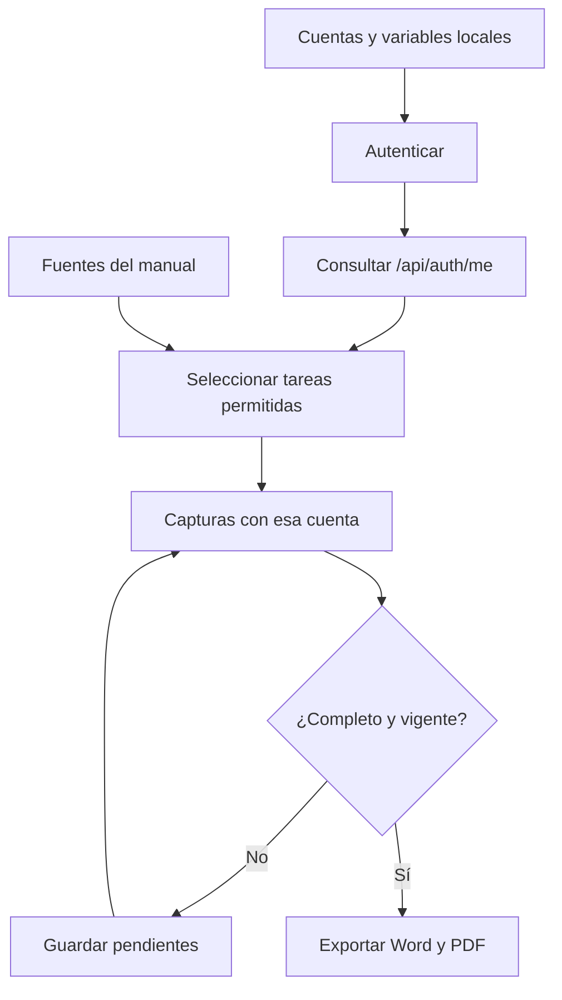

# 6. Accesos y funcionamiento del generador de manuales

## Producto documental

El generador inicia sesión, consulta `/api/auth/me` y selecciona tareas y capturas
con los mismos permisos que consume Vue. Una cuenta con varias asignaciones
activas recibe la unión de sus funciones. El generador no concede permisos.

Se ejecuta sólo en desarrollo local. Las URLs se validan también en Playwright;
los comandos de generación rechazan el entorno de producción.

Cada cuenta recibe su edición, identificada con el usuario y sus áreas y roles.
El índice agrupa inicio, tareas permitidas y ayuda. Las fuentes se comparten en
`docs/user-manual`; no se copian para mantener una versión por rol.
Las capturas se seleccionan desde esos mismos capítulos filtrados. Publicar exige
la selección completa, sin capítulos o imágenes repetidos ni referencias retiradas.
Los ejemplos históricos sin datos conservan su excepción documentada; una captura
de una acción disponible sigue siendo obligatoria. El índice describe el alcance
de consulta; las instrucciones para registrar, surtir o devolver requieren su permiso.
La configuración, ejecución y recuperación se explican en el
[procedimiento por cuenta](07-manual-accounts-and-files.md).

## Perfiles y áreas

| Perfiles de referencia | Acceso o área |
| --- | --- |
| `sistemas-admin` | Acceso completo: incluye ajustes, catálogos, usuarios, surtido y devolución. |
| `almacen-auxiliar`, `almacen-coordinador` | Inventario, compras y salidas de todas las áreas, con surtido y devolución. Altas de clientes/proveedores desde selectores; sin páginas de Directorio, ajustes administrativos, Usuarios o Catálogos. |
| `impresion-coordinador`, `impresion-operador` | Impresión. |
| `taller-herreria-coordinador`, `taller-herreria-operador` | Taller/Herrería: clave `workshop_3d`, nombre TALLER 3D. |
| `acabados-coordinador`, `acabados-operador` | Acabados. |
| `router-coordinador`, `router-operador` | Router. |
| `pt-coordinador`, `pt-operador` | PT/TRÁFICO. |
| `instalaciones-coordinador`, `instalaciones-instalador` | Instalaciones; el segundo rol es Instalador. |

Los perfiles operativos, incluidos sus coordinadores, sólo acceden a los grupos
Almacén y Salidas. En Almacén consultan la tabla con búsqueda, filtros, orden,
paginación y actualización, sin botones de gestión, importación, exportación,
costos ni Detalles de peso. En Salidas consultan y registran solicitudes para sus
áreas autorizadas; no crean clientes ni proveedores ni realizan surtidos o
devoluciones. Su manual indica solicitar los registros faltantes a Almacén.
El recorrido comprueba también una salida surtida para verificar la ausencia de devolución.

El alta auxiliar de proveedores corresponde a Nuevo material, Nuevo consumible y
Nueva compra, con permisos de registro y lectura. No se extiende a filtros,
importación, Mermas o Salidas; esos selectores usan registros existentes.

Auxiliar y Coordinador de Almacén gestionan inventario, compras y salidas. La
regularización de entregas históricas exige su permiso específico y distingue al
Coordinador. Las restricciones por estado de cada documento siguen aplicándose.
El índice de cada edición indica su alcance detectado y las cuentas con varias
asignaciones conservan la unión de sus permisos.

## Responsabilidades de la herramienta

| Fuente | Responsabilidad |
| --- | --- |
| [environment.mjs](../../scripts/manual/environment.mjs) | Entorno de desarrollo, modos admitidos y orígenes locales; reglas compartidas con Playwright. |
| [authentication.mjs](../../scripts/manual/authentication.mjs) | Login de la cuenta y diagnóstico HTTP/conexión, sin publicar credenciales, cookies ni causas privadas. |
| [options.mjs](../../scripts/manual/options.mjs) | Opciones de ejecución, modo dev predeterminado y ayuda. |
| [profiles.mjs](../../scripts/manual/profiles.mjs) | Perfiles, configuración, credenciales y selección de cuentas completas. La demostración calcula permisos con las políticas existentes. |
| [model.mjs](../../scripts/manual/model.mjs) | Capítulos, permisos y evaluación de bloques de tareas. |
| [publication.mjs](../../scripts/manual/publication.mjs) | Índice por usuario, fuentes filtradas, retirada de capítulos e imágenes sin acceso y huellas de publicación. |
| [documentCaptures.mjs](../../scripts/manual/documentCaptures.mjs) | Inventario único de ejemplos de estados y reconocimiento de ejemplos sin datos. |
| [capture.mjs](../../scripts/manual/capture.mjs) | Cancelación de la página al agotar el tiempo y espera de la operación antes de continuar. |
| [paths.mjs](../../scripts/manual/paths.mjs) | Directorio local por cuenta, traslado desde la ubicación anterior y exclusión del catálogo general. |
| [preparation.mjs](../../scripts/manual/preparation.mjs) | Búsqueda paginada de referencias ROLLO y preparación de documentos con consultas simultáneas acotadas. |
| [manuals.mjs](../../scripts/manuals.mjs) | Selección de perfiles, capturas y exportación con el motor común. |
| [profileManuals.spec.ts](../../tests/manual-profiles/profileManuals.spec.ts) | Sesión aislada, control de escrituras y recuperación de capturas. |
| [captureRecipes.ts](../../tests/manual-profiles/captureRecipes.ts) | Recorridos visibles sin confirmar operaciones. |
| [selectPreparation.ts](../../tests/manual-profiles/selectPreparation.ts) | Lecturas de preparación con la sesión del navegador y selección visible de proveedor/material; una referencia por cuenta. |

## Configuración interna del recorrido

`manuals.mjs` lee los archivos locales y pasa estas variables a Playwright durante
la ejecución. No requieren otro `.env` ni se completan manualmente:

| Variables | Función |
| --- | --- |
| `FRONT_MANUAL_MODE`, `FRONT_MANUAL_BASE_URL` | Modo y origen de Vue obtenidos de los argumentos y del JSON de cuentas. |
| `FRONT_MANUAL_IDS` | IDs de las cuentas seleccionadas que tienen credenciales completas. |
| `FRONT_MANUAL_ACCOUNTS`, `FRONT_MANUAL_ENV_FILE` | Rutas de los dos archivos de entrada; no contienen sus valores. |
| `FRONT_MANUAL_MISSING` | Reanudación automática por cuenta; `--fresh` la desactiva. |

Leer las credenciales sólo prepara los datos de entrada. Después,
`authenticateManualAccount` llama a `/api/auth/login` y `realSession` consulta
`/api/auth/me` para obtener la identidad y los permisos que determinan el manual.
La configuración de Playwright prepara Vite antes de realizar esas peticiones.

**Identificador:** `DIA-VUE-MAN-001`. **Pregunta:** ¿cómo se obtiene una publicación
coherente con el acceso de una cuenta? **Fuentes:** archivos de la tabla anterior y
el exportador común. Las flechas expresan dependencia y orden del flujo documental;
el diagrama no representa operaciones de inventario.

## Garantías durante la captura

La autenticación crea una sesión nueva por cuenta. La contraseña no se escribe
en pantalla; cookies y tokens permanecen en memoria. No se guardan archivos de
sesión, trazas, video ni capturas automáticas de error de Playwright.

El navegador bloquea escrituras de negocio; permite la renovación de sesión.
Abrir formularios o agregar detalles a un borrador no los guarda. Al terminar se
comprueba de nuevo el acceso: si cambió, se interrumpe la publicación. Una imagen
requerida ausente deja el manual pendiente; no se sustituye por otra de administración.
Antes de exportar, se contrastan capítulos e imágenes con los permisos de esa
cuenta. Cada referencia debe pertenecer a su selección y carpeta; cada PNG debe
conservar la huella verificada. Un archivo de otra cuenta no cubre una captura faltante.
Los ejemplos históricos son condicionales en `dev`: su ausencia se registra y se
conserva la explicación textual del estado. Las capturas de acciones siguen siendo
obligatorias. La preparación reutiliza las reglas de Compras y Salidas de Vue y
no agrega campos ni modifica sus validaciones.
