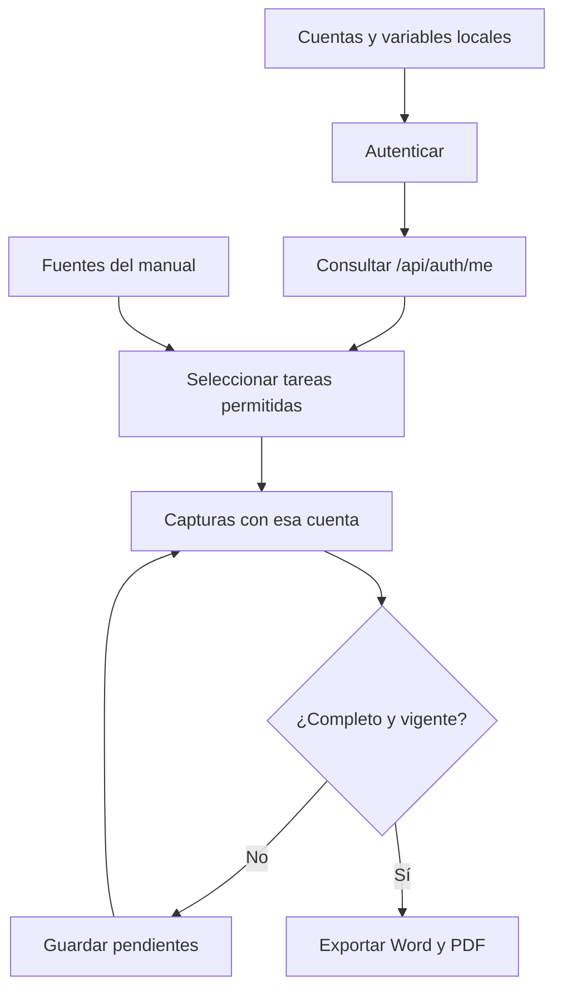

# 6. Accesos y funcionamiento del generador de manuales

## Producto documental

Cada cuenta de capacitación recibe un manual con recorrido inicial, tareas
permitidas, capturas propias, advertencias antes de confirmar cambios y recuperación
de errores. La fuente común se mantiene en `docs/user-manual`; el generador selecciona
capítulos y bloques de tareas a partir del acceso efectivo. Los documentos se
identifican por perfil y conservan una tabla de contenido propia.

El nombre del rol no basta para seleccionar contenido: la aplicación acumula
permisos de las asignaciones activas de rol y área. Una cuenta con varias
asignaciones recibe la unión de esas funciones. El generador utiliza `/api/auth/me`
y las mismas claves de permiso que consumen las páginas Vue. No concede permisos.

## Procedimiento de generación

La [guía para generar manuales por cuenta](07-manual-accounts-and-files.md)
reúne preparación, credenciales, ejecución, resultados y recuperación de errores.
Este capítulo explica los accesos y las responsabilidades internas de la herramienta.

## Perfiles y áreas

| Perfiles de referencia | Alcance actual |
| --- | --- |
| `sistemas-admin` | Administración del sistema; acceso completo, incluidos ajustes, catálogos, usuarios, surtido y devolución. |
| `almacen-auxiliar`, `almacen-coordinador` | Gestión de inventario, compras, solicitudes, surtido y devolución; altas de clientes/proveedores desde selectores, sin páginas independientes de Directorio, ajustes administrativos, Usuarios o Catálogos. |
| `impresion-coordinador`, `impresion-operador` | Almacén de consulta y solicitudes de Salidas. |
| `taller-herreria-coordinador`, `taller-herreria-operador` | Mismo alcance operativo; el área existente tiene clave `workshop_3d` y nombre TALLER 3D. |
| `acabados-coordinador`, `acabados-operador` | Mismo alcance operativo. |
| `router-coordinador`, `router-operador` | Mismo alcance operativo. |
| `pt-coordinador`, `pt-operador` | Mismo alcance operativo; el área se identifica como PT/TRÁFICO. |
| `instalaciones-coordinador`, `instalaciones-instalador` | Coordinador e Instalador; mismo alcance operativo. |

Los perfiles operativos no reciben instrucciones ni capturas para surtir, devolver,
modificar inventario, consultar costos, gestionar compras o administrar registros.
Las restricciones se contrastan con controles reales: se comprueba también una
salida ya surtida para verificar que el operador no recibe el botón de devolución.

Auxiliar y Coordinador de Almacén tienen los mismos permisos funcionales y pueden
consultar y registrar salidas de Materiales, Consumibles y Mermas para todas las
áreas. Las cuentas operativas sólo consultan y registran solicitudes para sus áreas
asignadas y autorizadas. El índice de cada manual explica ese alcance. La pertenencia a un perfil no sustituye la autorización
del servidor ni las restricciones del estado de cada documento.

## Responsabilidades de la herramienta

| Fuente | Responsabilidad |
| --- | --- |
| [profiles.mjs](../../scripts/manual/profiles.mjs) | Perfiles de referencia, validación de configuración y lectura local de credenciales. La demostración calcula permisos con las políticas existentes. |
| [model.mjs](../../scripts/manual/model.mjs) | Capítulos, permisos y evaluación de bloques de tareas. |
| [publication.mjs](../../scripts/manual/publication.mjs) | Índice personalizado, fuentes filtradas, huellas de acceso y validación de la publicación. |
| [manuals.mjs](../../scripts/manuals.mjs) | Selección de perfiles, ejecución de capturas y exportación con el motor común. |
| [profileManuals.spec.ts](../../tests/manual-profiles/profileManuals.spec.ts) | Sesión aislada por cuenta, control de escrituras, preparación de datos de demostración y recuperación de capturas. |
| [captureRecipes.ts](../../tests/manual-profiles/captureRecipes.ts) | Recorridos visibles: abrir páginas y formularios, seleccionar opciones y capturar sin confirmar operaciones. |

**Identificador:** `DIA-VUE-MAN-001`. **Pregunta:** ¿cómo se obtiene una publicación
coherente con el acceso de una cuenta? **Fuentes:** archivos de la tabla anterior y
el exportador común. Las flechas expresan dependencia y orden del flujo documental;
el diagrama no representa operaciones de inventario.

## Garantías durante la captura

La autenticación utiliza la API con una sesión nueva por cuenta. La contraseña no
se escribe en la pantalla. Cookies y tokens permanecen en memoria; no se generan
archivos de sesión. Trazas, video y capturas de error automáticas de Playwright están
deshabilitados para este recorrido. Las peticiones del navegador que cambien datos
de negocio se bloquean; sólo se permite renovar la autenticación cuando corresponde.
Abrir un formulario o agregar una partida a un borrador no lo guarda.

El acceso vuelve a comprobarse al terminar. Una modificación de permisos o
asignaciones interrumpe la publicación para evitar mezclar capturas de accesos
diferentes. Si falta una imagen requerida, el comando falla y conserva el estado
pendiente; no la sustituye por una imagen de administración.
