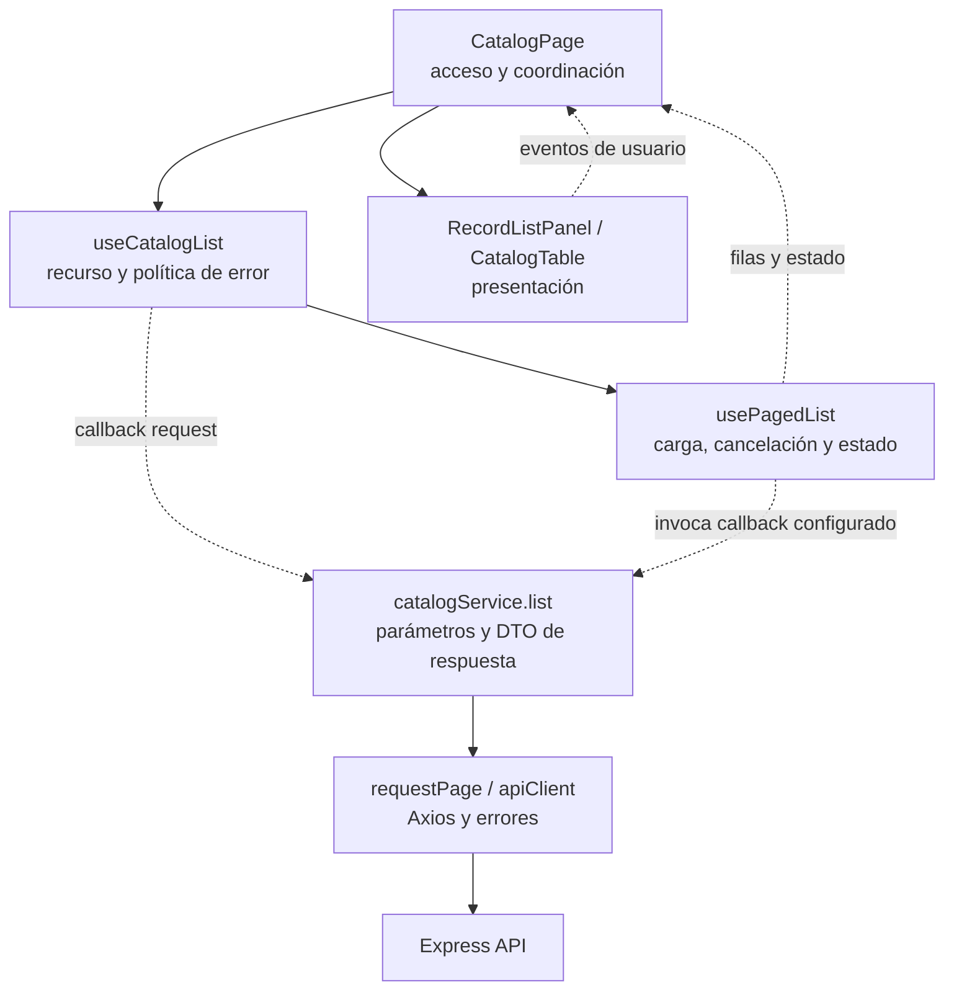

# Patrones y principios de diseño en Vue

La [arquitectura](architecture.md) conserva módulos, fronteras y convenciones. Este
documento conecta los patrones existentes con sus responsabilidades y límites; la
[guía de entradas y salidas](input-security.md) explica el tratamiento de datos.

## Patrones aplicados

| Patrón / mecanismo | Implementación | Responsabilidad |
| --- | --- | --- |
| Contenedor/presentación | `pages/` y composables coordinan; `CatalogTable`, `InventoryEditor`, `RecordListPanel` y `AppNavigation` reciben props y emiten eventos. | El componente visual no decide endpoints, permisos ni persistencia. |
| Composición funcional | `useCatalogList` y `useInventoryList` componen `usePagedList`; las páginas componen listado, búsqueda y editor. | Reutilizar comportamiento con estado por instancia y limpieza al desmontar. |
| Estrategia por callback | `usePagedList.request`, `useRemoteLookup` y `useRecordSave` reciben operaciones del módulo. | Variar consultas y guardado sin mezclar recursos en el núcleo compartido. No requiere clases Strategy. |
| Adaptador HTTP y de datos | Servicios de módulos, `apiClient`, `requestPage` y mappers. | Traducir parámetros y validar la respuesta; conservar id, versión y códigos, sin renderizar. |
| Slots y composición visual | `ServerTable`, `RecordListPanel`, `EditorDialog` y `RecordEditorDialog`. | Compartir estructura sin convertir todos los formularios en un CRUD universal. |
| Provisión de sesión | `createAuthSession`, `provide/inject` y guarda de Router. | Una instancia por aplicación; la autorización definitiva sigue en Express. |
| Fábrica de esquemas | `createIssueValidationSchema` y `createPurchaseValidationSchema`. | Adaptar reglas públicas al modo de captura y a VeeValidate; no decidir stock ni persistencia. |

Los callbacks son una estrategia funcional; las uniones discriminadas de TypeScript
son un mecanismo para expresar operaciones válidas. SOLID aporta principios de
evaluación. No se presentan como patrones GoF adicionales ni como una certificación.

## Mapa de diagramas y código

| Pregunta | Figura propietaria | Código representativo |
| --- | --- | --- |
| ¿Quién configura el listado compartido? | [DIA-VUE-PAT-001](#dependencias-y-composición-de-un-listado) | [CatalogPage](../src/modules/catalogs/pages/CatalogPage.vue), [useCatalogList](../src/modules/catalogs/composables/useCatalogList.ts), [usePagedList](../src/shared/composables/usePagedList.ts). |
| ¿Quién presenta, valida y guarda un documento? | [DIA-VUE-DOC-001](document-responsibilities.md#composición-del-editor-y-adaptadores) | [useIssueEditor](../src/modules/issues/composables/useIssueEditor.ts) y [usePurchaseEditor](../src/modules/purchases/composables/usePurchaseEditor.ts). |
| ¿Cuándo se confirma una escritura y se recarga? | [DIA-VUE-DOC-002](document-responsibilities.md#secuencia-de-guardado-confirmado) | [useRecordSave](../src/shared/composables/useRecordSave.ts), [issueService](../src/modules/issues/services/issueService.ts), [confirmMutation](../src/shared/http/recordContract.ts). |
| ¿Cómo se integra un alta de otro dominio? | [DIA-VUE-DOC-003](document-responsibilities.md#composición-entre-dominios-para-altas-rápidas) | [IssueWorkspace](../src/app/pages/IssueWorkspace.vue) y [PurchaseWorkspace](../src/app/pages/PurchaseWorkspace.vue). |

Los diagramas detallados y su tabla de responsabilidades viven junto a la revisión
de Salidas/Compras; no se duplica su contenido en la guía general. La sesión y la
seguridad conservan sus figuras en [renovación coordinada](../../back/docs/architecture/views/processes/shared-runtime-behavior/02-browser-session-and-form-state.md#renovación-coordinada-del-transporte-http)
y [fronteras de escritura](../../back/docs/architecture/coding-standards/09-errors-security-audit-and-logging.md#fronteras-de-una-escritura-de-formulario).

## Dependencias y composición de un listado

**Identificador:** `DIA-VUE-PAT-001`. **Pregunta:** ¿cómo reutilizar el listado sin
acoplar presentación y HTTP? **Fuente:** `CatalogPage`, `useCatalogList`,
`usePagedList`, `catalogService`, `RecordListPanel` y `CatalogTable`. Flechas
continuas = composición/llamada; discontinuas = datos, eventos o callbacks. Los
tipos estructurales se nombran por su contrato existente, no por una clase nueva.

El núcleo no importa `catalogService`: recibe la función desde el consumidor.
La composición conoce el recurso; el componente visual no importa Axios ni sesión.
Los archivos de [Catálogos](catalogs.md), [Movimientos](movements.md) e
[Identidad y Directorio](identity-and-directory.md) conservan sus contratos propios.

## Evaluación de SOLID

| Principio | Aplicación observable | Límite de la evaluación |
| --- | --- | --- |
| S — Responsabilidad única | Presentación, coordinación reactiva, reglas públicas y transporte están separados. | Una page coordina varias operaciones de un mismo caso; su tamaño no exige por sí solo más capas. |
| O — Abierto/cerrado | Slots, configuración y callbacks extienden marcos compartidos. | Otra semántica de stock o recuperación exige un flujo específico; no se añade una bandera por cada excepción a un composable universal. |
| L — Sustitución | Los callbacks conservan consulta, `AbortSignal`, resultados paginados y rechazo ante error. | TypeScript comprueba firmas; las pruebas comprueban comportamiento. Un adaptador que oculta errores o cambia el significado del total no es intercambiable. |
| I — Segregación | Props/eventos y tipos como `LookupState` exponen lo que la presentación necesita. | No se entrega la sesión, el cliente HTTP o todo el editor a un botón o tabla. |
| D — Inversión | `usePagedList` recibe `request`; `useRemoteLookup` recibe su consulta; los módulos aportan adaptadores concretos. | Es inversión por contratos funcionales en esos puntos; el frontend sigue usando Vue y Axios. No se declara independencia completa de frameworks. |

La evaluación usa [SOLID de Robert C. Martin](https://blog.cleancoder.com/uncle-bob/2020/10/18/Solid-Relevance.html)
como criterio de revisión y [composables de Vue](https://vuejs.org/guide/reusability/composables.html)
como mecanismo. No se agregan herencia, stores por formulario ni un contenedor de
inyección para representar cada letra. La evaluación del servidor está en
[principios SOLID del backend](../../back/docs/architecture/views/development/design-and-construction-patterns/16-solid-principles.md).

## Qué cambió y cómo se comprueba

El selector compartido cuenta filas recibidas, deduplica ids con `Set` y termina
ante una página vacía con total antiguo; búsqueda, reintento y desmontaje invalidan
la consulta anterior. `requestPage` rechaza conteos inválidos. Los imports de
`shared`, presentación, servicios y mappers se comprueban con ESLint, además de
prohibir `v-html` en las vistas actuales.

Las pruebas de composables observan estado, resultados y cancelación; el navegador
comprueba consumidores reales con API simulada. Esos casos se documentan en
[herramientas y pruebas](tooling.md#crecimiento-de-catálogos-y-fronteras-arquitectónicas).
No prueban persistencia del servidor ni capacidad bajo carga.
