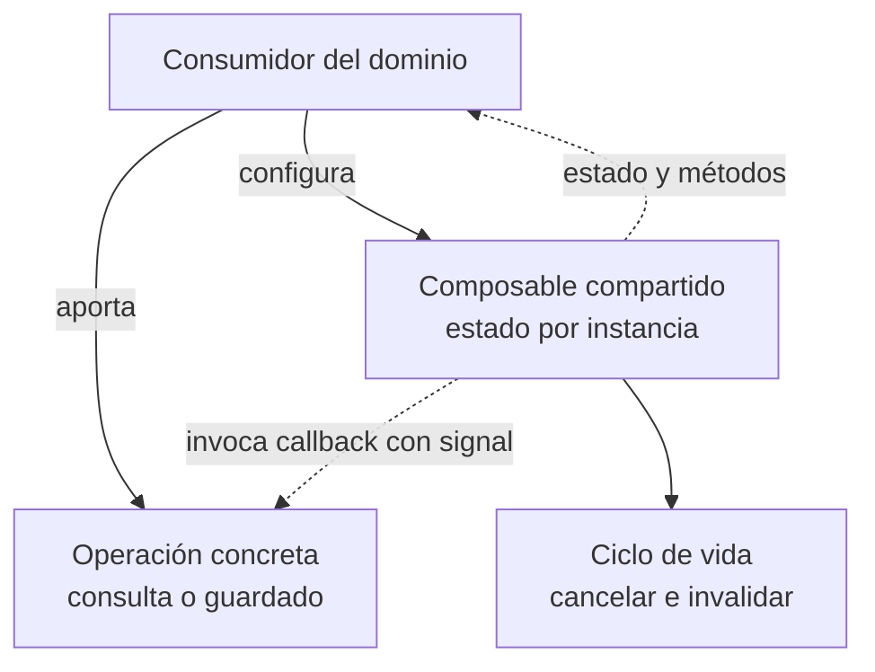
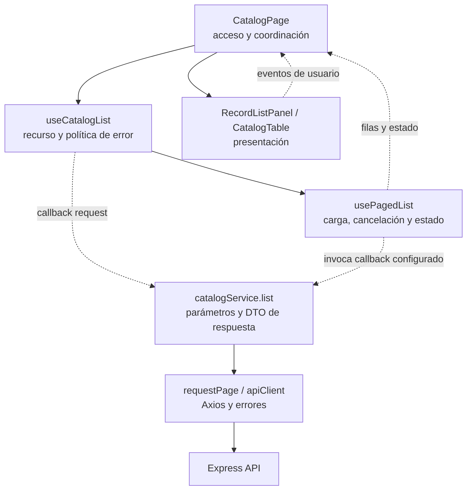

# 3. Composables y operaciones por callback

## Problema y decisión

Los listados comparten carga, error, cancelación y paginación, pero consultan
recursos distintos. Un composable concentra el comportamiento reactivo común
y recibe la operación variable como función. Es composición y estrategia
funcional; no se declaran clases Strategy ni se comparte el estado de todas las
pantallas en una única instancia.

## Modelo general de composición por callback

**Identificador:** `DIA-VUE-GEN-002`. **Pregunta:** ¿cómo varía la operación sin
acoplar el núcleo al dominio? **Fuente:** contratos de `usePagedList`,
`useRemoteLookup` y `useRecordSave`. Flechas continuas = configuración/consumo;
discontinuas = invocación configurada o resultado observable.

## Dependencias y composición de un listado

**Identificador:** `DIA-VUE-PAT-001`. **Pregunta:** ¿cómo reutilizar el listado sin
acoplar presentación y HTTP? **Fuente:** `CatalogPage`, `useCatalogList`,
`usePagedList`, `catalogService`, `RecordListPanel` y `CatalogTable`. Flechas
continuas = composición/llamada; discontinuas = datos, eventos o callbacks.

## Código, contrato y límites

[useCatalogList](../../src/modules/catalogs/composables/useCatalogList.ts)
configura `request(query, signal)` y traduce rechazos 401/403 mediante `onDenied`.
[usePagedList](../../src/shared/composables/usePagedList.ts) conserva la consulta,
las filas y el error, aborta la solicitud anterior e invalida respuestas antiguas
con una secuencia; al desmontar cancela el trabajo. No importa `catalogService`.

[useDocumentRead](../../src/shared/composables/useDocumentRead.ts) y
[useRecordSave](../../src/shared/composables/useRecordSave.ts) aplican el mismo
criterio a contratos distintos. No se fusionan sólo porque todos tengan una
promesa. Cancelar en el navegador no revierte una escritura ya confirmada.

El callback debe conservar resultados, errores y `AbortSignal`; una firma válida
de TypeScript no demuestra sustitución de comportamiento.
[catalogListTest](../../tests/unit/modules/catalogs/catalogListTest.ts) y
[remoteLookupTest](../../tests/unit/shared/composables/remoteLookupTest.ts)
comprueban estado, paginación y respuestas tardías según sus contratos.
Referencia: [composables de Vue](https://vuejs.org/guide/reusability/composables.html).
