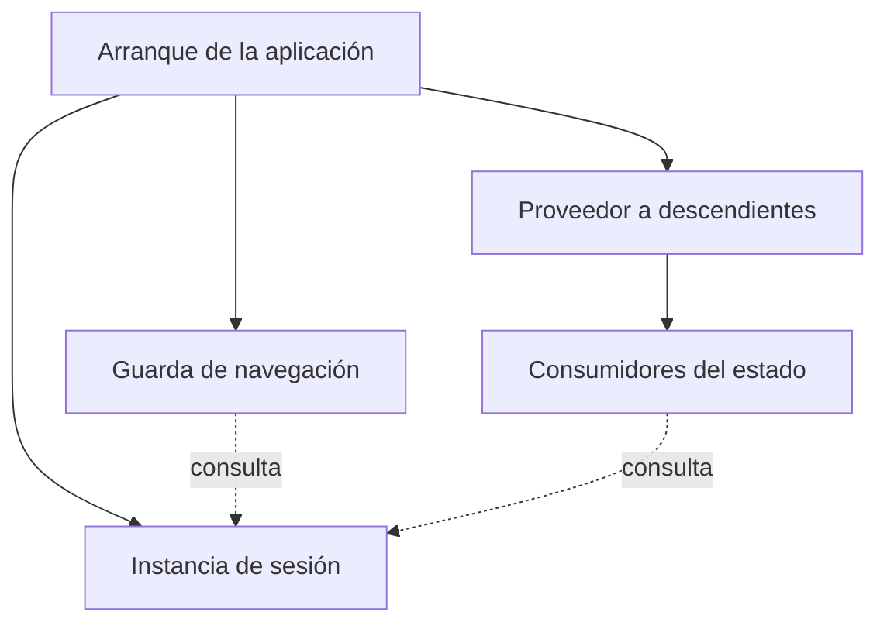
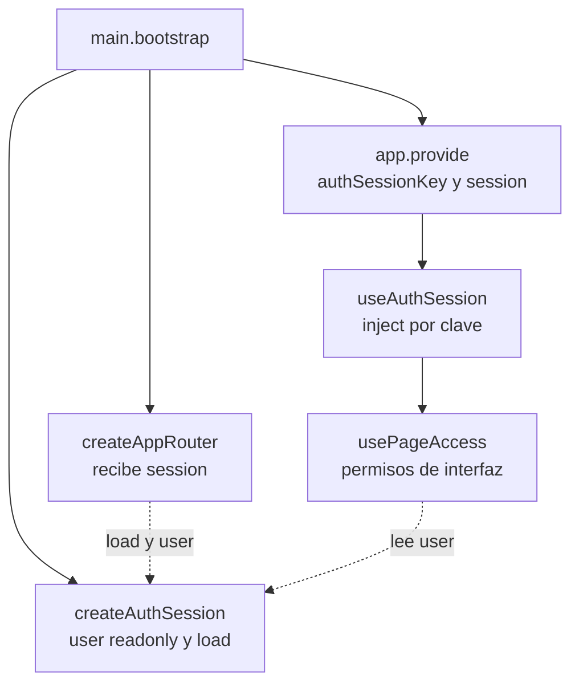

# 6. Provisión de sesión e inyección

## Problema y decisión

La navegación y las páginas deben observar la misma sesión sin pasarla por cada
componente visual. El arranque crea una instancia, configura el Router con ella
y la proporciona a los descendientes. Es inyección mediante `provide/inject`;
no hay un singleton global obligatorio ni un store por formulario.

## Modelo general de provisión de estado de aplicación

**Identificador:** `DIA-VUE-GEN-005`. **Pregunta:** ¿cómo comparten un estado la
navegación y sus consumidores? **Fuente:** composición del arranque e inyección
de Vue. Flechas continuas = configuración; discontinuas = uso de la misma instancia.

## Aplicación en el arranque de Vue

**Identificador:** `DIA-VUE-APL-005`. **Pregunta:** ¿dónde se comparte realmente
la sesión? **Fuente:** `main.bootstrap`, `createAuthSession`, `authSessionKey`,
`createAppRouter`, `useAuthSession` y `usePageAccess`.
Flechas continuas = creación/configuración; discontinuas = consumo de la instancia.

## Código, contrato y límites

[main.ts](../../src/main.ts) crea la sesión y pasa **esa misma instancia** al
[Router](../../src/app/router/index.ts). El valor predeterminado de la factory
del Router existe, pero no crea otra sesión en este arranque explícito.
[session.ts](../../src/modules/auth/session.ts) define la clave, la inyección y
la lectura de `/api/auth/me`; agrupa lecturas simultáneas con `loading`.
[usePageAccess](../../src/app/composables/usePageAccess.ts) observa permisos y
traduce 401/403 a navegación. No expone un método para que un botón conceda permisos.

La renovación de tokens pertenece a [apiClient](../../src/shared/http/apiClient.ts),
no al mecanismo de inyección. Las credenciales viajan en cookies; los permisos de
la interfaz no sustituyen la autorización en Express. La agrupación de promesas
de sesión y la renovación coordinada son mecanismos diferentes.

[routerTest](../../tests/unit/app/routerTest.ts),
[pageAccessTest](../../tests/unit/app/pageAccessTest.ts) y
[sessionRecovery.spec.ts](../../tests/e2e/sessionRecovery.spec.ts) ejercitan estos
consumidores. La API del navegador se simula; no se acredita la firma real de JWT.
Referencia: [provide/inject](https://vuejs.org/guide/components/provide-inject.html).
