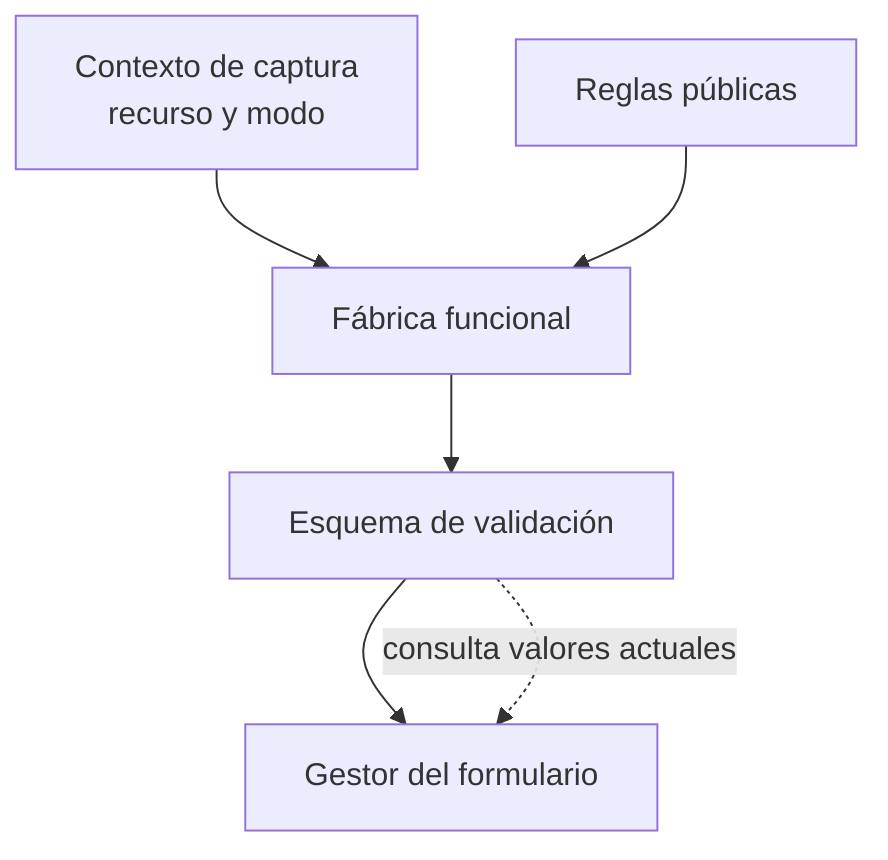
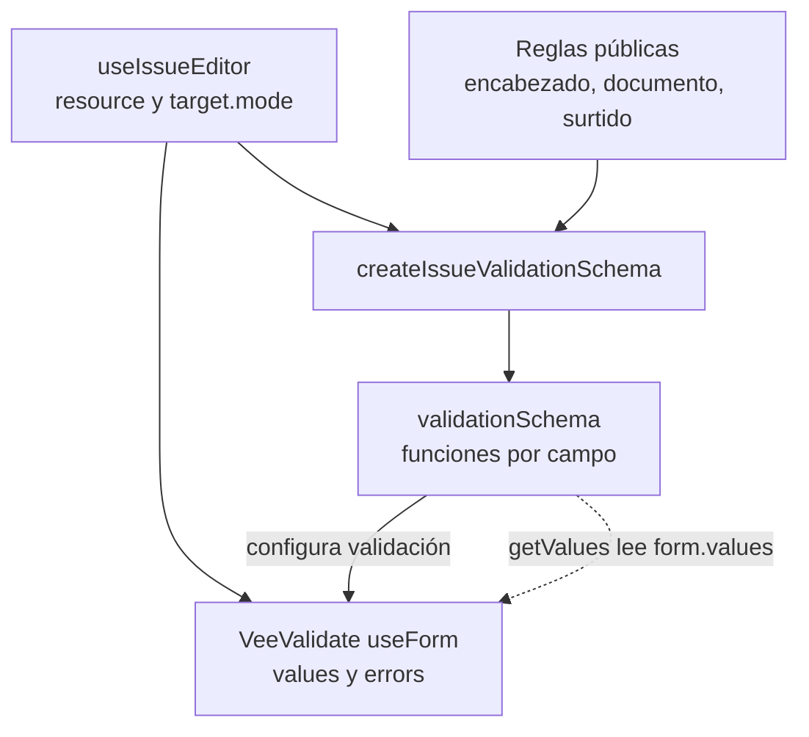

# 7. Fábricas funcionales de esquemas

## Problema y decisión

Crear, consultar y surtir no validan la misma captura. Una función construye el
esquema a partir del modo y las reglas públicas, y lee valores vigentes mediante
un callback. Es una fábrica funcional; no una implementación del patrón GoF
Abstract Factory ni una máquina State basada en clases.

## Modelo general de construcción de un esquema

**Identificador:** `DIA-VUE-GEN-006`. **Pregunta:** ¿cómo variar validación sin
copiar reglas en cada componente? **Fuente:** factories actuales de formularios.
Flechas continuas = entrada o producto; discontinuas = lectura diferida de captura.

## Aplicación al esquema del editor de Salidas

**Identificador:** `DIA-VUE-APL-006`. **Pregunta:** ¿quién elige las reglas y quién
las ejecuta sobre la captura actual? **Fuente:** `createIssueValidationSchema`,
`useIssueEditor`, `@nexus/form-validation` y VeeValidate. Flechas continuas =
configuración/consumo; discontinuas = callback `getValues`.

## Código, contrato y límites

[issueForm](../../src/modules/issues/issueForm.ts) adapta las reglas; el esquema
de `view`/`return` es vacío en el editor principal. `supply` comprueba detalles
pendientes seleccionados y cantidad de proyecto. `header` valida encabezado;
`create`/`edit` usan las reglas del recurso. Devolución tiene captura y validación
propias. [useIssueEditor](../../src/modules/issues/composables/useIssueEditor.ts)
conecta el esquema a `useForm`, sin validar al montar.

[purchaseForm](../../src/modules/purchases/purchaseForm.ts) aplica la misma decisión
para alta/edición. La adaptación `mensaje || true` pertenece a VeeValidate;
los predicados públicos devuelven mensaje o `null`. `getValues` evita validar una
instantánea anterior. Los tipos discriminados de `issue.ts`/`purchase.ts` expresan
operaciones admitidas en TypeScript; la comprobación de HTTP sigue en Express.

[issueTest](../../tests/unit/modules/issues/issueTest.ts),
[purchaseTest](../../tests/unit/modules/purchases/purchaseTest.ts) y las
[pruebas de paridad](../../../back/tests/unit/validators/formValidationParityTest.js)
protegen captura y solicitudes. No se trasladan reglas privadas ni comprobaciones
de existencias/estado al esquema del navegador.
