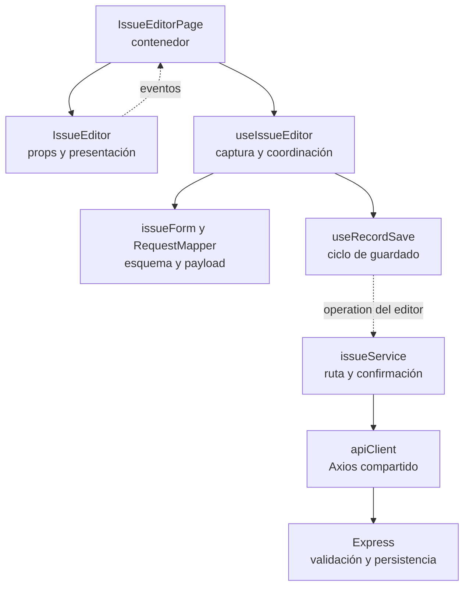
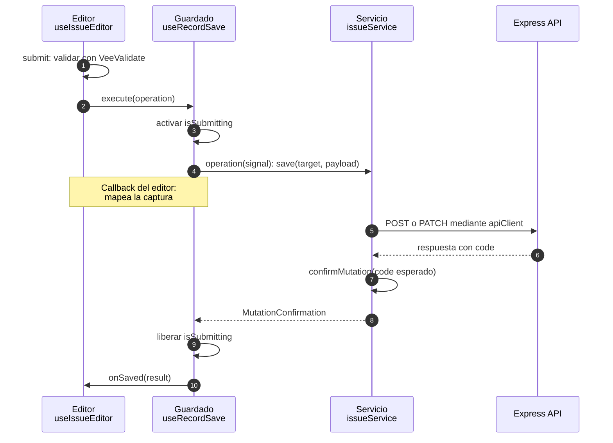
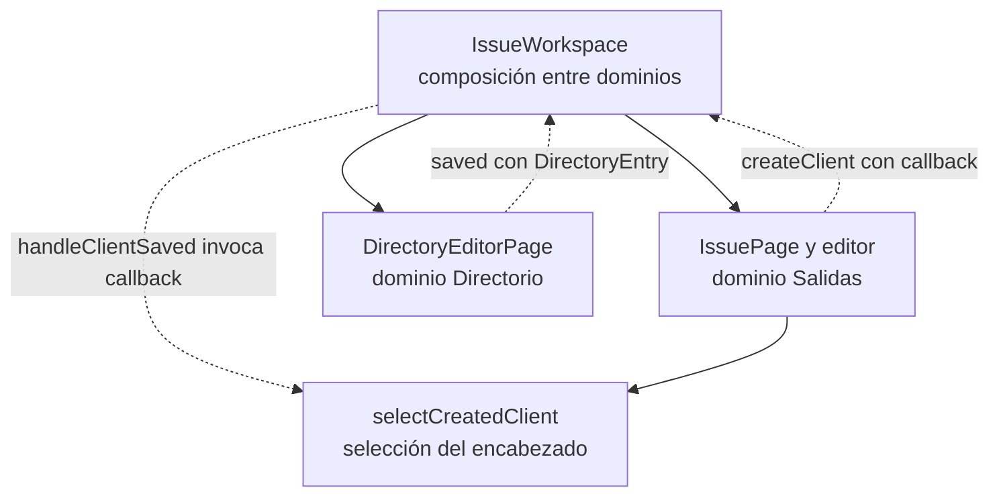

# 8. Responsabilidades y nombres de Salidas y Compras

El [índice Vue](../index.md) conserva audiencia, correspondencia funcional y criterios
de descripción de diseño aplicables a esta revisión.

La revisión se concentra en `modules/issues`, `modules/purchases`, sus pantallas
contenedoras en `app` y sus consumidores de `shared`. La estructura sigue la
arquitectura existente de Vue; una carpeta o un nombre de patrón por sí solos no
establecen una separación de responsabilidades.

El catálogo general de [patrones y principios](01-applicability-and-principles.md) conserva los mecanismos
comunes. Aquí se documentan sus colaboradores concretos, con enlaces al código;
los diagramas describen la implementación actual, no una arquitectura propuesta.

## Propietarios del código

| Archivo o capa | Responsabilidad y motivo de cambio |
| --- | --- |
| `issue.ts` / `purchase.ts` | Tipos de documento, captura, consulta y operaciones. No contienen valores de configuración ni reglas ejecutables. |
| `issueConfig.ts` / `purchaseConfig.ts` | Descriptores de recursos, etiquetas, rutas Vue y permisos de presentación. Salidas también mantiene aquí los descriptores estáticos de sus filtros. |
| `issueRules.ts` / `purchaseRules.ts` | Decidir qué modo admite el estado leído. Salidas conserva además el saldo visible de devolución y la distinción entre destinos de lectura y escritura. No autorizan ni reemplazan transacciones del backend. |
| `issueForm.ts` / `purchaseForm.ts` | Crear valores iniciales y adaptar las reglas públicas al esquema de VeeValidate. La validación consulta la captura vigente mediante `getValues`; no conserva un payload anterior. |
| `issueDetails.ts` / `purchaseDetails.ts` | Crear borradores con identificador local. Salidas también acumula por artículo/proveedor, actualiza la selección de surtido y obtiene los detalles nuevos seleccionados. El ID local no se persiste como ID del documento. |
| `purchaseCalculations.ts` | Calcular totales visibles y el escenario de corrección. El servidor conserva el cálculo que persiste. |
| `mappers/*RequestMapper.ts` | Seleccionar y normalizar campos del request por operación. No envían HTTP, no conocen componentes ni deciden rutas de endpoints. |
| `mappers/*ResponseMapper.ts` | Comprobar respuestas y adaptar registros/opciones a los modelos de lectura. Los lectores internos de decimales, relaciones y detalles permanecen privados. |
| `services` | Resolver endpoints, verbos HTTP, código de éxito esperado, archivos y adaptación de respuestas mediante Axios compartido. |
| `composables` | Coordinar el estado reactivo y el ciclo de una interacción: captura, guardado, filtros, selección dependiente o acciones del editor. Componen capacidades sin implementar todo el módulo en un único composable. |
| `pages` | Conectar sesión/permisos, composables y eventos de presentación. Incluye contenedores de diálogo; no toda página tiene que ser una ruta independiente. |
| `components` | Presentar props y emitir intenciones. Un `Editor` presenta el formulario modal conforme a la convención existente; su nombre no implica que conozca la API. |
| `app/pages/*Workspace` | Componer las altas rápidas entre dominios mediante callbacks, sin importar las páginas de Directorio o Inventario desde Salidas/Compras. |

No se extrae una función a otro archivo únicamente por su longitud. Por ejemplo,
`useIssueHeaderSelection` conserva consultas de opciones, selección inicial,
dependencias cliente/asesor y área/solicitante y sugerencia de proyecto: todas
forman la misma interacción de selección del encabezado. Guardar el documento
pertenece a otro flujo. Los constructores de borradores están en `*Details`,
porque asignar una identidad local no corresponde al mapper de respuestas HTTP.

## Patrones y principios aplicados

- **Contenedor y presentación:** las páginas conectan comportamiento; formularios,
  tablas y filtros reciben props y emiten eventos. Las reglas de ESLint protegen
  las importaciones de estas fronteras.
- **Composición:** captura, lectura cancelable, guardado, selectores, listados y
  reportes conservan sus composables. `useDocumentRead` y `useRecordSave` reciben
  operaciones/callbacks; no importan Salidas ni Compras.
- **Adaptadores:** requests, respuestas y transporte tienen propietarios distintos.
  Cambiar la representación HTTP no requiere cambiar el componente visual.
- **Fábrica de esquemas por modo:** `createIssueValidationSchema` elige la
  validación de encabezado, documento o surtido y no valida capturas en consulta
  o devolución. `createPurchaseValidationSchema` adapta alta y edición sin copiar
  las reglas públicas de EJS.
- **Uniones discriminadas de TypeScript:** crear no exige documento; editar,
  surtir y devolver sí lo exigen. `IssueWriteTarget` y `PurchaseWriteTarget`
  excluyen la consulta. Corregir una compra exige cantidad/costo; cancelar no
  acepta esos datos. El servicio convierte la intención en su ruta HTTP.

Esto concreta responsabilidad única (SRP). La inyección de operaciones/callbacks
mantiene los composables compartidos independientes de los dominios. No se declara
una aplicación completa de SOLID: no hay una jerarquía polimórfica que justifique
inventar clases para Liskov o interfaces sin consumidores. Una nueva regla que
cambie estado, stock o autorización se implementa y comprueba también en Express.

## Composición del editor y adaptadores

**Identificador:** `DIA-VUE-DOC-001`. **Pregunta:** ¿qué cambia al modificar la vista,
las reglas o el contrato HTTP? **Alcance:** dependencias del editor de Salidas;
Compras aplica el mismo corte con sus propios módulos. Flechas continuas = consumo
o composición; discontinuas = eventos o ejecución de una operación configurada.
Es un diagrama de colaboración funcional, no un diagrama UML de clases.

El callback que ejecuta `useRecordSave` está definido en `useIssueEditor`: construye
el payload con `mapIssueFormToRequest` y llama al servicio. El núcleo compartido
no importa el servicio de Salidas. La página pasa props y conecta eventos; el
componente visual no conoce Axios. La figura omite selectores y lectura para
centrarse en esa frontera, sin atribuir sus tareas al editor visual.

| Frontera / mecanismo | Fuente en Salidas | Consumidor equivalente en Compras |
| --- | --- | --- |
| Contenedor/presentación | [IssueEditorPage](../../src/modules/issues/pages/IssueEditorPage.vue) y [IssueEditor](../../src/modules/issues/components/IssueEditor.vue). | [PurchaseEditorPage](../../src/modules/purchases/pages/PurchaseEditorPage.vue) y [PurchaseEditor](../../src/modules/purchases/components/PurchaseEditor.vue). |
| Composición del formulario | [useIssueEditor](../../src/modules/issues/composables/useIssueEditor.ts). | [usePurchaseEditor](../../src/modules/purchases/composables/usePurchaseEditor.ts). |
| Fábrica de esquemas | [createIssueValidationSchema](../../src/modules/issues/issueForm.ts). | [createPurchaseValidationSchema](../../src/modules/purchases/purchaseForm.ts). |
| Adaptación de request | [mapIssueFormToRequest](../../src/modules/issues/mappers/issueRequestMapper.ts). | [mapPurchaseFormToRequest](../../src/modules/purchases/mappers/purchaseRequestMapper.ts). |
| Adaptación de respuesta | [issueResponseMapper](../../src/modules/issues/mappers/issueResponseMapper.ts), consumido por [issueService](../../src/modules/issues/services/issueService.ts). | [purchaseResponseMapper](../../src/modules/purchases/mappers/purchaseResponseMapper.ts), consumido por [purchaseService](../../src/modules/purchases/services/purchaseService.ts). |
| Lectura por callback | [useIssueActions](../../src/modules/issues/composables/useIssueActions.ts) configura [useDocumentRead](../../src/shared/composables/useDocumentRead.ts) con `issueService.get`. | [usePurchaseActions](../../src/modules/purchases/composables/usePurchaseActions.ts) configura el mismo lector con `purchaseService.get`. |
| Guardado por callback | Ambos editores configuran [useRecordSave](../../src/shared/composables/useRecordSave.ts). | El mismo contrato conserva `AbortSignal`, errores y confirmación sin conocer el dominio. |

La fábrica selecciona funciones de validación; no es una jerarquía Abstract Factory.
Las reglas públicas siguen en `back/src/public` y sólo orientan la captura. Las
uniones de [issue.ts](../../src/modules/issues/issue.ts) y
[purchase.ts](../../src/modules/purchases/purchase.ts) expresan estas diferencias:

| Captura | Esquema y operación admitida |
| --- | --- |
| Salida `create` / `edit` | Documento completo según recurso; editar requiere documento leído. |
| Salida `header` | Sólo encabezado, sin volver a enviar sus detalles. |
| Salida `supply` | Selección de pendientes y cantidad de proyecto; no edición del encabezado. |
| Salida `view` / `return` | Esquema vacío en el editor principal y sin llamada a `save`. La devolución usa [useIssueReturn](../../src/modules/issues/composables/useIssueReturn.ts) y `returnDetail`, con su captura propia. |
| Compra `create` / `edit` | Reglas públicas de alta/edición; `PurchaseWriteTarget` excluye `view`. |
| Corrección / cancelación de partida | `PurchaseDetailChange` distingue datos de corrección y cancelación; [usePurchaseCorrection](../../src/modules/purchases/composables/usePurchaseCorrection.ts) coordina el flujo. |

Estas opciones son modos de interacción y contratos de tipos; no constituyen un
patrón State ni una máquina de estados persistente. El servidor vuelve a comprobar
permisos, pertenencia y estado antes de modificar datos.

## Secuencia de guardado confirmado

**Identificador:** `DIA-VUE-DOC-002`. **Pregunta:** ¿qué evidencia permite cerrar el
editor y actualizar el listado? **Fuente:** `useIssueEditor`, `useRecordSave`,
`issueService.save`, `confirmMutation` y `useIssueActions.handleSaved`.
Secuencia UML del camino válido; los participantes son módulos funcionales.
La página entrega `onSaved` al editor; se omite la propagación de eventos Vue entre
contenedores para mantener visible el contrato del callback.

`onSaved` emite `saved` desde `IssueEditorPage`; `IssuePage` conecta ese evento con
`useIssueActions.handleSaved`, que cierra, solicita la recarga y muestra el mensaje.
Compras usa el mismo ciclo con `purchaseService`. `confirmMutation` comprueba el
código recibido: no genera un folio ni confirma una transacción por sí mismo.
El servicio de lectura usa el mapper de respuesta; el guardado devuelve una
confirmación, sin simular que retorna un documento completo.

Los caminos que no aparecen en la secuencia conservan estos efectos:

- Captura inválida: VeeValidate impide ejecutar la operación HTTP.
- Rechazo HTTP o código inesperado: no se llama a `onSaved`; `useRecordSave`
  conserva el mensaje y copia los errores de campos cuando recibe `ApiError`.
  Sólo `RECORD_VERSION_CONFLICT` marca conflicto; 401/403 llaman a `onDenied`.
- Desmontaje: se aborta el `signal` y no se notifica un guardado tardío. Esto no
  deshace una transacción que el servidor ya haya confirmado.
- Lectura sustituida o cerrada: `useDocumentRead` aborta e invalida la secuencia;
  una respuesta antigua no reemplaza el documento actual.

## Composición entre dominios para altas rápidas

**Identificador:** `DIA-VUE-DOC-003`. **Pregunta:** ¿cómo registrar un cliente desde
una salida sin acoplar Salidas a las pantallas de Directorio? **Fuente:**
`IssueWorkspace.createClient`, `handleClientSaved`, el evento `createClient` de
`IssuePage` y `useIssueHeaderSelection.selectCreatedClient`. Flechas continuas =
composición; discontinuas = evento o callback. Es un mapa de colaboración, no una
secuencia de llamadas HTTP.

El [workspace](../../src/app/pages/IssueWorkspace.vue) comprueba permisos de crear y
leer clientes antes de abrir [DirectoryEditorPage](../../src/modules/directory/pages/DirectoryEditorPage.vue).
Tras el alta convierte `DirectoryEntry` en `LookupItem` y ejecuta el callback
recibido. [useIssueHeaderSelection](../../src/modules/issues/composables/useIssueHeaderSelection.ts)
conserva la opción creada, selecciona su id y refresca opciones; no selecciona una
opción inactiva. El guardado permanece en Directorio y la autorización definitiva
en Express. Cerrar el diálogo elimina el callback pendiente.

[PurchaseWorkspace](../../src/app/pages/PurchaseWorkspace.vue) aplica la misma composición
para proveedores y artículos con sus contratos de callback. No hay un bus global
ni una importación de pantallas entre los módulos. La [sesión proporcionada](01-applicability-and-principles.md)
es compartida por la aplicación; estas capturas conservan estado por instancia.

## Convenciones de nombres comprobadas

Los métodos `get`, `list`, `save` y `changeDetail` son verbos válidos dentro de un
servicio de recurso. Las funciones independientes necesitan expresar el efecto:
`createInitialIssueValues`, `mapIssueFormToRequest`, `createIssueDetailDraft`,
`resolveIssueEditMode`, `getIssueReturnableQuantity` y `calculatePurchaseTotals`.

Los booleanos `canEditHeader`, `canEditDetails` y `isOriginallySupplied` explican
capacidad o estado. `handleSaved`, `handleDetailSaved` y `handleClientSaved` son
callbacks; el evento Vue conserva el nombre `saved`. El composable
`useIssueHeaderSelection` declara su responsabilidad completa, no sólo la carga
de opciones. Los componentes mantienen PascalCase y los composables el prefijo
`use`, conforme al estándar del repositorio.

Las operaciones HTTP con varios identificadores reciben un objeto con nombres
explícitos (`resource`, `documentId`, `detailId`, `change`, `signal`). Los nombres
de campos de la API se conservan en el borde HTTP. No se agregan barriles ni
reexports de compatibilidad: los consumidores importan al propietario real.

## Verificación

Se conservan las pruebas de contratos, payloads, filtros, totales, conflictos,
cancelación al desmontar y recorridos de navegador de ambos módulos. Los casos
adicionales comprueban que consulta/devolución no escriban el documento y que el
surtido no altere detalles ya persistidos o cancelados ni el documento leído.
Estas pruebas observan comportamiento; no fijan el número de archivos ni el
nombre de una función privada.
