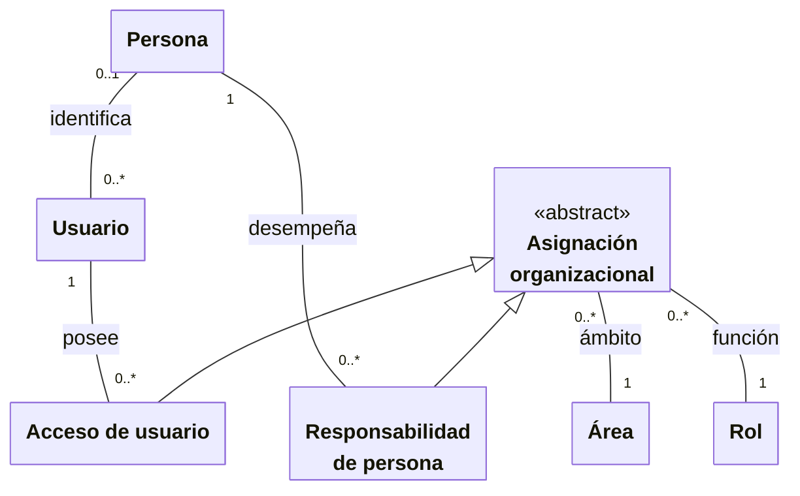

# Personas, usuarios y asignaciones organizacionales

**Identificador:** `DIA-VUE-DOM-001`. **Pregunta:** ¿Cómo se relacionan persona,
cuenta y asignaciones sin confundir responsabilidad con autorización?

**Fuentes:** [glosario](../business-glossary.md#personas-acceso-y-responsabilidades),
[requisitos de acceso](../requirements-specification/catalog/01-access-and-identity.md),
[identidades](../../architecture/views/logical/class-and-type-models/04-identity.md)
y [sesión](../../architecture/views/logical/class-and-type-models/01-session-and-login.md).
**Notación:** clases conceptuales, asociaciones con multiplicidad y generalización.

**Lectura visual:** [cajas, flechas y multiplicidades](../../architecture/views/diagram-reading.md#clases-y-dominio).

## Interpretación y restricciones

| Concepto del diagrama | Vocabulario del negocio |
| --- | --- |
| Persona | Individuo que participa en el trabajo, por ejemplo como solicitante, asesor o receptor. |
| Usuario | Cuenta de acceso a Nexus; «cuenta» se utiliza con ese mismo sentido. |
| Responsabilidad de persona | Función desempeñada por una persona en un área. |
| Acceso de usuario | Rol y área asignados a una cuenta para determinar sus permisos. |
| Asignación organizacional | Concepto común que reúne las dos asignaciones anteriores; no es otra operación de captura. |
| Área | Departamento de la organización. |
| Rol | Función organizacional, como Auxiliar, Coordinador, Operador o Instalador. |

Una persona participa como solicitante, asesor o receptora sin necesitar credenciales.
Asignarle responsabilidades no concede acceso a una cuenta. Una cuenta puede estar
vinculada a una persona y sus accesos combinan rol y área. Una persona puede tener
ninguna o varias cuentas vinculadas; cada cuenta se vincula como máximo a una persona.
Las responsabilidades y los accesos conservan finalidades distintas aunque ambos
relacionen un rol con un área.

El área de una salida es un dato operativo y también participa en su alcance de acceso.
Auxiliar y Coordinador de Almacén pueden consultar y registrar solicitudes para todas
las áreas; las cuentas de áreas operativas sólo lo hacen para sus áreas autorizadas.

## Relación con la implementación

El [modelo de clases y tipos de Identidad](../../architecture/views/logical/class-and-type-models/04-identity.md)
usa los nombres del código: `IdentityEntry`, `PersonAccess`, `PersonValues`,
`UserValues` y `OrganizationState`. La generalización conceptual de esta figura no
declara una clase TypeScript `AsignacionOrganizacional`. La
[selección de área](../../architecture/views/processes/07-issues/04-department-scope.md)
explica el comportamiento del campo en Salidas.
