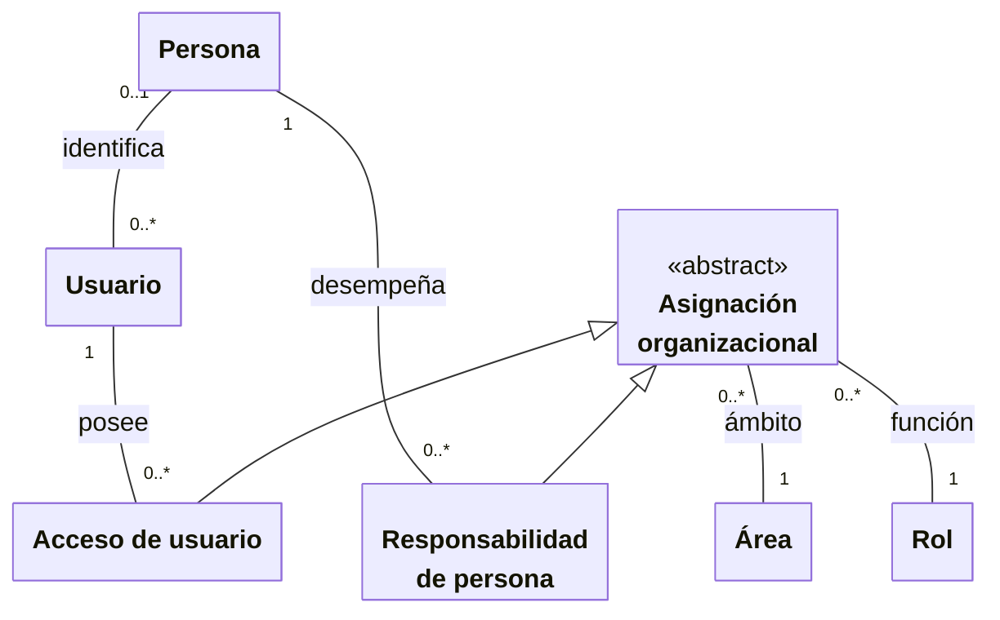

# Identidad y organización

**Identificador:** `DIA-VUE-DOM-001`. **Pregunta:** ¿Cómo se relacionan persona,
cuenta y asignaciones sin confundir responsabilidad con autorización?

**Fuentes:** [glosario](../business-glossary.md#personas-acceso-y-responsabilidades),
[requisitos de acceso](../requirements-specification/catalog/01-access-and-identity.md),
[identidades](../../architecture/views/logical/class-and-type-models/04-identity.md)
y [sesión](../../architecture/views/logical/class-and-type-models/01-session-and-login.md).
**Notación:** clases conceptuales, asociaciones con multiplicidad y generalización.

**Lectura visual:** [cajas, flechas y multiplicidades](../../architecture/views/diagram-reading.md#clases-y-dominio).

## Interpretación y restricciones

Una persona participa como solicitante, asesor o receptora sin necesitar credenciales.
Asignarle responsabilidades no concede acceso a una cuenta. Una cuenta puede estar
vinculada a una persona y sus accesos combinan rol y área; la API determina los permisos
efectivos y el alcance autorizado. La sesión Vue conserva los permisos recibidos para
presentar navegación y acciones; no reconstruye la política desde nombres de roles.

El área de una salida es un dato operativo y también participa en su alcance de acceso.
Almacén puede consultar las áreas autorizadas; una cuenta de área operativa sólo opera
en las suyas. La [selección de área](../../architecture/views/processes/07-issues/04-department-scope.md)
explica la adaptación del campo al alcance recibido. Un selector bloqueado no sustituye
la comprobación de la solicitud en el servidor.
