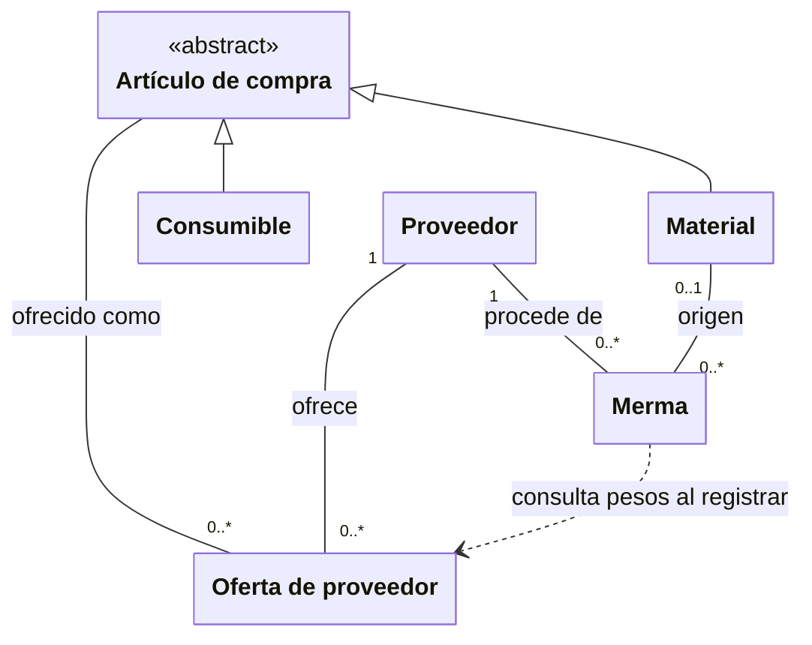
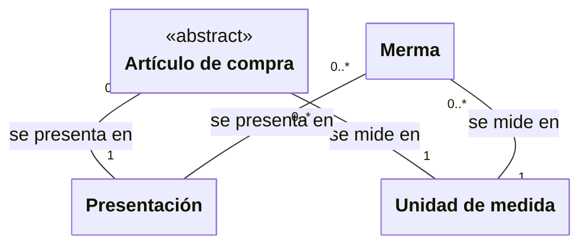

# Artículos y existencias

**Identificador:** `DIA-VUE-DOM-002`. **Pregunta:** ¿Por qué un artículo puede
aparecer varias veces en inventario sin ser un artículo distinto?

**Fuentes:** [glosario](../business-glossary.md#catálogo-existencias-y-relaciones-comerciales),
[requisitos de inventario](../requirements-specification/catalog/03-receipts-issues-and-inventory.md),
[contratos de inventario](../../architecture/views/logical/class-and-type-models/05-inventory.md).
**Notación:** clases conceptuales; asociaciones y multiplicidades, dependencia de consulta
discontinua y generalización de las dos clasificaciones comprables.

**Lectura visual:** [cajas, flechas y multiplicidades](../../architecture/views/diagram-reading.md#clases-y-dominio).

## Clasificación de artículos y mermas

**Identificador:** `DIA-VUE-DOM-006`. **Pregunta:** ¿Qué catálogo describe la
presentación y cuál describe la unidad? **Fuentes:** glosario y requisitos de catálogo
citados al inicio. **Notación:** asociaciones conceptuales con multiplicidades.

Los conceptos se repiten con el mismo significado. Separar clasificación y existencias
permite leer las cardinalidades sin cruzar los vínculos comerciales con los catálogos.

## Interpretación y restricciones

La existencia de materiales y consumibles pertenece a la oferta artículo–proveedor.
No hay un stock único por nombre de artículo. La misma combinación artículo–proveedor
no se registra dos veces; un proveedor diferente produce otra oferta del mismo artículo.
Material y consumible son clasificaciones separadas; el consumible carece de dimensiones.

La merma conserva proveedor y stock propios. Al registrarla usa un material como
plantilla y puede precargar pesos de su oferta; los datos guardados de la merma no se
sincronizan retroactivamente si cambia esa oferta. La relación opcional de origen
describe el modelo consultable; la captura actual exige elegir la plantilla válida.

La [secuencia de selección](../../architecture/views/processes/05-warehouse/01-inventory-selection-write.md)
explica las dependencias del formulario. Las presentaciones y unidades se mantienen en
[catálogos](../../architecture/views/logical/class-and-type-models/03-catalogs-and-directory.md).
La vista previa del navegador orienta la captura; la API calcula y persiste los resultados.
