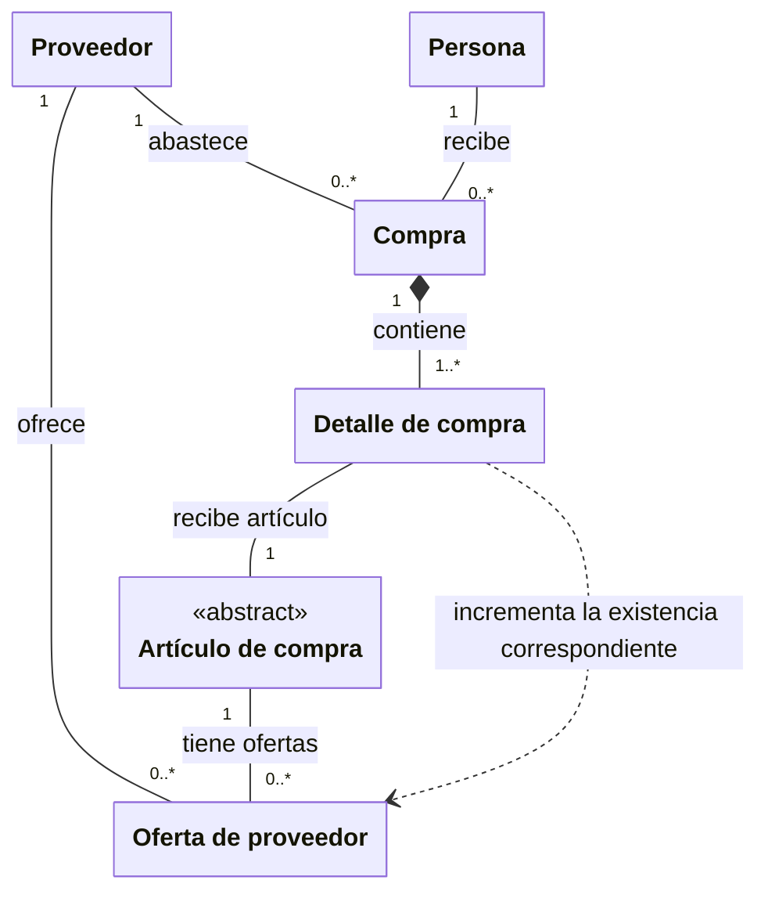

# Compras y recepción

**Identificador:** `DIA-VUE-DOM-003`. **Pregunta:** ¿Qué relaciones se conservan
al capturar, ampliar, corregir o cancelar un detalle de compra?

**Fuentes:** [requisitos operativos](../requirements-specification/catalog/03-receipts-issues-and-inventory.md),
[casos de compra](../use-cases/purchases/index.md),
[contratos de compra](../../architecture/views/logical/class-and-type-models/07-purchases.md).
**Notación:** clases conceptuales; composición de detalles y asociaciones con roles.

**Lectura visual:** [cajas, flechas y multiplicidades](../../architecture/views/diagram-reading.md#clases-y-dominio).

## Interpretación y restricciones

Todos los detalles pertenecen al contexto de la compra: materiales o consumibles.
El proveedor del encabezado y el artículo del detalle determinan la oferta afectada.
La persona que recibe es un dato del proceso; puede ser distinta del usuario que lo registra.

La edición conserva el proveedor del documento leído. Las partidas ya registradas se
consultan; las nuevas se agregan mediante el editor. Corregir cantidad/costo o cancelar
una partida son acciones específicas: no se simulan eliminando la historia del documento.
Las observaciones de encabezado son editables en el comportamiento vigente; no reemplazan
las observaciones de los ajustes y movimientos que resultan de otras operaciones.

La composición expresa pertenencia del detalle, no una orden de borrado físico.
Los [estados de interacción](../../architecture/views/logical/states/01-purchases.md)
y las [secuencias de compra](../../architecture/views/processes/06-purchases/index.md)
describen cómo el cliente presenta esas acciones y confirma sus respuestas.
