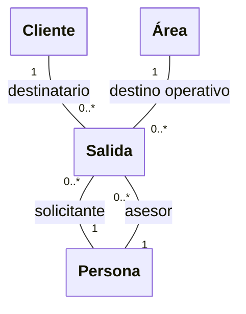
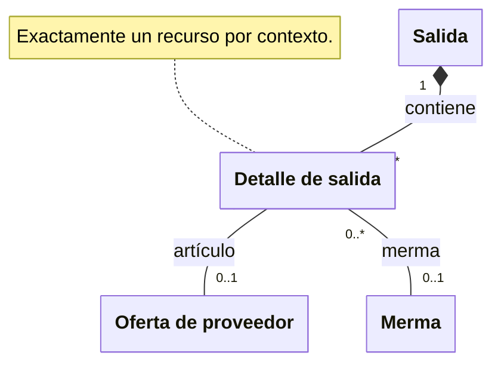

# Solicitudes de salida, surtido y devolución

**Identificador:** `DIA-VUE-DOM-004`. **Pregunta:** ¿Cómo se separan el contexto
de la solicitud y las existencias de las que se entrega material?

**Fuentes:** [casos de salida](../use-cases/issues/index.md),
[glosario](../business-glossary.md#documentos-y-trazabilidad-de-inventario),
[contratos de salida](../../architecture/views/logical/class-and-type-models/08-issues.md).
**Notación:** clases conceptuales; composición, roles y asociaciones con multiplicidades.

**Lectura visual:** [cajas, flechas y multiplicidades](../../architecture/views/diagram-reading.md#clases-y-dominio).

## Detalles y recurso solicitado

**Identificador:** `DIA-VUE-DOM-007`. **Pregunta:** ¿Qué existencia identifica cada
detalle y cómo pertenece a la solicitud? **Fuentes:** glosario y casos de salida
citados al inicio. **Notación:** composición y alternativa exclusiva de asociaciones.

La primera figura explica participantes y área; la segunda, composición y existencia.
Ambas representan la misma Salida. Los detalles conservan cantidades solicitadas,
surtidas y devueltas, descritas por sus contratos; la división no crea otro documento.

## Interpretación y restricciones

Las figuras reúnen los tres contextos bajo el concepto Salida. Cada documento es de
materiales, consumibles o mermas y sus partidas no mezclan contextos. Cada detalle
apunta exclusivamente a una oferta de artículo o a una merma; las dos relaciones
opcionales no permiten un detalle sin recurso ni con ambos recursos.

Solicitante y asesor son dos participaciones de Persona y pueden diferir del usuario
autenticado. El número de proyecto es un dato del encabezado en la captura actual;
no implica disponer de un módulo Vue de mantenimiento de proyectos.

Crear una solicitud pendiente no equivale a descontar stock. Almacén ejecuta surtidos
y devoluciones con permiso y estado válidos. Las áreas operativas consultan y capturan
salidas de su alcance, sin acceder por ello a la devolución. Los detalles ya surtidos
se protegen de la edición general; el encabezado conserva un modo específico.

Los [estados del editor](../../architecture/views/logical/states/02-issues.md)
separan consulta, edición, encabezado, surtido y devolución. Las
[secuencias](../../architecture/views/processes/07-issues/index.md) explican lecturas,
selecciones y respuestas; los saldos autorizados proceden siempre de la API.
