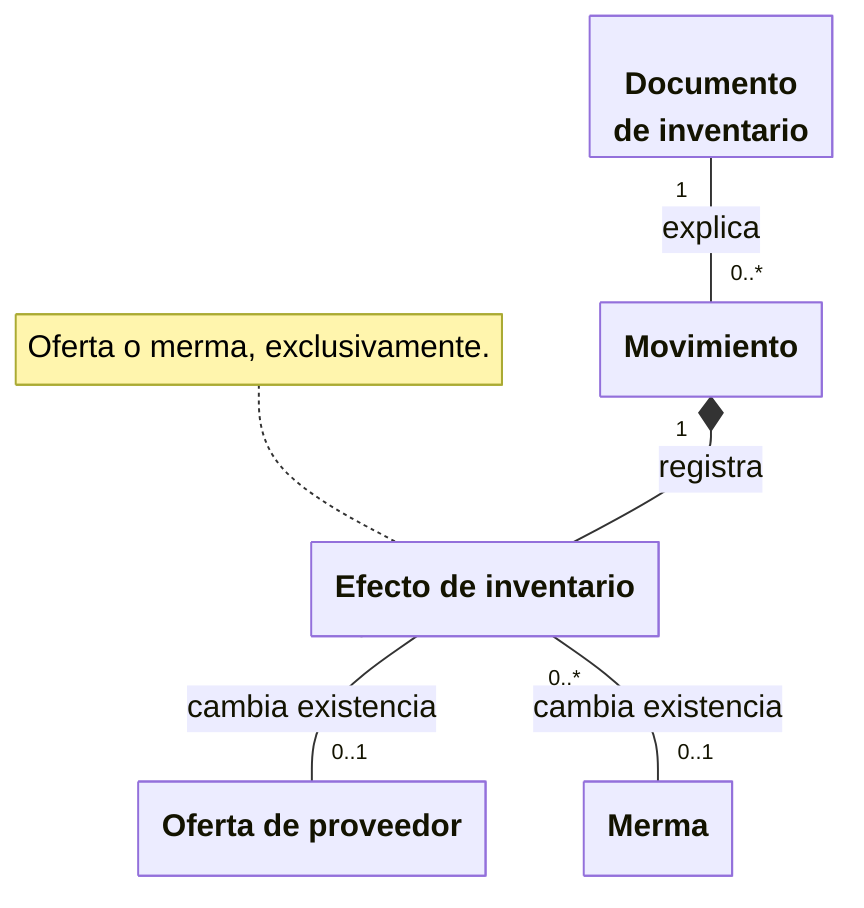

# Movimientos y trazabilidad

**Identificador:** `DIA-VUE-DOM-005`. **Pregunta:** ¿Cómo se explica un cambio de
existencia sin confundir el historial con un formulario de ajuste?

**Fuentes:** [glosario](../business-glossary.md#documentos-y-trazabilidad-de-inventario),
[casos de movimientos](../use-cases/movements/index.md),
[contratos de consulta](../../architecture/views/logical/class-and-type-models/06-movements-and-queries.md).
**Notación:** conceptos UML; composición del efecto y asociaciones con multiplicidad.

**Lectura visual:** [cajas, flechas y multiplicidades](../../architecture/views/diagram-reading.md#clases-y-dominio).

## Interpretación y restricciones

Una compra, salida surtida/devuelta, ajuste o entrada adicional de merma explica el
hecho que modifica stock. Una solicitud aún pendiente no genera por sí misma ese efecto.
Cada efecto corresponde a un solo recurso; un movimiento puede agrupar varios efectos.
Corregir o devolver conserva la referencia del documento original.

El listado Vue muestra una proyección consultable por recurso con referencia, fecha,
tipo, stock anterior, cantidad y nuevo stock. `MovementRow` no es el agregado conceptual
completo ni habilita editar el historial. El filtro y el reporte reutilizan su consulta;
la [secuencia de filtros](../../architecture/views/processes/08-movements-and-reports/01-movement-filters.md)
explica cuándo se aplican y cómo se conserva la consulta previa si son inválidos.
