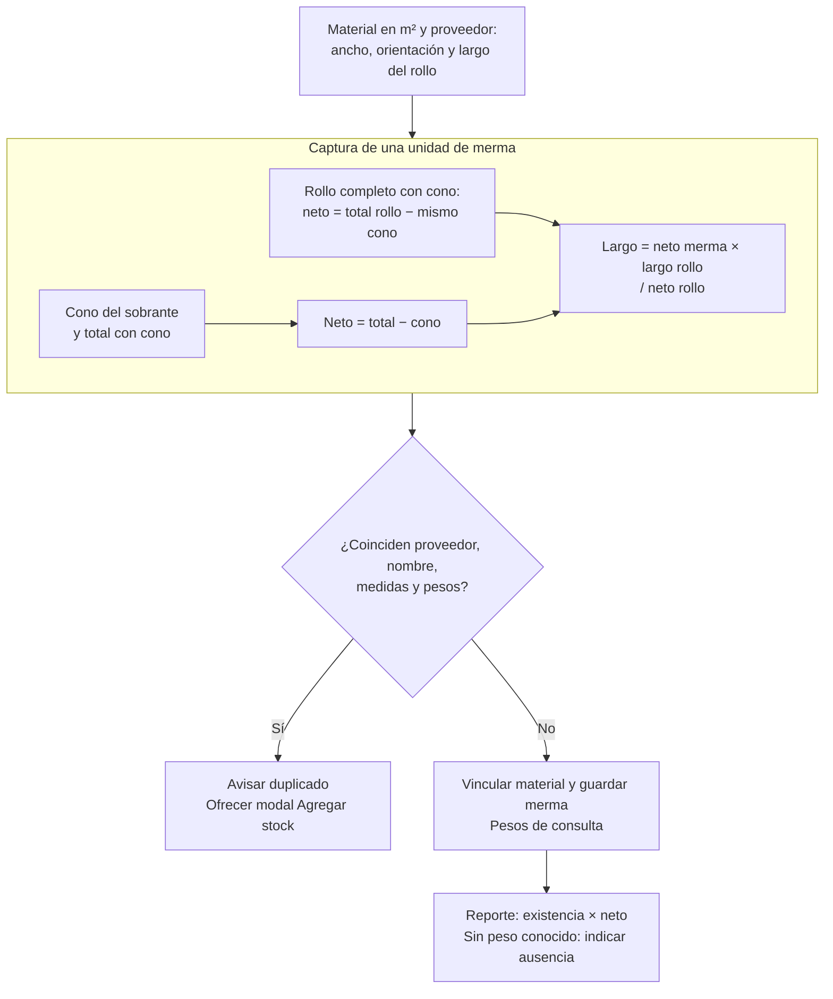

# 4.4 Consulta, reportes y funciones modeladas

| ID | Requisito | Estado |
| --- | --- | --- |
| RF-REP-001 | Nexus debe permitir al Administrador del sistema consultar movimientos de artículos o mermas con filtros, sin modificar inventario; elegir un recurso exige seleccionar primero su proveedor y cambiarlo limpia la selección anterior. | Implementado |
| RF-REP-002 | Nexus debe permitir al usuario autorizado exportar los reportes registrados para su ámbito con los filtros aplicables. | Implementado |
| RF-REP-003 | El reporte de mermas debe consolidar por nombre, proveedor y base; la altura también debe separar grupos excepto para la presentación `ROLLO`. | Implementado |
| RF-REP-004 | Los archivos Excel deben conservar resultados calculados y fórmulas para las celdas derivadas definidas por cada reporte, sin alterar datos de origen. | Implementado |
| RF-REP-005 | Nexus debe permitir al Administrador del sistema de Sistemas exportar los movimientos ofrecidos por la consulta conservando su ámbito y filtros aplicables. | Implementado |
| RF-REP-006 | El reporte de mermas debe presentar como total de cada grupo la suma del stock de sus existencias. | Implementado |
| RF-REP-007 | La exportación de mermas debe incluir todos los grupos y el total general en una sola hoja denominada `Mermas`. | Implementado |
| RF-REP-008 | Nexus debe permitir elegir el alcance Activos o con stock, Activos o Con stock antes de exportar inventario de materiales o mermas. Debe combinarlo con los filtros admitidos por cada reporte según sus criterios. | Implementado |
| RF-REP-009 | El reporte de mermas debe calcular el área total de cada grupo sumando existencia × base × altura por recurso; una dimensión ausente aporta cero. | Implementado |
| RF-REP-010 | Nexus debe permitir al usuario autorizado exportar el inventario de consumibles con la búsqueda por nombre y el alcance seleccionado, incluyendo todos los proveedores de consumibles y excluyendo ofertas de materiales. | Implementado |
| RF-REP-011 | Nexus debe permitir al Administrador del sistema de Sistemas consultar y exportar los movimientos de Materiales, Consumibles y Mermas por separado. Las consultas, conteos, archivos e informes mensuales deben conservar el contexto elegido; los filtros no deben cambiarlo. | Implementado |
| RF-REP-012 | El reporte de mermas debe mostrar el peso total disponible de los rollos, sumando existencia × peso neto unitario de cada medida antes de consolidar el grupo. Si un rollo con existencia carece de peso, debe indicar «Sin peso capturado» en su grupo y en el total, sin presentar una suma parcial como completa. Otras presentaciones no aportan peso. | Implementado |
| RF-MER-001 | Durante el alta de una merma, almacén debe elegir un proveedor antes del material usado como plantilla; cambiar el proveedor debe limpiar la plantilla anterior. | Implementado |
| RF-MER-002 | Al seleccionar una plantilla, el sistema debe proponer el mayor costo unitario máximo aplicable; el actor puede corregirlo y el valor guardado se conserva como dato histórico propio de la merma. | Implementado |
| RF-MER-003 | Nexus debe permitir al Personal de almacén o al Administrador del sistema actualizar el nombre, stock mínimo, costo unitario máximo y estado de una merma sin usar la edición general para cambiar existencias. | Implementado |
| RF-MER-004 | Nexus debe admitir como referencia de merma sólo un material de tipo MATERIAL con unidad m², reconocida por símbolo o nombre metro cuadrado. Debe excluir consumibles y otras unidades y validar la captura antes del alta. | Implementado |
| RF-MER-005 | Una edición de merma debe conservar proveedor, presentación, unidad y dimensiones como identidad física inmutable. | Implementado |
| RF-MER-006 | El sistema debe rechazar un alta que repita la identidad de merma definida por `RN-021`. Ante un duplicado definitivo, debe ofrecer continuar con Agregar stock según sus criterios. | Implementado |
| RF-MER-007 | Al crear una merma de Rollo, Nexus debe mostrar base y altura calculadas y sin edición manual, conforme a `RF-MER-013`. Para otras presentaciones, debe permitir capturar las dimensiones requeridas. | Implementado |
| RF-MER-008 | El sistema debe calcular la cantidad convertida de una merma como existencia × base × altura en altas, ajustes y salidas, sin solicitar su captura manual. | Implementado |
| RF-MER-009 | La merma debe vincularse al material de origen y conservar dimensiones, pesos de la merma, total de muestra y costo propios sin modificar la oferta ni recalcular registros anteriores. | Implementado |
| RF-MER-010 | Nexus debe permitir al Personal de almacén o al Administrador del sistema sumar una cantidad positiva a una merma mediante **Agregar stock**, conservando un documento individual con folio, actor, observaciones opcionales, cantidad y saldos, vinculado a un movimiento de entrada. | Implementado |
| RF-MER-011 | Al registrar una merma de Rollo, almacén debe capturar en kg el peso del cono y el peso de una unidad de merma con cono, distintos del peso del rollo completo. El sistema debe calcular el neto como total menos cono. Los tres pesos quedan para consulta después del alta y se conservan al mover existencias de la misma identidad. Los históricos sin peso conservan su valor desconocido. | Implementado |
| RF-MER-012 | Al registrar una merma de Rollo, Nexus debe usar un rollo completo con cono como muestra. Debe solicitar su peso total y tomar su largo del material, descontando el mismo cono de la muestra y del sobrante. Debe conservar esos valores con la merma sin modificar material ni proveedor. | Implementado |
| RF-MER-013 | Nexus debe calcular neto = total − cono y largo = neto de merma × largo del rollo / neto del rollo completo. Debe fijar la menor dimensión nominal positiva en su campo original y calcular la otra. Si faltan datos, debe limpiar el resultado y solicitar completar la captura. | Implementado |

## Condiciones de consulta y reporte

- `RF-REP-003`, `RF-REP-006`, `RF-REP-007`, `RF-REP-009` y `RF-REP-012` son condiciones del
  reporte de mermas de `RF-REP-002`, no objetivos adicionales del actor.
- **CA-RF-REP-008-1:** **Activos o con stock** aplica la unión de ambas condiciones;
  **Activos** exige estado activo y **Con stock** exige saldo positivo.
  La condición se combina con los filtros admitidos por cada reporte; el proveedor
  de la tabla sólo limita el Excel de Mermas, no el de Materiales ni Consumibles.
- **CA-RF-REP-008-2:** Materiales debe aplicar la búsqueda por nombre e incluir todos
  sus proveedores. Mermas debe combinar nombre y proveedor. El filtro de proveedor
  de una tabla de Materiales o Consumibles no debe limitar su exportación de inventario.

## Criterios de captura de merma

- **CA-RF-MER-006-1:** dos rollos con iguales medidas y pesos distintos no se
  consideran el mismo registro conforme a `RN-021`.
- **CA-RF-MER-006-2:** si el alta fue rechazada definitivamente por duplicado y el
  usuario tiene permiso de entrada, confirmar la alternativa abre **Agregar stock**
  con cantidad y observaciones precargadas. Abrirlo no registra la entrada; el
  usuario debe confirmar ese formulario por separado.
- **CA-RF-MER-011-1:** el peso del cono admite cero; el total con cono debe ser
  mayor que el cono y no superar 999.99 kg. Ambos admiten tres enteros y dos decimales.
  Capturar un peso requiere el otro. El sistema calcula el neto por unidad y rechaza
  entradas inválidas antes del alta.
- **CA-RF-MER-010-1:** agregar una cantidad incrementa el saldo; no sustituye un ajuste
  administrativo. Establecer el saldo final requiere **Ajustar stock**, motivo y permiso
  exclusivo del Administrador conforme a `RF-CAT-018` y `RF-ADJ-001`.
- **CA-RF-MER-012-1:** el peso del rollo completo con cono debe ser mayor que el
  cono, hasta 999.99 kg y con dos decimales. El largo se toma del material; no se
  capturan largo ni neto de muestra. El mismo cono se resta a ambos totales. Un alta
  de Rollo sin pesos se rechaza aunque se envíen dimensiones manuales.
- **CA-RF-MER-012-2:** la merma guarda el total de muestra, cono, total y neto de merma,
  dimensiones finales y material de origen, inmutables tras el alta. El largo y neto de
  muestra sólo se calculan; sus campos anteriores quedan reservados a históricos.
  No actualiza pesos ni existencias de material/proveedor.
- **CA-RF-MER-012-3:** las referencias históricas permanecen intactas, sin inferir un
  peso del rollo completo ni recalcular medidas anteriores.
- **CA-RF-MER-007-1:** al confirmar un Rollo, el cliente debe enviar las dos medidas
  calculadas aunque sus controles estén deshabilitados.

## Capacidades no vigentes

Estas capacidades no tienen un flujo disponible en el cliente. Sus decisiones se
registran en [Brechas y decisiones pendientes](../../vision-scope-and-requirements/04-open-decisions.md).

| ID | Requisito | Estado |
| --- | --- | --- |
| RF-REQ-001 | El registro de requisiciones queda excluido del alcance vigente. Su incorporación requiere acordar comportamiento, autorización, datos y criterios de aceptación. | Fuera del alcance actual |
| RF-PRJ-001 | Nexus deberá permitir al Administrador del sistema mantener un catálogo de proyectos. Sus datos, operaciones y criterios de aceptación están pendientes de definición. | Modelado |
| RF-PRJ-002 | Nexus deberá permitir al Personal de almacén seleccionar un proyecto registrado como contexto de una salida. La fuente de proyectos y sus condiciones de selección están pendientes de definición. | Modelado |

## Recorrido del peso de merma

**Identificador:** `DIA-VUE-REQ-MER-PESO-001`. **Pregunta:** ¿cómo se relacionan captura, identidad y reporte de peso? **Fuente:** reglas `RF-MER-011`, `RF-MER-012` y `RF-REP-012`. **Notación:** flujo funcional, no secuencia de llamadas. El ofrecimiento de entrada ante duplicado exige permiso y rechazo definitivo.
La muestra es el rollo completo con cono. Su peso total se captura en Merma y su largo
procede del material seleccionado. El cono se captura una sola vez para ambos totales.

En otras presentaciones en m² se capturan medidas manuales y no se piden pesos.
El formulario de Rollo calcula las medidas; los registros históricos conservan sus datos conocidos.
