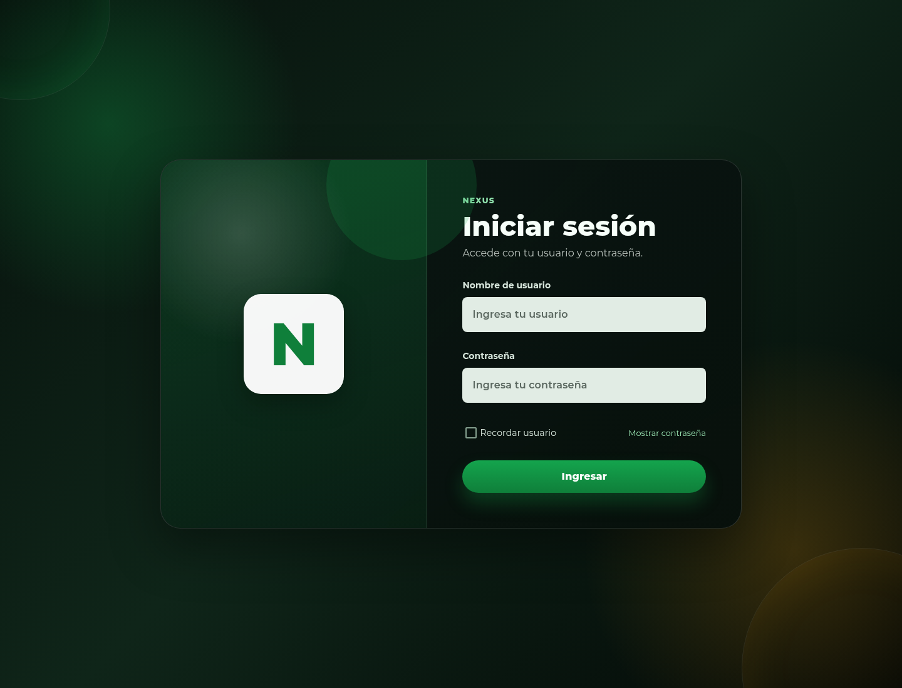

# 1. Acceso y sesión

## Ingresar

**Antes de empezar.** Tenga una cuenta y su contraseña. Si todavía no las tiene,
solicítelas al responsable de accesos.

1. Abra la dirección de Nexus en el navegador.
2. En **Iniciar sesión**, escriba el **Nombre de usuario** y la **Contraseña**.
3. Use el control de visibilidad de la contraseña si necesita revisar la captura.
   Compruebe que ninguna otra persona pueda verla.
4. Si lo desea, active **Recordar usuario** en un equipo de uso personal.
5. Pulse **Ingresar** una vez y espere el resultado.

**Compruebe el resultado.** Se abre una página permitida y aparece el menú
principal. No todas las cuentas tienen la misma página inicial.

**Recordar usuario** conserva el nombre para facilitar el siguiente ingreso; no
guarda la contraseña ni garantiza que la sesión permanezca abierta. Respete
mayúsculas, minúsculas y caracteres de su contraseña. No comparta sus credenciales.

## Corregir un ingreso rechazado

Corrija los campos señalados. Si se rechaza el acceso, revise usuario y contraseña y
reintente; si persiste, contacte al responsable de accesos. Esta pantalla no crea cuentas
ni recupera contraseñas por correo.

## Continuidad y recuperación de la sesión

Durante el uso, Nexus intenta mantener el acceso automáticamente mientras la
sesión pueda renovarse. Ante un corte breve, reintenta automáticamente y continúa
en la página solicitada. Si necesita volver a identificarse, muestra el ingreso.
La pantalla de sesión no disponible aparece si no logra recuperar el servicio.

1. Compruebe la conexión y espere a que el servicio esté disponible.
2. Pulse **Volver a comprobar el acceso** cuando esa opción aparezca.
3. Si vuelve al ingreso, identifíquese de nuevo.
4. Antes de repetir una operación que estaba guardando, consulte su resultado.

Renovar la sesión no confirma por sí mismo una compra, salida o ajuste pendiente.
Consulte [Errores y recuperación](15-errors-and-recovery.md) si quedó una captura
sin resultado claro.

## Cerrar sesión

Guarde o descarte las capturas abiertas y utilice **Cerrar sesión**. Compruebe que
se muestra el ingreso antes de dejar un equipo compartido. Cerrar sólo una pestaña
del navegador no equivale a cerrar la sesión.
