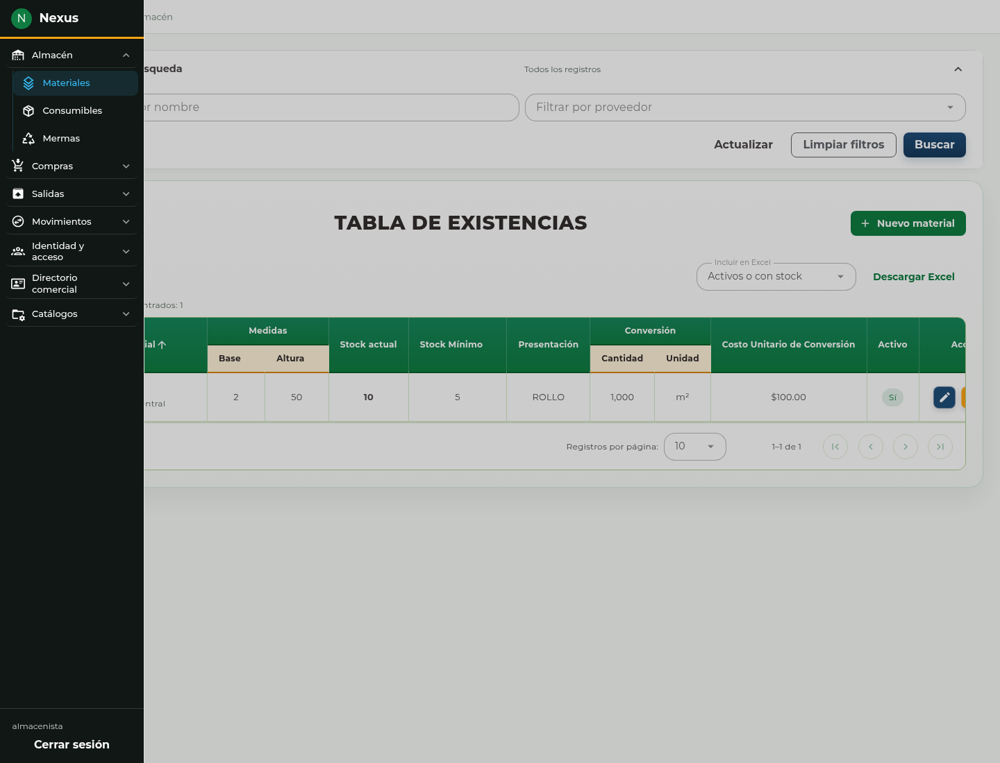

# 2. Navegación y controles comunes

## Abrir una sección

En pantallas grandes, el menú comienza como una columna de iconos. Pulse
**Expandir menú**, abra el grupo deseado y seleccione una página. El menú muestra las secciones permitidas para su cuenta. Abra el grupo indicado
en el procedimiento de su tarea.

Al navegar, hacer clic fuera del panel o pulsar **Escape**, el menú vuelve a su
estado compacto. En un teléfono, utilice **Menú** y **Cerrar menú**. La barra de
direcciones permite volver a una página o guardarla como favorito; siempre se
comprueban los permisos al entrar.

## Buscar y recorrer una tabla

1. Abra el módulo y espere a que termine la carga.
2. Capture el texto o seleccione los filtros necesarios.
3. Pulse **Buscar** para aplicar la captura a la consulta.
4. Revise los resultados y utilice los controles de página para recorrerlos.
5. Use **Limpiar filtros** para regresar a la consulta general.

Los encabezados que admiten ordenamiento permiten cambiar el orden. El tamaño de
página controla cuántas filas se muestran, no cuántos registros existen. Una tabla
sin resultados puede deberse a los filtros; límpielos antes de concluir que falta
un registro. En pantallas estrechas, desplace horizontalmente la tabla para ver
sus demás columnas y acciones.

La actualización del listado respeta la consulta vigente. Si una operación se
guarda correctamente, revise el listado actualizado; un filtro puede dejar fuera
al registro recién creado. No recargue toda la página durante una captura que
todavía no ha guardado.

Cuando vuelva a la pestaña o permanezca consultando un listado, éste puede
actualizarse automáticamente si su información ya venció. La actualización se
pospone mientras hay un formulario u otra operación que protege la captura.
Conserva los filtros aplicados; no necesita volver a abrir el módulo. Si falla,
revise el aviso y utilice **Actualizar** o **Reintentar**, según ofrezca la página.

## Seleccionar registros relacionados

Los selectores de proveedor, material, persona, área y otros registros permiten
buscar opciones. Abra el selector, escriba parte del nombre y **seleccione una
opción de la lista**. Escribir texto sin elegir una opción no establece la relación.

Algunos selectores dependen de otro campo. Por ejemplo, debe elegir el proveedor
antes del material de referencia de una merma. Cambiar el proveedor obliga a
revisar nuevamente el artículo. Si el selector ofrece más resultados, cárguelos
para continuar la búsqueda; si informa un fallo, utilice su opción de reintento.

<!-- manual:any suppliers:manage clients:create materials:write persons:write -->
Cuando aparezca **Registrar proveedor**, **Registrar cliente**, **Registrar
material** o una acción equivalente junto a un selector:

1. Abra esa acción sin cerrar el formulario principal.
2. Complete el formulario secundario y guárdelo.
3. Compruebe que regresa al formulario principal y que el nuevo registro queda
   seleccionado.
4. Continúe y guarde la operación principal.

El alta secundaria se guarda por separado: cerrar después la compra o salida no
elimina el proveedor, cliente o artículo que ya creó. Si cierra el alta secundaria
sin guardar, vuelve a la captura principal sin crear ese registro. Estas acciones
se ofrecen según el contexto y los permisos; no todos los selectores permiten altas.

<!-- manual:end -->

## Usar los formularios

Al abrir un formulario nuevo, los campos vacíos no representan todavía una captura
rechazada. Si aparecen mensajes después de editar o intentar enviar, corrija los
campos señalados y vuelva a confirmar. Un campo gris o de consulta muestra datos
que esa operación no permite cambiar.

**Guardar** registra un alta y **Actualizar** aplica una edición. Mientras se envía,
espere sin repetir la acción. Use **Cerrar** o **Regresar** para abandonar cambios
no guardados. Un mensaje de conflicto requiere consultar la versión actual; no
se resuelve pulsando repetidamente el botón de envío.
