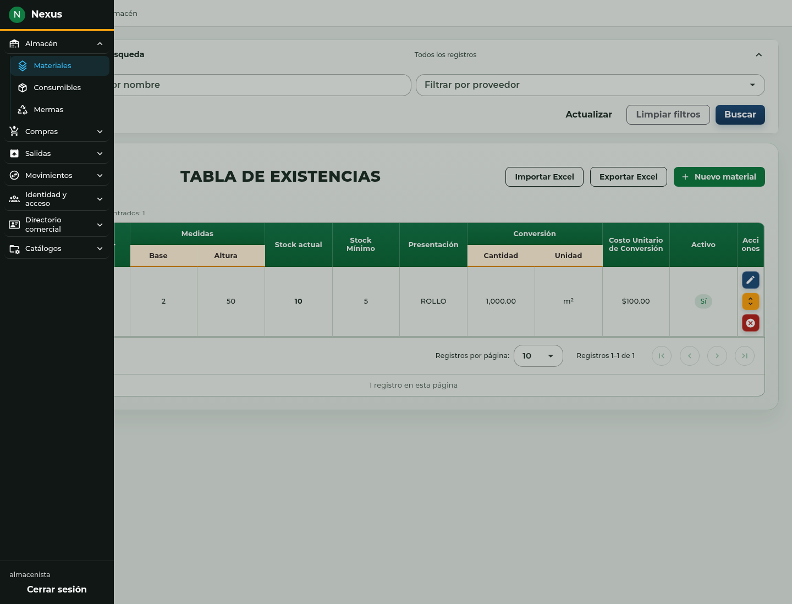

# 2. Navegación y controles comunes

## Abrir una sección

Pulse **Menú**, abra el grupo deseado y seleccione una página. El menú muestra las
secciones permitidas para su cuenta.

En pantallas grandes, el panel comienza como una columna de iconos. Al navegar,
hacer clic fuera del panel o pulsar **Escape**, vuelve al estado compacto. En un
teléfono, también puede cerrarlo con **Cerrar menú**.

Puede guardar la dirección de una página como favorito.

## Buscar y recorrer una tabla

1. Abra el módulo y espere a que termine la carga.
2. Capture el texto o seleccione los filtros necesarios.
3. Pulse **Buscar** para aplicar la captura a la consulta.
4. Revise los resultados y utilice los controles de página para recorrerlos.
5. Use **Limpiar filtros** para regresar a la consulta general.

Pulse un encabezado habilitado para ordenar y cambie el tamaño de página para ver
más registros. El total de resultados se conserva.
En pantallas estrechas, desplace la tabla para ver las demás columnas.

Si falta un registro, limpie los filtros. La actualización automática los conserva
y espera mientras tiene una captura abierta. Ante un fallo, use **Actualizar** o
**Reintentar**. Evite recargar el navegador con cambios sin guardar.

## Seleccionar registros relacionados

Abra el selector, escriba parte del nombre y **seleccione una opción de la lista**.
Escribir el nombre no basta para elegir el registro.

Algunos campos dependen de una selección previa. En Mermas, elija primero el
proveedor y después el material de referencia. Revise el artículo si cambia de proveedor.

Desplácese al final de la lista para cargar más opciones. Ante un fallo, pulse
**Reintentar catálogo**.

<!-- manual:any suppliers:manage clients:create materials:write persons:write -->
Cuando aparezca una acción **Registrar…** junto al selector:

1. Abra esa acción sin cerrar el formulario principal.
2. Complete el formulario secundario y guárdelo.
3. Compruebe que regresa al formulario principal y que el nuevo registro queda
   seleccionado.
4. Continúe y guarde la operación principal.

El registro creado permanece aunque cierre la operación principal. Cerrar el
formulario secundario sin guardar conserva la captura principal.

<!-- manual:end -->

## Usar los formularios

Corrija los campos que muestren un mensaje al editar o enviar. Los campos de
consulta no se pueden cambiar.

**Guardar** registra un alta; **Actualizar** guarda una edición. Espere la respuesta
sin repetir el envío. **Cerrar** o **Regresar** abandona los cambios sin guardar.
Si aparece un conflicto, siga [Errores y recuperación](15-errors-and-recovery.md).
