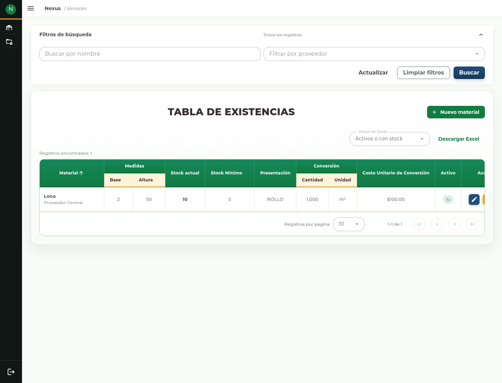
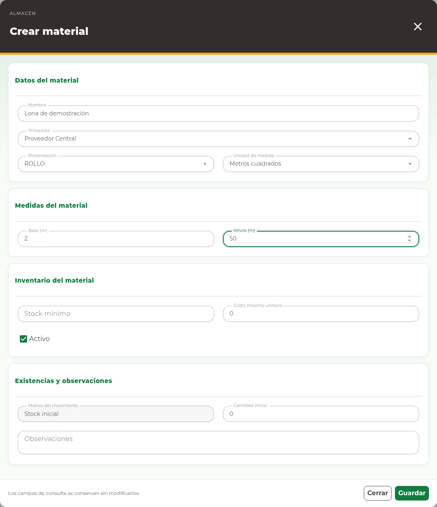
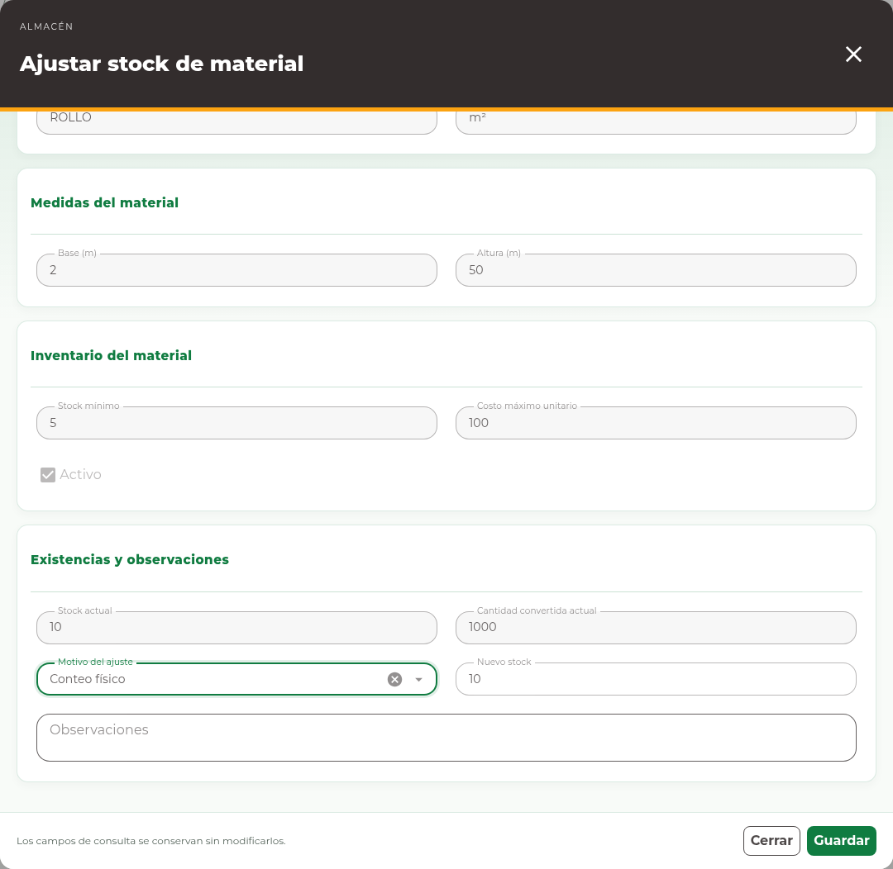

# 3. Materiales

## Consultar existencias

Abra **Almacén → Materiales**. La página **Tabla de Existencias** muestra los
materiales, proveedor, presentación, unidad y existencias. Las columnas agrupadas
de medidas y conversión permiten distinguir las dimensiones del artículo de la
cantidad disponible. Utilice los filtros y búsqueda para localizar el registro
correcto y leer sus datos completos.

<!-- manual:any materials:write -->
## Registrar un material

**Antes de empezar.** Deben existir el proveedor, la presentación y la unidad que
corresponden al artículo. Necesita permiso para crear materiales.

1. Pulse **Nuevo material** para abrir **Crear material**.
2. Complete los campos de la tabla siguiente.
3. Revise la presentación, unidad y cantidad inicial.
4. Pulse **Guardar** y espere la confirmación.
5. Localice el material en el listado y compruebe sus datos y existencias.

| Campo | Cómo utilizarlo |
| --- | --- |
| Nombre | Identifique el material de forma reconocible para otros operadores. |
| Proveedor | Seleccione el proveedor del registro. |
| Presentación | Seleccione cómo se maneja el artículo, por ejemplo un rollo. |
| Unidad de medida | Elija la unidad de su conversión o control. |
| Base (m), Altura (m) | Capture las dimensiones cuando la unidad del material las requiera. |
| Stock mínimo | Indique el umbral de referencia del inventario. |
| Costo máximo unitario | Capture el costo correspondiente al campo, sin sustituirlo por el total de una compra. |
| Activo | Manténgalo marcado si el artículo debe estar disponible para la operación. |
| Cantidad inicial | Capture la existencia con la que comienza este registro. |
| Observaciones | Explique la captura inicial cuando corresponda. |

La captura de un material desde una compra puede omitir cantidad inicial y costo:
las existencias y el costo de esa recepción se registran en la compra. No repita
la misma entrada como cantidad inicial y como recepción.
<!-- manual:end -->

<!-- manual:any materials:write -->
## Editar datos

1. Localice el registro y pulse **Editar**.
2. Revise los datos cargados y modifique únicamente los campos habilitados.
3. Pulse **Guardar** y compruebe el registro actualizado.

Proveedor, presentación, unidad y medidas se muestran como consulta en la edición.
La edición de datos no reemplaza un ajuste de stock. Para un cambio de identidad
del artículo, consulte al responsable del inventario en lugar de alterar otro
registro que ya tiene historial.
<!-- manual:end -->

<!-- manual:any materials:adjust-stock -->
## Ajustar el saldo

**Antes de confirmar.** Este ajuste cambia la existencia disponible y puede afectar
las entregas posteriores. Use un conteo comprobado y un motivo claro. No lo utilice
para registrar una compra que todavía no recibió.

1. Pulse **Ajustar stock** en la fila correcta.
2. Compruebe **Stock actual** y **Cantidad convertida actual**.
3. Seleccione **Motivo del ajuste**.
4. En **Nuevo stock**, escriba el saldo final que debe quedar y capture las
   **Observaciones** que explican la corrección.
5. Pulse **Guardar**, confirme si se solicita y compruebe el nuevo saldo.

**Nuevo stock** es un saldo absoluto. Si hay 10 unidades y el conteo correcto es
12, capture 12. Una recepción de compra se registra en Compras, no como ajuste de
conteo. Si otra persona cambió el registro, cierre y actualice el listado antes
de preparar un nuevo ajuste. Consulte el historial en **Movimientos → Materiales**.
<!-- manual:end -->

<!-- manual:any materials:write -->
## Retirar un registro

**Antes de confirmar una eliminación.** Compruebe nombre y proveedor. Si retira la
última relación con un proveedor, también puede retirarse el material. Si necesita
conservarlo para consulta, revise con su responsable si corresponde desactivarlo.

Si aparece **Eliminar**, revise el registro y el proveedor de la relación que se
retirará. La confirmación informa que, si no quedan otros proveedores, también
se eliminará el material. Confirme sólo si corresponde; el sistema puede impedirlo
por sus relaciones o historial. Desmarcar **Activo** en una edición expresa que el registro
deja de estar disponible para nuevas operaciones, sin borrar su historia.
<!-- manual:end -->

<!-- manual:any warehouse:reports-read -->
## Descargar el inventario

Use **Descargar Excel** si su cuenta puede exportar el inventario. Revise primero
los filtros; el reporte no se limita a las filas de la página visible.
<!-- manual:end -->
