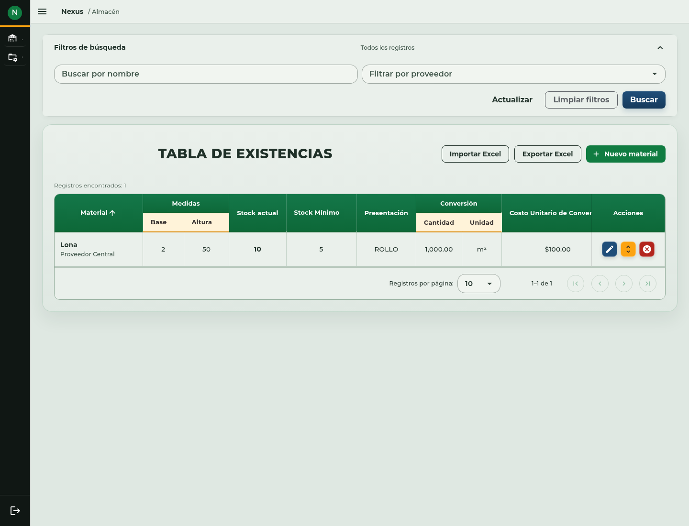
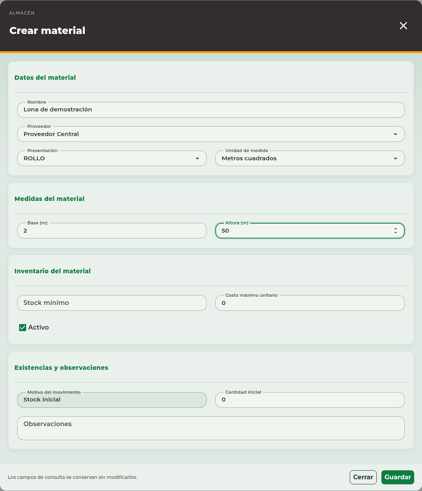
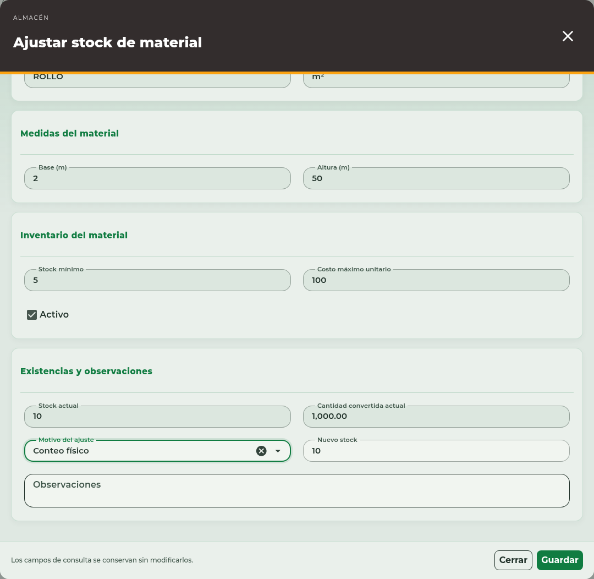

# 3. Materiales

## Consultar existencias

Abra **Almacén → Existencias de materiales**. **Tabla de Existencias de materiales** muestra material, proveedor,
presentación, unidad y stock. Las columnas agrupadas distinguen dimensiones y conversión.
Busque y filtre para localizar el registro correcto.

<!-- manual:all materials:read -->
<!-- manual:any inventory:costs-read materials:adjust-stock -->
<!-- manual:any materials:write materials:adjust-stock -->
## Importar materiales o consumibles desde Excel

Use **Importar Excel** para trabajar por lotes de hasta **500 filas y 2 MiB**.
El archivo representa una sola operación. El selector muestra las opciones permitidas
para su cuenta; no se elige una operación diferente en cada fila.

<!-- manual:all materials:write inventory:costs-read -->
**Alta:** capture los datos del artículo, proveedor del catálogo, **Cantidad inicial**
y observaciones. El sistema genera los IDs nuevos; Stock actual y Conversión
son referencias.

**Editar datos:** cambie **Stock mínimo**, **Costo máximo unitario** o **Activo**
de cada oferta. El nombre viene de **Artículos**; los datos del proveedor se editan
en **Proveedores**. Se conservan IDs/versiones, presentación, unidad, medidas y existencias.
<!-- manual:end -->

<!-- manual:any materials:adjust-stock -->

**Ajustar existencias:** capture **Stock contado**, **Motivo** y **Observaciones**.
Se conservan IDs/versiones y datos del artículo; el saldo final reemplaza la
existencia anterior.
<!-- manual:end -->

1. Abra el inventario correspondiente y pulse **Importar Excel**.
2. En **Operación del archivo**, elija la operación que realizará todo el archivo.
3. En edición o ajuste, deje vacíos los filtros para descargar todos los registros coincidentes o filtre por proveedor/nombre para acotar. La plantilla contiene hasta 500 registros; si hay más, descargue grupos filtrados.
4. Guarde una copia del archivo descargado y complete únicamente las columnas de captura de esa operación.
5. Conserve las hojas **Datos**, **Instrucciones** y **Catalogos**, sus encabezados y las columnas grises de referencia. Capture sólo en las columnas blancas.
6. Seleccione la misma operación, elija el `.xlsx` y pulse **Validar archivo**.
7. Revise todas las páginas de la vista previa: filas nuevas, cambios, datos anteriores/finales, advertencias y errores. Validar todavía no modifica inventario.
8. Si hay errores, use **Descargar errores**, corrija el archivo de captura, pulse **Descartar borrador** y vuelva a validarlo. El informe de errores sirve para revisar; no se vuelve a importar.
9. Pulse **Confirmar importación** una sola vez y espere el resultado. Conserve su referencia y compruebe el inventario. **Otro archivo** inicia una operación distinta.

<!-- module:any reference almacen-materiales -->

<!-- module:end -->

La plantilla mantiene las columnas y el orden del reporte de consulta y añade
IDs/versiones y campos de captura. El ajuste omite el costo. El Excel obtenido con
**Exportar Excel** es un reporte: para importar descargue la plantilla de la operación.
<!-- module:any reference consumables -->

Para altas de consumibles con presentación **KILOGRAMOS** o **METRO LINEAL**,
puede dejar **Base** y **Altura** vacías: se guardan como `1 × 1`. En otras
presentaciones, capture las medidas cuando correspondan al artículo.

<!-- module:end -->

En **Activo**, use **SI** o **NO**. Capture números con punto decimal y sin símbolos
de moneda; no cambie IDs ni versiones. Cada archivo admite hasta 500 filas. Para
trabajar más registros, aplique filtros, descargue grupos de hasta 500 y evite
repetir registros entre archivos.

Los IDs/versiones se incluyen automáticamente para quien tiene el permiso operativo;
consérvelos aunque cambie el nombre. No dependen de ser administrador. **Catalogos**
incluye sólo opciones de la operación: en Alta, proveedores, presentaciones y unidades;
en Ajustar existencias, motivos de ajuste; Editar datos no necesita catálogos.
No son registros que se importen. Seleccione el valor completo tal como aparece,
incluido el código o ID cuando forme parte de la opción. Retire de **Datos** las filas
que no quiera procesar, sin borrar ni renombrar encabezados.

<!-- manual:all materials:write inventory:costs-read -->
Las altas llevan **Cantidad inicial**. El mínimo, el costo y Activo corresponden a
cada proveedor. Use **0** como mínimo si no necesita la alerta. PIEZA exige enteros.
Un alta sin costo no podrá usarse en salidas hasta configurar un costo positivo.
<!-- manual:end -->

<!-- manual:any materials:adjust-stock -->
En **Stock contado**, cero significa que comprobó que no hay existencias; vacío no
es un conteo y bloquea el archivo. Retire las filas que aún no haya contado. Capture
el saldo físico final por presentación, con motivo y observaciones, y evite movimientos
durante el conteo. Si también necesita editar datos, complete una operación y descargue
una plantilla actual para la siguiente.
<!-- manual:end -->

Un duplicado, error o versión desactualizada bloquea **todo el archivo**. Ante datos
cambiados, descargue una plantilla actual y revise sus correcciones antes de volver
a capturarlas. Cambiar la operación retira el archivo seleccionado. Use siempre
la plantilla actual de la operación seleccionada.

### Manejo y recuperación del archivo

Suba el `.xlsx` directamente, sin comprimirlo en otro ZIP. No use CSV, macros,
fórmulas ni enlaces externos; pegue valores en las celdas de captura. Cambiar la
extensión de un archivo no lo convierte en una plantilla válida.

El servidor descarta el archivo después del análisis. La vista previa y sus errores
se eliminan al confirmar, descartar o vencer el borrador, que dura 24 horas. El recibo
confirmado se conserva; anote la referencia que muestra la pantalla. Nexus no borra el original ni las descargas de su equipo.
Conserve la copia de trabajo y el resultado hasta comprobar la operación; administre
sus copias según el [manejo de archivos locales](02-navigation-and-controls.md#archivos-en-su-equipo).

Si se pierde la respuesta al confirmar, reabra **Importar Excel** y pulse **Revisar y
reintentar confirmación**. Esa acción comprueba el mismo envío. No vuelva a cargar el
archivo ni cree otra alta mientras el resultado sea incierto.
<!-- manual:end -->
<!-- manual:end -->
<!-- manual:end -->

<!-- manual:any materials:write -->
## Registrar un material

1. Pulse **Nueva existencia** para abrir **Registrar existencia de material**.
2. Elija **Material** y **Proveedor**. La búsqueda incluye todo el catálogo, aunque el artículo todavía no tenga proveedor.
3. En **Existencias**, capture **Cantidad inicial** y revise **Cantidad convertida inicial**. Complete **Stock mínimo**, **Costo máximo unitario**, **Activo** y **Observaciones**. El motivo se asigna como **Stock inicial**.
4. Pulse **Guardar**. Se vincula el artículo al proveedor y se registra el stock inicial en una sola operación.

Nombre, presentación, unidad y medidas pertenecen al catálogo; no se vuelven a capturar aquí. PIEZA exige cantidades enteras; KILOGRAMOS y METRO LINEAL admiten decimales y conservan `1 × 1`.

Si falta el artículo, **escriba el nombre en Material** y espere la búsqueda. Pulse **Registrar material «texto escrito»** o presione **Enter** en el selector. Complete **Presentación**, **Unidad de medida**; capture medidas sólo cuando la presentación las requiera. KILOGRAMOS y METRO LINEAL fijan `1 × 1` y ocultan esos campos. No necesita elegir antes un proveedor. El artículo queda seleccionado; todavía debe guardar el formulario principal para vincularlo y registrar existencias. Cancelar el modal conserva la captura principal. Para corregir un artículo existente, use **Almacén → Artículos**.

<!-- manual:all suppliers:manage suppliers:read -->
Si falta el proveedor, **escriba su nombre comercial completo dentro de Proveedor**
y espere la búsqueda. Si ya existe, selecciónelo; si falta, pulse
**Registrar proveedor «texto escrito»** al final de la lista o presione **Enter**.
Abrir el selector
vacío no muestra el botón. Complete **Razón social**, revise **Nombre comercial**,
guarde y compruebe que el proveedor nuevo queda seleccionado en esta captura.
<!-- manual:end -->

Si una compra crea una oferta, su mínimo empieza en **0**. La recepción registra
la existencia y eleva el costo máximo de la oferta sólo si el mayor costo unitario
sin IVA de las partidas nuevas supera el valor guardado. No duplique la entrada.
<!-- manual:end -->

<!-- manual:any materials:write -->
## Editar una existencia

1. Localice el registro y pulse **Editar existencia**.
2. En **Existencias**, consulte el saldo actual y cambie **Stock mínimo**, **Costo máximo unitario** o **Activo**.
3. Pulse **Guardar** y compruebe el registro actualizado.

Use **Editar artículo** para cambiar el nombre y **Editar proveedor**
para cambiar sus datos comerciales. Cada botón abre su formulario en un modal
cuando la cuenta tiene el permiso correspondiente.

<!-- manual:end -->

<!-- manual:any materials:adjust-stock -->
## Ajustar el saldo

**Antes de confirmar.** El ajuste reemplaza el saldo. Compruebe el conteo y el
motivo; las recepciones se registran en Compras.

1. Pulse **Ajustar stock** en el registro correcto.
2. En **Existencias**, compruebe **Stock actual** y **Cantidad convertida actual**.
3. Seleccione **Motivo del ajuste**.
4. En **Nuevo stock**, escriba el saldo final que debe quedar y capture las
   **Observaciones** que explican la corrección.
5. Pulse **Guardar**, confirme si se solicita y compruebe el nuevo saldo.

Si hay 10 unidades y el conteo correcto es 12, capture **12** en **Nuevo stock**.
Compruebe el historial en **Movimientos → Materiales**. Ante un conflicto, siga
[Errores y recuperación](15-errors-and-recovery.md#conflictos-de-edición).
<!-- manual:end -->

<!-- manual:any materials:write -->
## Retirar un registro

**Eliminar** está disponible cuando la oferta tiene stock cero y carece de compras,
salidas y otros registros de inventario. Revise el proveedor antes de confirmar. El
artículo se conserva en **Artículos**. Para dejar de usar una oferta con historial en
operaciones nuevas, desmarque **Activo** en **Editar existencia**.
<!-- manual:end -->

<!-- manual:any warehouse:reports-read -->
## Descargar el inventario

Revise los filtros y pulse **Exportar Excel**. El archivo incluye todos los
resultados de la consulta.
<!-- manual:end -->

<!-- manual:any materials:write -->
Al seleccionar el artículo, **Datos del material** muestra Base, Altura,
Presentación y Unidad de medida con los valores de Artículos.
Son campos de sólo lectura en el alta y la edición. La cantidad inicial se
registra en **Cantidad inicial**; **Costo máximo unitario** y **Activo** corresponden
a las columnas del mismo nombre.
<!-- manual:end -->

<!-- manual:any materials:adjust-stock -->
El stock se modifica mediante **Ajustar stock**.
<!-- manual:end -->
