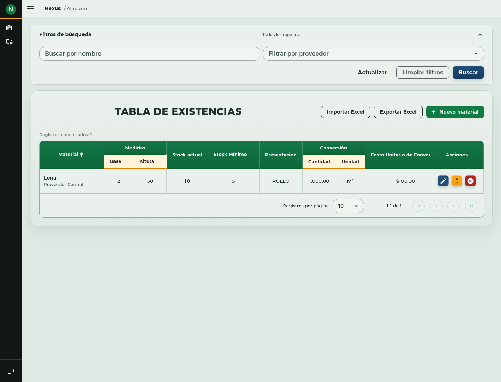
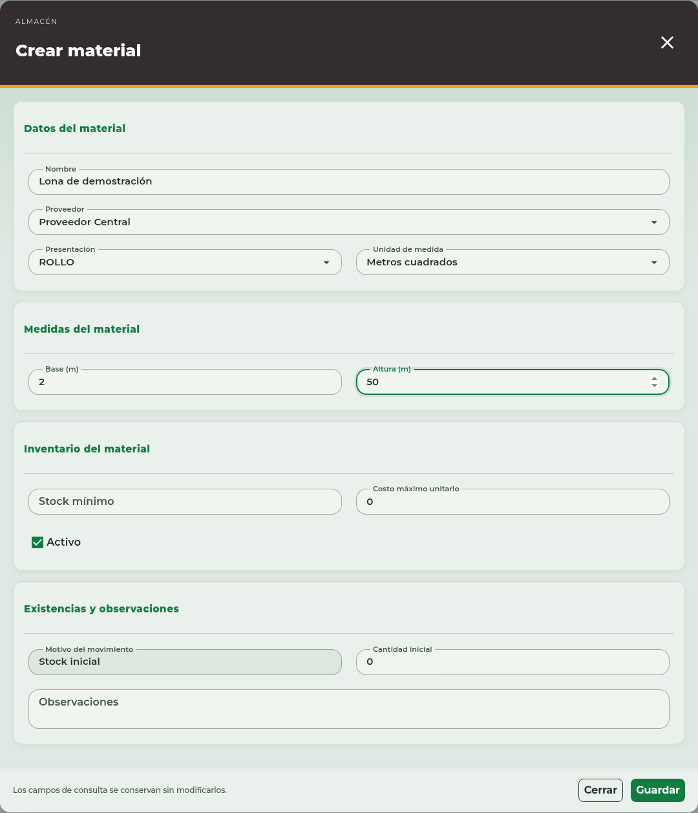
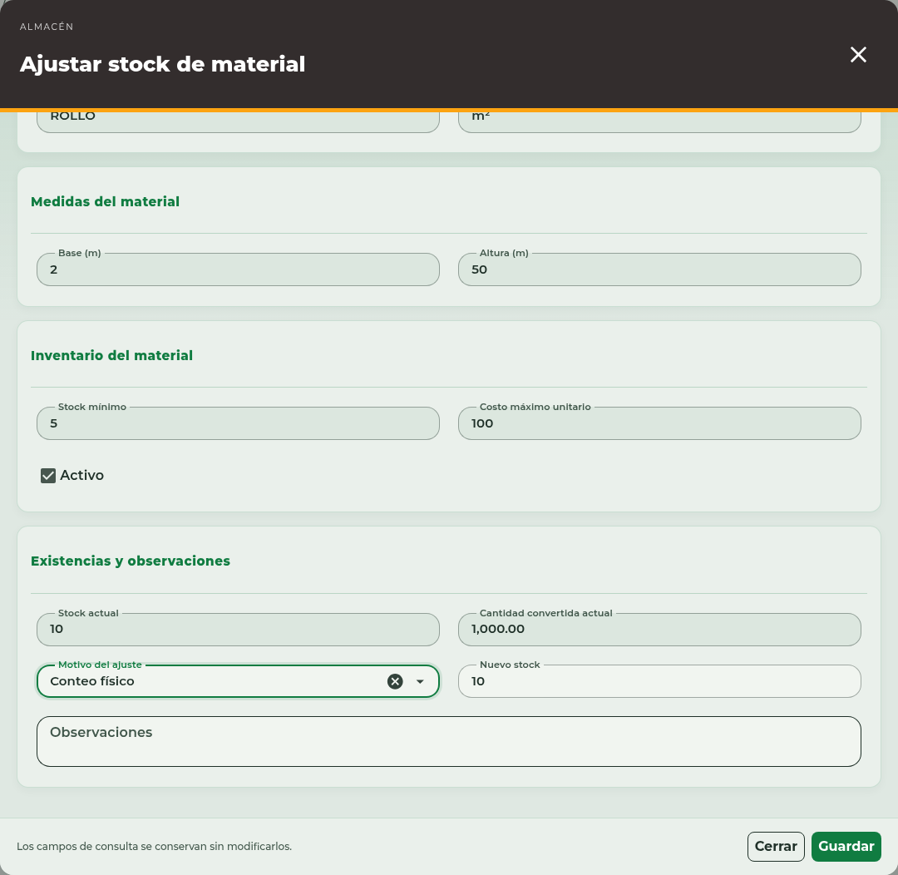

# 3. Materiales

## Consultar existencias

Abra **Almacén → Materiales**. **Tabla de Existencias** muestra material, proveedor,
presentación, unidad y stock. Las columnas agrupadas distinguen dimensiones y conversión.
Busque y filtre para localizar el registro correcto.

<!-- manual:any materials:write materials:adjust-stock -->
## Importar materiales o consumibles desde Excel

1. En el módulo correspondiente, pulse **Importar Excel** para trabajar con un archivo único.
2. Filtre proveedor/nombre y página; pulse **Descargar plantilla**. Sus filas existentes empiezan en Conservar.
3. Elija por fila Alta, Editar, Ajustar, Editar y ajustar o Conservar. Complete los datos sin cambiar hojas, encabezados ni IDs/versiones de registros existentes.
4. Seleccione el `.xlsx` y pulse **Validar archivo**. Revise cambios, cantidades y errores.
5. Si hay errores, descárguelos, pulse **Descartar borrador**, corrija el original y vuelva a validarlo.
6. Pulse **Confirmar importación** y espere el recibo. Use **Otro archivo** para continuar.

Use un archivo por inventario y mezcle sus altas, ediciones y ajustes. En Alta, el ID
queda vacío y el servidor lo genera. Para Editar/Ajustar conserve los IDs/versiones.
Editar deja el stock vacío; Ajustar/Editar y ajustar captura el saldo físico final
en `stock_contado_o_inicial`, con motivo y observaciones. Cero es válido y vacío se
rechaza. Para Alta esa columna es existencia inicial. Conservar no aplica cambios.
Una fila por destino; si necesita datos y stock, elija Editar y ajustar.

Un duplicado o error bloquea **todo el archivo**: todavía no se guarda ninguna fila.
**Descargar errores** indica cuáles corregir o retirar antes de volver a validar.

Máximo: 100 filas y 2 MiB. Actualizar cambia nombre, mínimo, costo y activo; conserva
existencias y medidas. Nombre y mínimo se comparten entre proveedores. Pieza exige
enteros. Un alta sin costo no podrá usarse en salidas hasta configurar un costo positivo.
Si se pierde la respuesta, vuelva a **Importar Excel** y pulse **Revisar y reintentar
confirmación**. No suba otra alta para repetirla. El borrador vence en 24 h; el archivo
de su equipo permanece bajo su control.
<!-- manual:end -->

<!-- manual:any materials:write -->
## Registrar un material

**Antes de empezar.** Identifique proveedor, presentación y unidad del artículo.

1. Pulse **Nuevo material** para abrir **Crear material**.
2. Complete los campos de la tabla siguiente.
3. Revise la presentación, unidad y cantidad inicial.
4. Pulse **Guardar** y espere la confirmación.
5. Localice el material en el listado y compruebe sus datos y existencias.

| Campo | Cómo utilizarlo |
| --- | --- |
| Nombre | Identifique el material de forma reconocible para otros operadores. |
| Proveedor | Seleccione el proveedor del registro. |
| Presentación | Seleccione cómo se maneja el artículo, por ejemplo un rollo. |
| Unidad de medida | Elija la unidad de su conversión o control. |
| Base (m), Altura (m) | Capture las dimensiones cuando la unidad del material las requiera. |
| Stock mínimo | Indique el umbral de referencia del inventario. |
| Costo máximo unitario | Capture el costo correspondiente al campo, sin sustituirlo por el total de una compra. |
| Activo | Manténgalo marcado si el artículo debe estar disponible para la operación. |
| Cantidad inicial | Capture la existencia con la que comienza este registro. |
| Observaciones | Explique la captura inicial cuando corresponda. |

Desde una compra se omiten cantidad inicial y costo máximo. La recepción registra
la existencia; el costo máximo se configura en **Almacén**. No duplique la entrada.
<!-- manual:end -->

<!-- manual:any materials:write -->
## Editar datos

1. Localice el registro y pulse **Editar**.
2. Revise los datos cargados y modifique únicamente los campos habilitados.
3. Pulse **Guardar** y compruebe el registro actualizado.

Proveedor, presentación, unidad y medidas son de consulta. Editar conserva el
saldo. Si necesita cambiar la identidad del artículo, consulte al responsable del inventario.
<!-- manual:end -->

<!-- manual:any materials:adjust-stock -->
## Ajustar el saldo

**Antes de confirmar.** El ajuste reemplaza el saldo. Compruebe el conteo y el
motivo; las recepciones se registran en Compras.

1. Pulse **Ajustar stock** en el registro correcto.
2. Compruebe **Stock actual** y **Cantidad convertida actual**.
3. Seleccione **Motivo del ajuste**.
4. En **Nuevo stock**, escriba el saldo final que debe quedar y capture las
   **Observaciones** que explican la corrección.
5. Pulse **Guardar**, confirme si se solicita y compruebe el nuevo saldo.

Si hay 10 unidades y el conteo correcto es 12, capture **12** en **Nuevo stock**.
Compruebe el historial en **Movimientos → Materiales**. Ante un conflicto, siga
[Errores y recuperación](15-errors-and-recovery.md#conflictos-de-edición).
<!-- manual:end -->

<!-- manual:any materials:write -->
## Retirar un registro

**Antes de eliminar.** Revise nombre y proveedor en la confirmación. Eliminar la
última relación con un proveedor también puede eliminar el material. Sus relaciones
o historial pueden impedirlo.

Desmarcar **Activo** conserva el registro y su historia para consulta.
<!-- manual:end -->

<!-- manual:any warehouse:reports-read -->
## Descargar el inventario

Revise los filtros y pulse **Exportar Excel**. El archivo incluye todos los
resultados de la consulta.
<!-- manual:end -->
