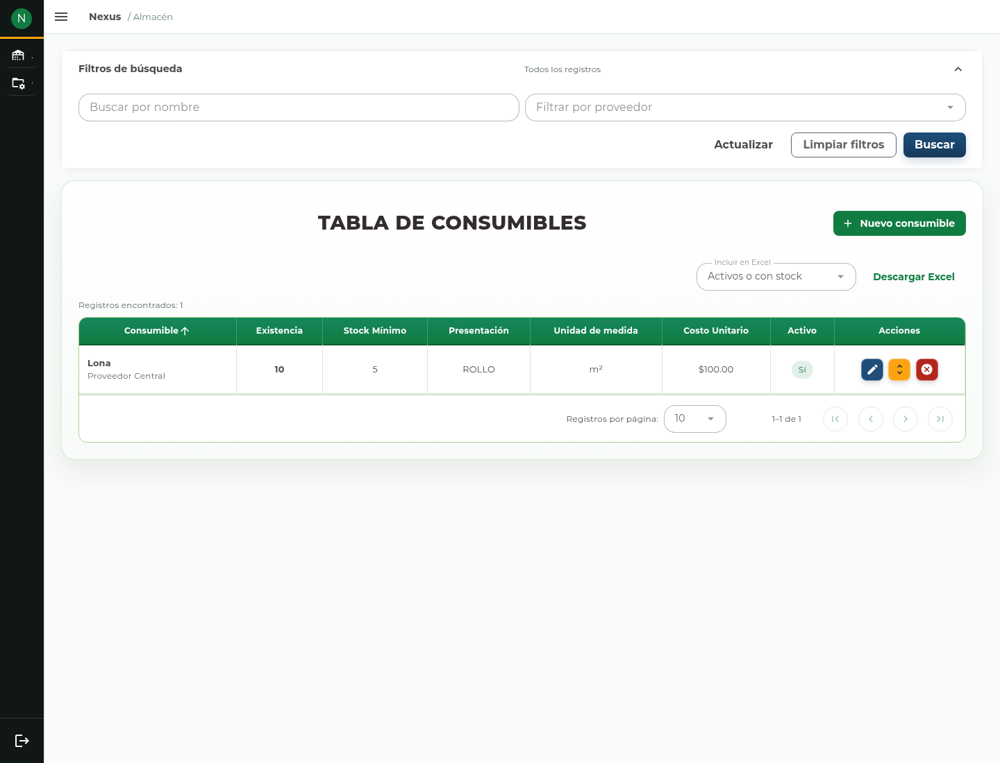
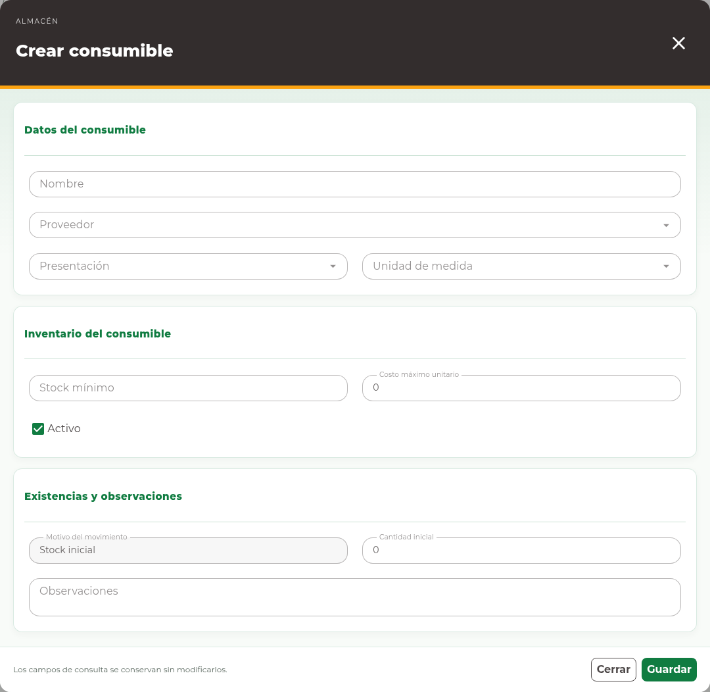

# 4. Consumibles

## Consultar consumibles

Abra **Almacén → Consumibles**. La **Tabla de Consumibles** distingue existencia,
stock mínimo, presentación y unidad de medida. El costo unitario se muestra a
las cuentas autorizadas. No interprete una
cantidad como metros cuadrados si el consumible se controla en otra unidad.

<!-- manual:any materials:write -->
## Registrar un consumible

**Antes de empezar.** Identifique el proveedor, presentación y unidad del
consumible. Compruebe que el registro no exista con los mismos datos.

1. Pulse **Nuevo consumible**.
2. En **Crear consumible**, capture **Nombre** y elija **Proveedor**,
   **Presentación** y **Unidad de medida**.
3. Complete **Stock mínimo**, **Costo máximo unitario** y **Activo**.
4. Capture **Cantidad inicial** y las **Observaciones** de esa existencia.
5. Pulse **Guardar** y compruebe el registro y su saldo en el listado.

El formulario adapta sus campos al consumible. No agregue dimensiones en el nombre
para compensar una unidad o presentación equivocada. Si lo registra desde una
compra, la recepción se captura con las partidas de esa compra y no se duplica
como existencia inicial.
<!-- manual:end -->

<!-- manual:any materials:write -->
## Editar datos

Para corregir los datos habilitados, pulse **Editar** en la fila, revise los
valores, cambie lo necesario y pulse **Guardar**. La edición no cambia proveedor,
presentación o unidad de un registro con identidad ya establecida.
<!-- manual:end -->

<!-- manual:any materials:adjust-stock -->
## Ajustar el saldo

Para corregir un conteo:

1. Pulse **Ajustar stock** en el consumible correcto.
2. Revise el saldo actual y seleccione **Motivo del ajuste**.
3. Escriba el saldo final en **Nuevo stock**, no la diferencia.
4. Explique la corrección en **Observaciones** y pulse **Guardar**.
5. Compruebe el saldo actualizado y, cuando corresponda, su movimiento.

Utilice **Compras → Consumibles** para recepciones y **Salidas → Consumibles**
para entregas. Los ajustes corrigen el saldo; no sustituyen esos documentos.
<!-- manual:end -->

<!-- manual:any materials:write -->
## Disponibilidad e incidencias

La casilla **Activo** controla la disponibilidad del registro para nuevas
operaciones. Si una eliminación está disponible, requiere revisar su confirmación
y puede ser rechazada si el consumible tiene relaciones que deben conservarse.

Si un cambio simultáneo impide guardar, cierre y actualice el listado, revise el
saldo vigente y vuelva a preparar la corrección. Si se perdió la conexión después
de enviar, compruebe primero si el cambio quedó aplicado.
<!-- manual:end -->

<!-- manual:any warehouse:reports-read -->
## Descargar el inventario

Con permiso de reporte, pulse **Descargar Excel** después de revisar la consulta.
El [capítulo de reportes](14-reports.md) explica su alcance.
<!-- manual:end -->
