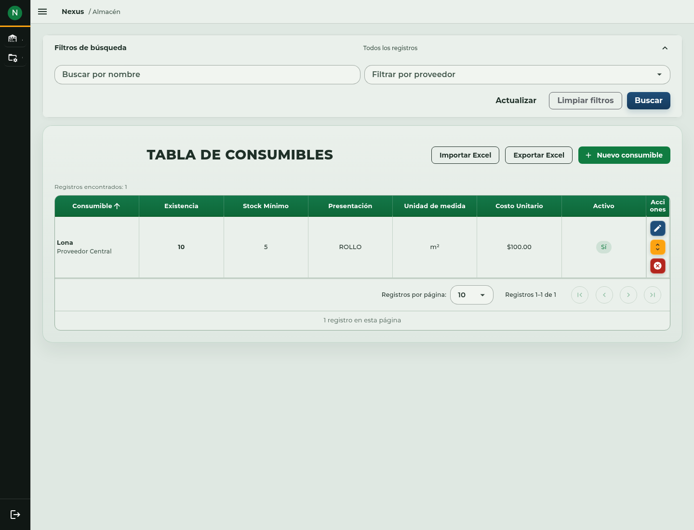
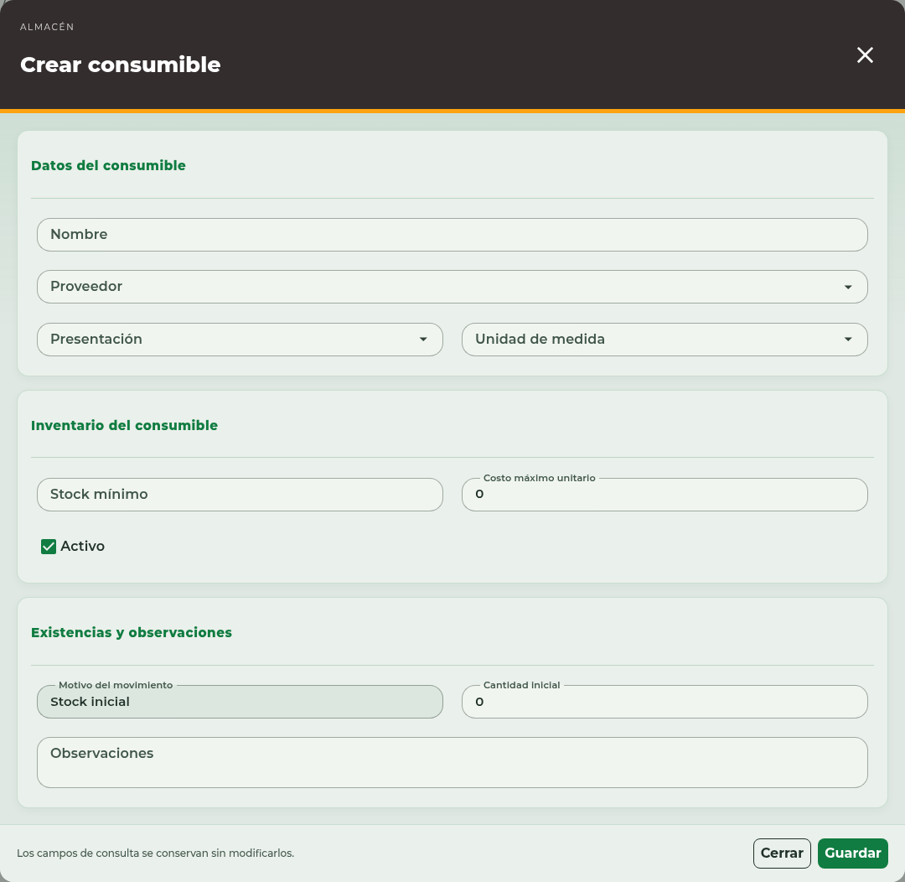

# 4. Consumibles

## Consultar consumibles

Abra **Almacén → Consumibles**. La **Tabla de Consumibles** distingue existencia,
stock mínimo, presentación y unidad de medida. Lea la unidad para interpretar la cantidad.

<!-- manual:any inventory:costs-read -->
También puede consultar el costo unitario.
<!-- manual:end -->

<!-- manual:all materials:read -->
<!-- manual:any inventory:costs-read materials:adjust-stock -->
<!-- manual:any materials:write materials:adjust-stock -->
## Importar desde Excel

Pulse **Importar Excel** y siga el [procedimiento de materiales y consumibles](03-materials.md#importar-materiales-o-consumibles-desde-excel).
El selector asigna una sola operación a todo el archivo. Base y Altura permanecen
como referencias vacías en la estructura de consulta; los consumibles no capturan
dimensiones. Conserve los IDs/versiones incluidos para editar o ajustar.
<!-- manual:end -->
<!-- manual:end -->
<!-- manual:end -->

<!-- manual:any materials:write -->
## Registrar un consumible

**Antes de empezar.** Identifique el proveedor, presentación y unidad del
consumible. Compruebe que el registro no exista con los mismos datos.

1. Pulse **Nuevo consumible**.
2. En **Crear consumible**, capture **Nombre** y elija **Proveedor**,
   **Presentación** y **Unidad de medida**.
3. Complete **Stock mínimo**, **Costo máximo unitario** y **Activo**.
4. Capture **Cantidad inicial** y las **Observaciones** de esa existencia.
5. Pulse **Guardar** y compruebe el registro y su saldo en el listado.

Compruebe presentación y unidad antes de guardar. Desde una compra, la existencia
se recibe al guardar la compra; no la duplique como cantidad inicial.
<!-- manual:end -->

<!-- manual:any materials:write -->
## Editar datos

Pulse **Editar** y cambie **Nombre**, **Stock mínimo**, **Costo máximo unitario**
o **Activo**; después pulse **Guardar**. Proveedor, presentación y unidad son de
consulta. El stock y su conversión permanecen sin cambios y no hay campos de
dimensiones. Nombre y mínimo se comparten entre proveedores; costo y Activo
afectan la oferta seleccionada.
<!-- manual:end -->

<!-- manual:any materials:adjust-stock -->
## Ajustar el saldo

Para corregir un conteo:

1. Pulse **Ajustar stock** en el consumible correcto.
2. Revise el saldo actual y seleccione **Motivo del ajuste**.
3. Escriba el saldo final en **Nuevo stock**, no la diferencia.
4. Explique la corrección en **Observaciones** y pulse **Guardar**.
5. Compruebe el saldo actualizado y, cuando corresponda, su movimiento.

Utilice **Compras → Consumibles** para recepciones y **Salidas → Consumibles**
para entregas. Los ajustes corrigen el saldo; no sustituyen esos documentos.
<!-- manual:end -->

<!-- manual:any materials:write -->
## Disponibilidad e incidencias

Desmarcar **Activo** retira el registro de nuevas operaciones y conserva su historia.
Para eliminarlo, revise la confirmación; sus relaciones pueden impedirlo. Ante un
conflicto o un envío sin respuesta, siga [Errores y recuperación](15-errors-and-recovery.md).
<!-- manual:end -->

<!-- manual:any warehouse:reports-read -->
## Descargar el inventario

Pulse **Exportar Excel** después de revisar la consulta.
El [capítulo de reportes](14-reports.md) explica su alcance.
<!-- manual:end -->
