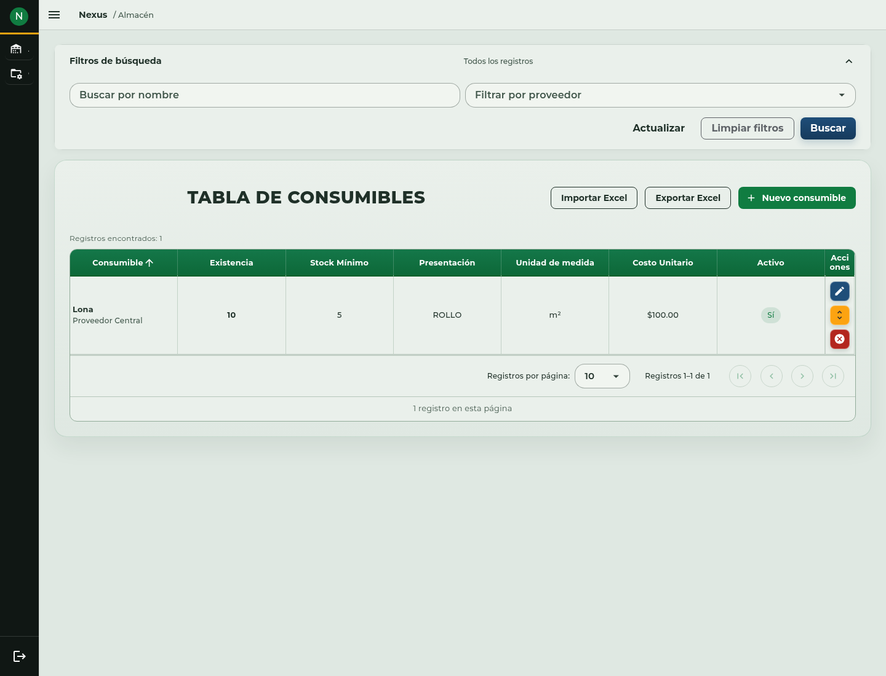
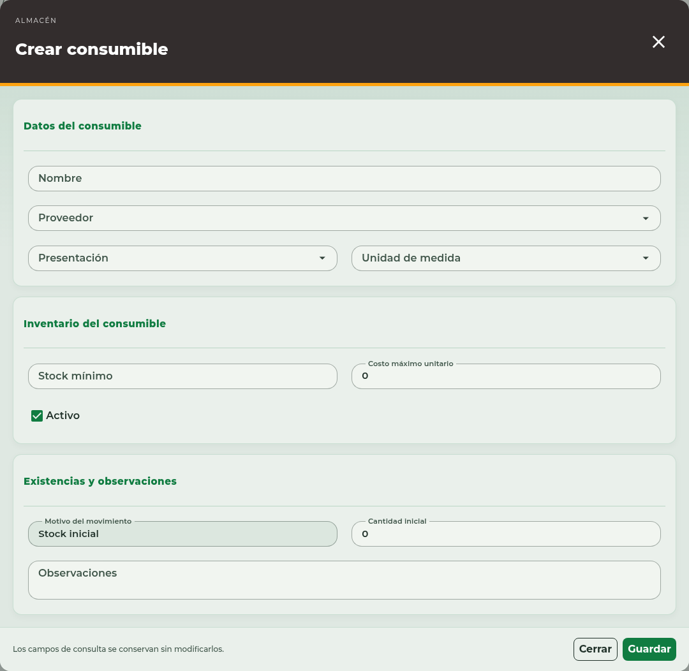

# 4. Consumibles

## Consultar consumibles

Abra **Almacén → Existencias de consumibles**. La **Tabla de Existencias de consumibles** distingue existencia,
stock mínimo, presentación y unidad de medida. Lea la unidad para interpretar la cantidad.

<!-- manual:any inventory:costs-read -->
También puede consultar el costo unitario.
<!-- manual:end -->

<!-- manual:all materials:read -->
<!-- manual:any inventory:costs-read materials:adjust-stock -->
<!-- manual:any materials:write materials:adjust-stock -->
## Importar desde Excel

Pulse **Importar Excel** y siga el [procedimiento de materiales y consumibles](03-materials.md#importar-materiales-o-consumibles-desde-excel).
El selector asigna una sola operación a todo el archivo. Para altas con
presentación KILOGRAMOS o METRO LINEAL, puede dejar Base y Altura vacías: la
importación las completa como 1 × 1. Si captura esas columnas, ambos valores
deben ser 1. Conserve los IDs/versiones incluidos para editar o ajustar.

<!-- manual:end -->
<!-- manual:end -->
<!-- manual:end -->

<!-- manual:any materials:write -->
## Registrar un consumible

1. Pulse **Nueva existencia**.
2. Elija **Consumible** y **Proveedor** del catálogo completo.
3. En **Existencias**, capture **Cantidad inicial** y revise **Cantidad convertida inicial**. Complete **Costo máximo unitario**, **Activo** y **Observaciones**. El motivo se asigna como **Stock inicial**.
4. Pulse **Guardar** y compruebe el saldo. Se crea la relación con el proveedor sin duplicar el artículo.

Presentación, unidad, medidas y mínimo provienen del catálogo. PIEZA exige enteros; KILOGRAMOS y METRO LINEAL admiten decimales y representan una unidad `1 × 1`.

Si falta el consumible, **escriba el nombre en Consumible** y pulse **Registrar consumible «texto escrito»** o presione **Enter** en el selector después de la búsqueda. Complete el modal; el tipo Consumible está definido por el módulo y no necesita elegir antes un proveedor. Al guardar queda seleccionado sin registrar todavía stock ni proveedor. Guarde el formulario principal para completar el vínculo y la existencia. Corrija artículos existentes desde **Almacén → Artículos**.

<!-- manual:all suppliers:manage suppliers:read -->
Si falta el proveedor, **escriba su nombre comercial completo dentro de Proveedor**
y espere la búsqueda. Si ya existe, selecciónelo; si falta, pulse
**Registrar proveedor «texto escrito»** al final de la lista o presione **Enter**.
Abrir el selector
vacío no muestra el botón. Complete **Razón social**, revise **Nombre comercial**,
guarde y compruebe que el proveedor nuevo queda seleccionado en esta captura.
<!-- manual:end -->

Compruebe presentación y unidad antes de guardar. Desde una compra, la existencia
se recibe al guardar la compra; no la duplique como cantidad inicial. La recepción
eleva el costo máximo de la oferta sólo si el mayor costo unitario sin IVA de las
partidas nuevas supera el valor guardado.
<!-- manual:end -->

<!-- manual:any materials:write -->
## Editar una existencia

Pulse **Editar existencia**. En **Existencias**, consulte el saldo actual, cambie
**Costo máximo unitario** o **Activo** y pulse **Guardar**.
Use **Editar artículo** para cambiar el nombre o stock mínimo y **Editar proveedor**
para cambiar sus datos comerciales. Cada botón abre su formulario en un modal
cuando la cuenta tiene el permiso correspondiente.

<!-- manual:end -->

<!-- manual:any materials:adjust-stock -->
## Ajustar el saldo

Para corregir un conteo:

1. Pulse **Ajustar stock** en el consumible correcto.
2. En **Existencias**, revise el saldo actual y seleccione **Motivo del ajuste**.
3. Escriba el saldo final en **Nuevo stock**, no la diferencia.
4. Explique la corrección en **Observaciones** y pulse **Guardar**.
5. Compruebe el saldo actualizado y, cuando corresponda, su movimiento.

Utilice **Compras → Consumibles** para recepciones y **Salidas → Consumibles**
para entregas. Los ajustes corrigen el saldo; no sustituyen esos documentos.
<!-- manual:end -->

<!-- manual:any materials:write -->
## Disponibilidad e incidencias

**Eliminar** está disponible cuando la oferta tiene stock cero y carece de compras,
salidas y otros registros de inventario. Revise el proveedor antes de confirmar. El
artículo se conserva en **Artículos**. Para dejar de usar una oferta con historial en
operaciones nuevas, desmarque **Activo** en **Editar existencia**.
<!-- manual:end -->

<!-- manual:any warehouse:reports-read -->
## Descargar el inventario

Pulse **Exportar Excel** después de revisar la consulta.
El [capítulo de reportes](14-reports.md) explica su alcance.
<!-- manual:end -->

## Unidad del consumible en el alta

Seleccione la presentación **KILOGRAMOS** o **METRO LINEAL**: esa elección fija
ambas medidas en **1 × 1**, independientemente de la unidad de medida seleccionada.
Estos campos se ocultan durante el alta porque se completan automáticamente.
La cantidad comprada expresa kg o metros, respectivamente: 4 kilos a $20 por kilo
suman $80 antes de IVA. Las medidas representan la unidad y no multiplican el precio.
Esta regla también aplica al alta desde Compras y Excel. En Excel, Base y Altura
vacías se completan en 1; los valores distintos de 1 se rechazan.

<!-- manual:any materials:write -->
El formulario conserva los nombres de las columnas: Consumible, Presentación,
Unidad de medida, Stock mínimo, Costo máximo unitario y Activo. Los datos
heredados de Artículos se muestran como referencia; Cantidad inicial se registra
en **Existencia**.

<!-- manual:end -->
