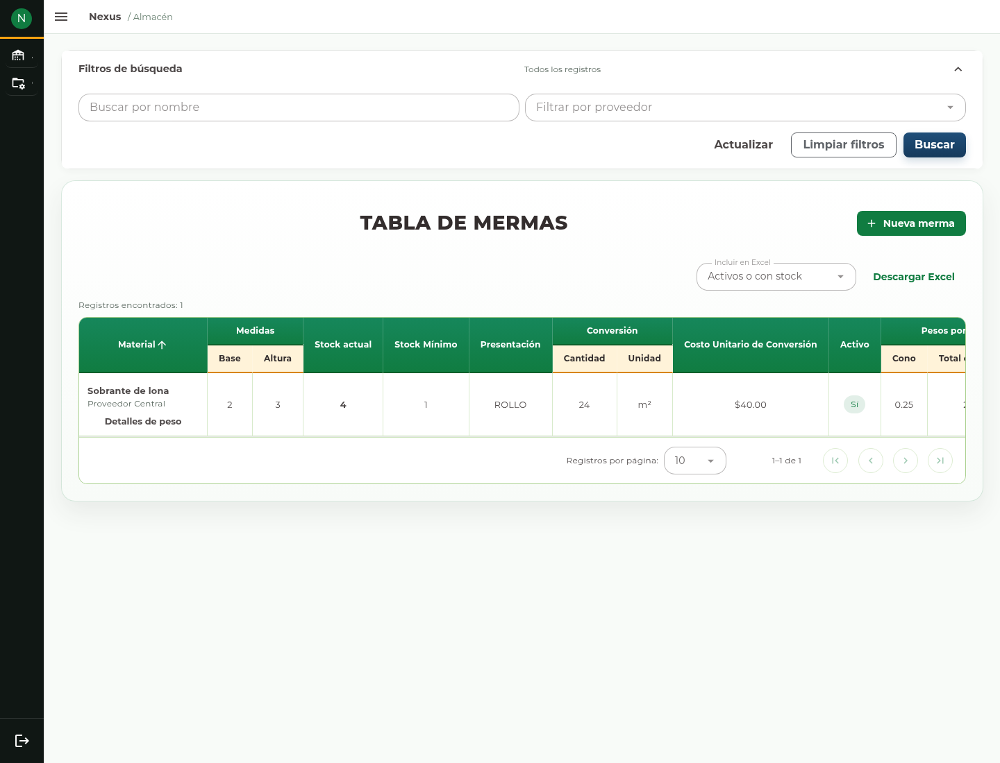
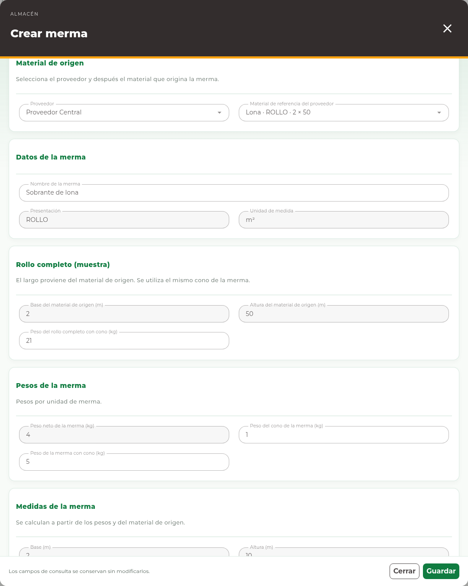
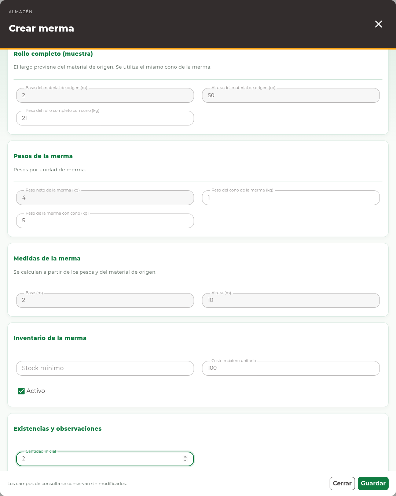
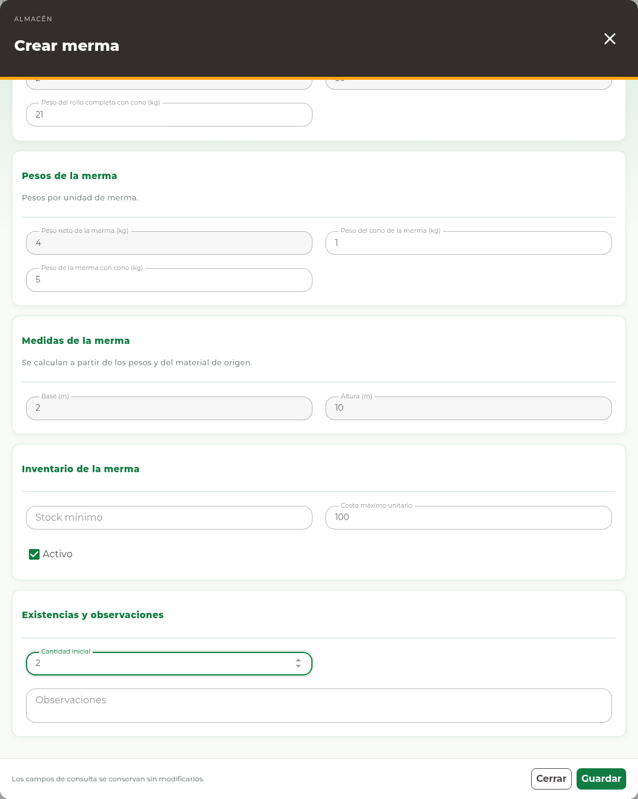
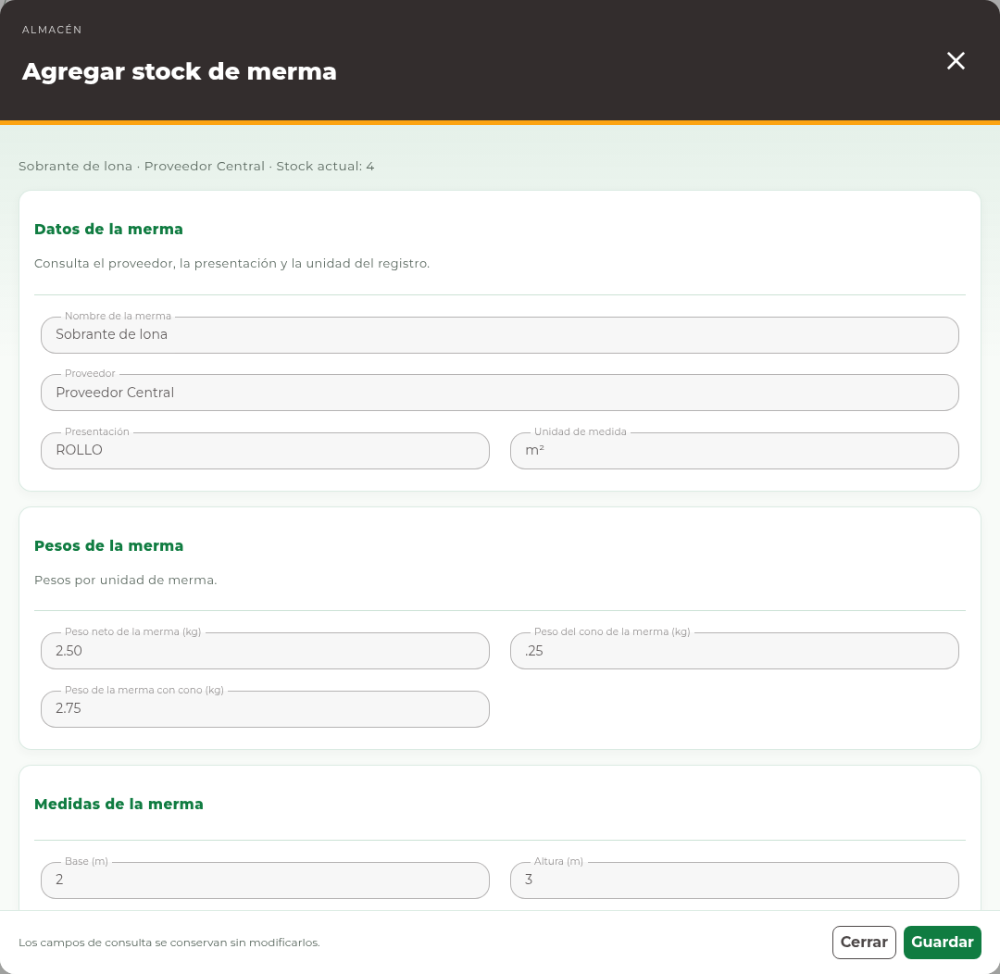

# 5. Mermas

## Consultar una merma

Abra **Almacén → Mermas**. En **Tabla de Mermas**, busque por nombre y proveedor,
revise las medidas y distinga cantidad de piezas o presentaciones de su conversión.
Utilice **Detalles de peso** cuando esté disponible para consultar los pesos
conservados del registro; **Cerrar detalles** termina esa consulta.

<!-- manual:any wastes:write -->
## Registrar una merma

**Antes de empezar.** Debe existir el material de referencia del proveedor. Para
un rollo necesita el peso del rollo completo con cono y los pesos de la merma.
Tome los pesos en kilogramos y las medidas en metros.

1. Pulse **Nueva merma** para abrir **Crear merma**.
2. Seleccione **Proveedor** y después **Material de referencia del proveedor**.
3. Escriba **Nombre de la merma**. Revise presentación y unidad heredadas.
4. Complete los pesos o las medidas habilitadas según la presentación.
5. Revise la vista previa de las medidas calculadas.
6. Capture **Stock mínimo**, **Costo máximo unitario**, **Activo**,
   **Cantidad inicial** y **Observaciones**, según corresponda.
7. Pulse **Guardar** una sola vez y compruebe el registro y su existencia.

| Campo para rollos | Significado |
| --- | --- |
| Peso del rollo completo con cono (kg) | Peso de la muestra completa del material de origen. Incluye el cono. |
| Peso del cono de la merma (kg) | Peso del cono que se descuenta para obtener el peso neto. |
| Peso de la merma con cono (kg) | Peso total de una unidad de la merma, incluido su cono. |
| Peso neto de la merma (kg) | Resultado de consulta; no se captura como un total independiente. |
| Base (m), Altura (m) | Se calculan para rollos; en otros casos se capturan cuando están habilitadas. |
| Cantidad inicial | Número de unidades de esa merma, distinto del peso por unidad. |

El formulario puede requerir desplazamiento vertical. Las siguientes capturas
muestran sus secciones en la misma captura en preparación.

Un peso total debe ser coherente con el peso del cono. No escriba el peso de varias
mermas como si fuera el peso de una unidad. La vista previa ayuda a revisar la
captura; el resultado confirmado aparece después de guardar.
<!-- manual:end -->

<!-- manual:any wastes:add-stock -->
## Merma existente y entradas adicionales

Si el sistema identifica una merma existente, revise el aviso y el registro que
propone. Sólo si corresponde a la misma merma, confirme continuar con la entrada
de existencias. No acepte otra identidad sólo para completar el alta.

**Antes de confirmar.** La entrada aumenta el inventario. No vuelva a agregar
una cantidad que ya se registró al crear la merma. Compruebe el resultado anterior
si hubo una interrupción.

Para una entrada posterior, use **Agregar stock** cuando la fila ofrezca esa acción:

1. Compruebe el nombre y las características de la merma.
2. En **Cantidad a agregar**, capture la entrada positiva.
3. Explique la entrada en **Observaciones** y pulse **Guardar**.
4. Compruebe el saldo incrementado y el movimiento correspondiente.

**Cantidad a agregar** incrementa el saldo; **Nuevo stock** en **Ajustar stock**
lo reemplaza. Para un conteo físico utilice el ajuste con su motivo, no una entrada.
<!-- manual:end -->

<!-- manual:any wastes:write -->
## Editar datos

Use **Editar** para los datos habilitados. Las medidas, pesos e identidad que
sostienen el historial se conservan como consulta. Un registro con **Referencia
histórica** muestra la muestra conservada para ese registro; no obliga a recapturarla.
<!-- manual:end -->

<!-- manual:any wastes:write wastes:add-stock -->
## Recuperar una captura pendiente

Si aparece **Recuperar captura**, mantenga esa captura y pulse el botón para
comprobar el resultado de la operación anterior. El sistema reutiliza la misma
operación. No abra otra alta para repetirla. Consulte
[Errores y recuperación](15-errors-and-recovery.md) si el servicio sigue sin responder.
<!-- manual:end -->
