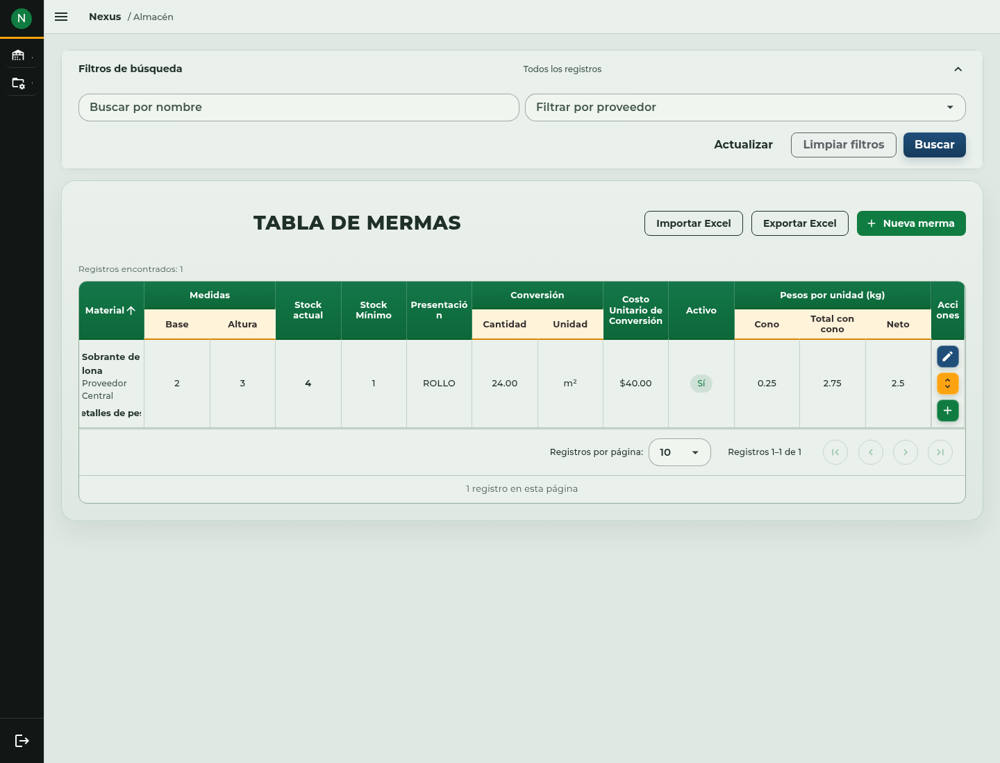
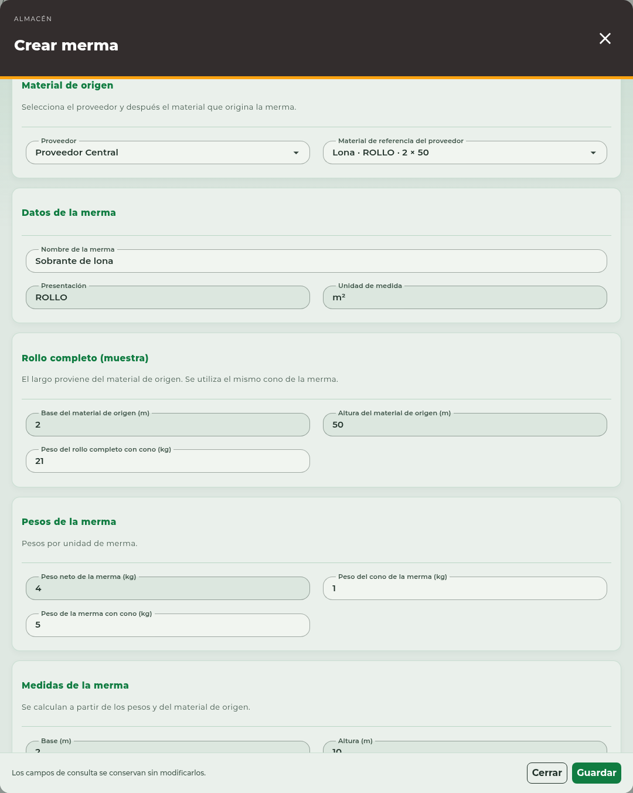
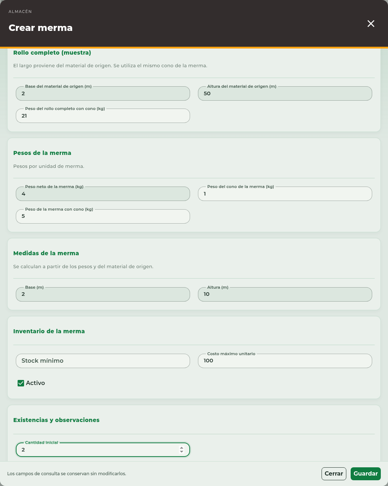
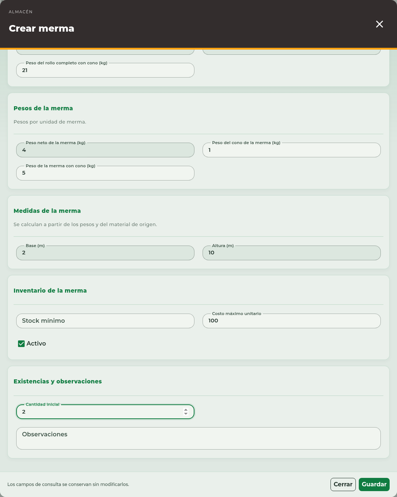
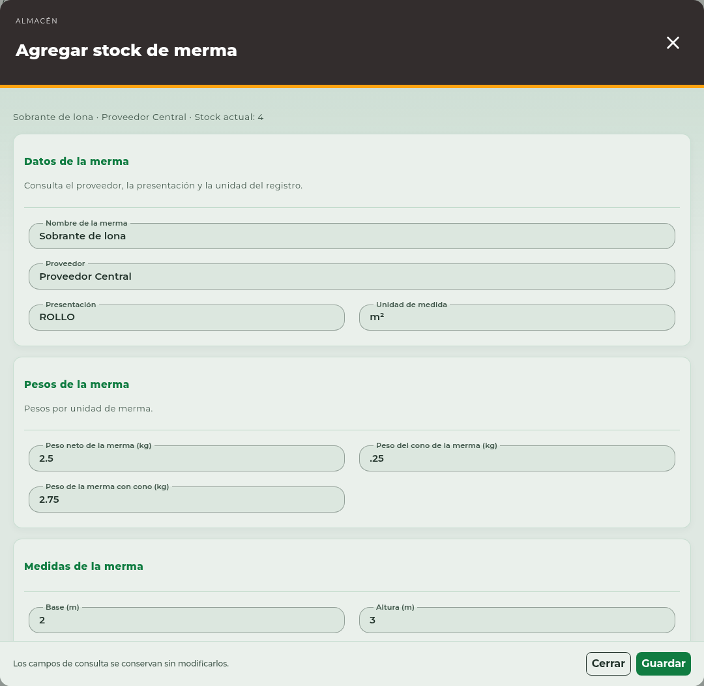

# 5. Mermas

<!-- manual:all wastes:read -->
<!-- manual:any inventory:costs-read wastes:adjust-stock -->
<!-- manual:any wastes:write wastes:adjust-stock -->
## Importar desde Excel

Cada Excel representa una operación elegida en **Operación del archivo**, según
las opciones disponibles para su cuenta. Las primeras columnas siguen el orden del
inventario de consulta. Los registros operativos son individuales aunque el reporte
agrupa totales. Después se añaden los IDs/versiones y los campos necesarios.

1. Pulse **Importar Excel** y seleccione la operación para todo el archivo.
2. En Alta, seleccione proveedor y descargue la plantilla con sus materiales de referencia en m². En edición o ajuste, filtre los registros actuales y descargue sus IDs/versiones.
3. En edición o ajuste, deje vacíos los filtros para incluir todos los registros coincidentes o filtre por proveedor/nombre. La plantilla incluye hasta 500 registros; si hay más, trabaje grupos filtrados. Complete sólo las columnas blancas de captura y conserve las grises.
4. Seleccione la misma operación y el archivo; pulse **Validar archivo**. Revise los datos y errores.
5. Corrija los errores en el original, descarte el borrador y vuelva a validar.
6. Pulse **Confirmar importación** y espere el recibo.

<!-- manual:all wastes:write inventory:costs-read -->
**Alta:** capture nombre, proveedor, material de referencia, mínimo, costo, Activo,
**Cantidad inicial** y observaciones; medidas o pesos según la presentación. El sistema
genera el ID nuevo y obtiene presentación/unidad del material de referencia.

**Editar datos:** cambie **Material**, **Stock mínimo**, **Costo unitario** y **Activo**.
Se conservan IDs/versiones, proveedor, material de origen, medidas, pesos y existencia.
<!-- manual:end -->

<!-- manual:any wastes:adjust-stock -->

**Ajustar existencias:** capture **Stock contado**, **Motivo** y **Observaciones**.
Se conservan IDs/versiones, identidad, medidas y pesos.
<!-- manual:end -->

<!-- manual:all wastes:write inventory:costs-read -->
En Alta seleccione el material de referencia de la lista; la opción ya incluye su
ID. Para Rollo capture cono, merma con cono y rollo completo con cono, en kg; el
sistema calcula las medidas. La edición de datos conserva el stock.
<!-- manual:end -->

<!-- manual:any wastes:adjust-stock -->
En ajuste capture el saldo físico final: cero es válido y vacío se rechaza. Retire
las filas que aún no haya contado y evite movimientos durante la captura. Para
cambiar datos y stock complete dos operaciones con una descarga actual entre ellas.
<!-- manual:end -->

En **Activo**, use **SI** o **NO**. Capture números con punto decimal y sin símbolos
de moneda; no cambie IDs ni versiones. Cada archivo admite hasta 500 filas. Para
trabajar más registros, aplique filtros y evite repetir destinos entre archivos.

Conserve los IDs/versiones que se descargan para cada registro existente. No es
necesario ser administrador: se incluyen según el permiso operativo. Cambiar la
operación retira el archivo seleccionado.

Si una fila está repetida o es inválida, **no se aplica ninguna fila**. Descargue
los errores, corrija o retire los repetidos y vuelva a validar. Un alta repetida no suma stock.

Conserve **Datos**, **Instrucciones**, **Catalogos**, los encabezados y las columnas
grises de referencia. **Catalogos** muestra sólo las opciones aplicables: en Alta,
proveedores y materiales de referencia; en Ajustar existencias, motivos; Editar datos
no requiere catálogos. No son registros de inventario. Elija la opción completa tal
como aparece, incluido el ID cuando venga integrado. Complete sólo la captura de la
operación seleccionada y retire las filas que no quiera procesar.

Suba el `.xlsx` directamente, sin otro ZIP, fórmulas, macros ni enlaces externos.
El archivo de **Exportar Excel** sirve para consultar; descargue una plantilla
operativa para cargar cambios. Las plantillas antiguas deben sustituirse por una
actual. **Descargar errores** genera un informe: corrija la copia de captura y vuelva
a validarla, sin importar el informe de errores.

Máximo: 500 filas y 2 MiB. Actualizar sólo cambia nombre, mínimo, costo y activo;
conserva stock, medidas y pesos. Para entradas posteriores use **Agregar stock**.
Si se pierde la respuesta, pulse **Revisar y reintentar confirmación** desde la
misma opción de importación. No cargue otro archivo para repetir una confirmación
incierta. El archivo subido se descarta tras el análisis; el borrador y los errores
vencen en 24 h y se eliminan al confirmar o descartar. El recibo confirmado se conserva.
El original y las descargas de su equipo permanecen bajo su control: guarde una copia
hasta comprobar el resultado y siga el [manejo de archivos locales](02-navigation-and-controls.md#archivos-en-su-equipo).
<!-- manual:end -->
<!-- manual:end -->
<!-- manual:end -->

## Consultar una merma

Abra **Almacén → Mermas**. Busque por nombre y proveedor y revise medidas, cantidad y
conversión. Los pesos de cono, total y neto se consultan directamente en la tabla.

<!-- manual:any wastes:write wastes:adjust-stock wastes:add-stock -->
**Detalles de peso** muestra las referencias guardadas cuando están disponibles;
**Cerrar detalles** termina esa consulta.
<!-- manual:end -->

<!-- manual:any wastes:write -->
## Registrar una merma

**Antes de empezar.** Debe existir el material de referencia del proveedor. Para
un rollo necesita el peso del rollo completo con cono y los pesos de la merma.
Tome los pesos en kilogramos y las medidas en metros.

1. Pulse **Nueva merma** para abrir **Crear merma**.
2. Seleccione **Proveedor** y después **Material de referencia del proveedor**.
3. Escriba **Nombre de la merma**. Revise presentación y unidad heredadas.
4. Complete los pesos o las medidas habilitadas según la presentación.
5. Revise la vista previa de las medidas calculadas.
6. Capture **Stock mínimo**, **Costo máximo unitario**, **Activo**,
   **Cantidad inicial** y **Observaciones**, según corresponda.
7. Pulse **Guardar** una sola vez y compruebe el registro y su existencia.

| Campo para rollos | Significado |
| --- | --- |
| Peso del rollo completo con cono (kg) | Peso de la muestra completa del material de origen. Incluye el cono. |
| Peso del cono de la merma (kg) | Peso del cono que se descuenta para obtener el peso neto. |
| Peso de la merma con cono (kg) | Peso total de una unidad de la merma, incluido su cono. |
| Peso neto de la merma (kg) | Resultado de consulta; no se captura como un total independiente. |
| Base (m), Altura (m) | Se calculan para rollos; en otros casos se capturan cuando están habilitadas. |
| Cantidad inicial | Número de unidades de esa merma, distinto del peso por unidad. |

Capture el peso de una sola merma. Los pesos con cono deben superar el peso del
cono. Revise las medidas calculadas antes de guardar.
<!-- manual:end -->

<!-- manual:any wastes:add-stock -->
## Merma existente y entradas adicionales

Si aparece una merma existente, compruebe su identidad antes de continuar.

**Antes de confirmar.** La entrada suma unidades al saldo. No repita una cantidad
ya registrada; compruebe el resultado si se interrumpió el envío.

Para una entrada posterior, use **Agregar stock** cuando esté disponible en el registro:

1. Compruebe el nombre y las características de la merma.
2. En **Cantidad a agregar**, capture la entrada positiva.
3. Explique la entrada en **Observaciones** y pulse **Guardar**.
4. Compruebe el saldo incrementado y el movimiento correspondiente.

Use esta acción para unidades que ingresan. Si el conteo físico difiere del saldo,
avise al responsable del inventario.
<!-- manual:end -->

<!-- manual:any wastes:write -->
## Editar datos

Use **Editar** para cambiar **Nombre de la merma**, **Stock mínimo**, **Costo máximo
unitario** y **Activo**. Proveedor, presentación, unidad, medidas y pesos permanecen
de consulta. El material de origen y la existencia se conservan. **Referencia histórica**
muestra la muestra guardada; no debe recapturarla. Guarde y compruebe los datos actualizados.
<!-- manual:end -->

<!-- manual:any wastes:adjust-stock -->
## Ajustar el saldo

El ajuste reemplaza el saldo con un conteo comprobado. Para recibir otras unidades,
use **Agregar stock**.

1. Localice la merma y pulse **Ajustar stock**.
2. Compruebe nombre, proveedor, medidas y **Stock actual**.
3. Seleccione **Motivo del ajuste**.
4. Capture en **Nuevo stock** la cantidad total que debe quedar. Puede ser cero;
   no escriba la diferencia que desea sumar o restar.
5. Explique la corrección en **Observaciones** y pulse **Guardar**.
6. Espere la confirmación, compruebe el saldo y consulte su movimiento cuando tenga acceso.

El ajuste conserva identidad y pesos. Ante un conflicto, siga
[Errores y recuperación](15-errors-and-recovery.md#conflictos-de-edición).
<!-- manual:end -->

<!-- manual:any warehouse:reports-read -->
## Descargar el inventario

Revise la búsqueda y el proveedor, seleccione **Incluir en Excel** y pulse
**Exportar Excel**. En Mermas, el proveedor elegido sí delimita el archivo.
Revise cantidades y pesos; un peso desconocido no es cero. Las opciones de inclusión
se explican en [Reportes](14-reports.md).
<!-- manual:end -->

<!-- manual:any wastes:write wastes:add-stock -->
## Recuperar una captura pendiente

Pulse **Recuperar captura** para comprobar el envío anterior. Conserve sus datos y
evite abrir otra alta. Si el servicio no responde, consulte
[Errores y recuperación](15-errors-and-recovery.md).
<!-- manual:end -->
