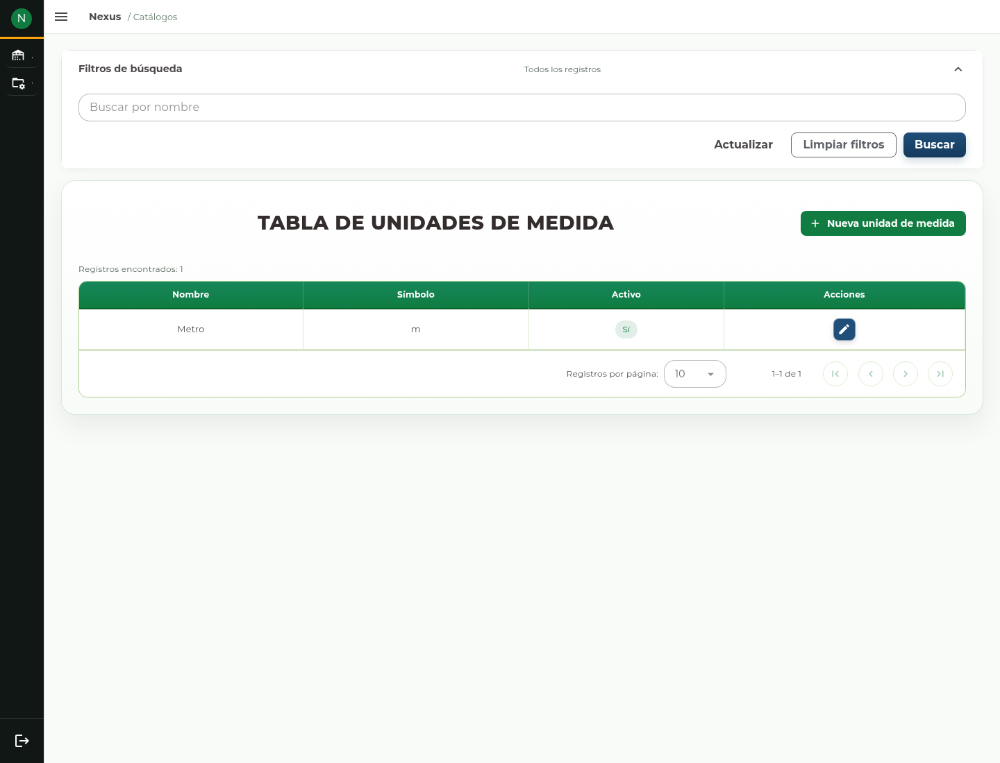
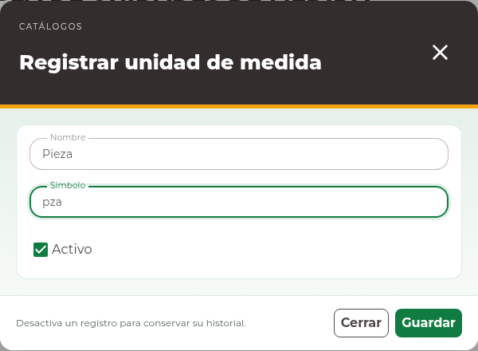

# 6. Catálogos

## Elegir el catálogo

Abra **Catálogos** y elija el tipo de dato que necesita administrar. La cuenta
debe tener permiso de gestión de catálogos. Estos registros se ofrecen después en
los selectores de otros módulos.

| Catálogo | Uso principal | Acción de alta |
| --- | --- | --- |
| Áreas | Organización y asignaciones de personas o solicitudes. | Nueva área |
| Roles | Responsabilidad o rol asignado. | Nuevo rol |
| Presentaciones | Forma en que se maneja el artículo. | Nueva presentación |
| Unidades de medida | Nombre y símbolo de la unidad de control. | Nueva unidad de medida |
| Motivos de ajuste | Explicación clasificada de las correcciones de stock. | Nuevo motivo de ajuste |
| Estados de cumplimiento | Clasificación disponible en los flujos que la utilizan. | Nuevo estado de cumplimiento |

## Crear un registro

1. Busque primero el nombre para evitar duplicados.
2. Pulse la acción de alta del catálogo.
3. Escriba **Nombre**. En Unidades de medida, complete también **Símbolo**.
4. Revise **Activo** y pulse **Guardar**.
5. Compruebe el registro en la tabla y, cuando lo utilice, en el selector correspondiente.

Use nombres consistentes y símbolos que otros operadores puedan interpretar.
Cambiar un nombre no transforma por sí mismo los saldos ni las medidas de los
artículos que ya lo utilizan. Si el sistema informa que el nombre ya existe,
revise el registro existente en lugar de añadir variaciones para evitar el aviso.

## Editar o desactivar

1. Localice el registro y abra su acción de edición.
2. Corrija los campos habilitados.
3. Si deja de utilizarse para nuevas capturas, desmarque **Activo**.
4. Pulse **Actualizar** y compruebe el resultado.

La desactivación no elimina documentos históricos. Los flujos operativos pueden
excluir registros inactivos al buscar nuevas opciones y conservar los valores
ya asociados a registros existentes.

## Resolver un rechazo

Si falta un dato, corrija el campo señalado. Si otra persona modificó el registro,
el formulario conserva su captura y bloquea el envío; utilice **Cerrar y actualizar
listado**, vuelva a abrir el registro y contraste la información vigente antes de
editar. No cambie catálogos ajenos a su responsabilidad para resolver un permiso
o un problema de conexión.
