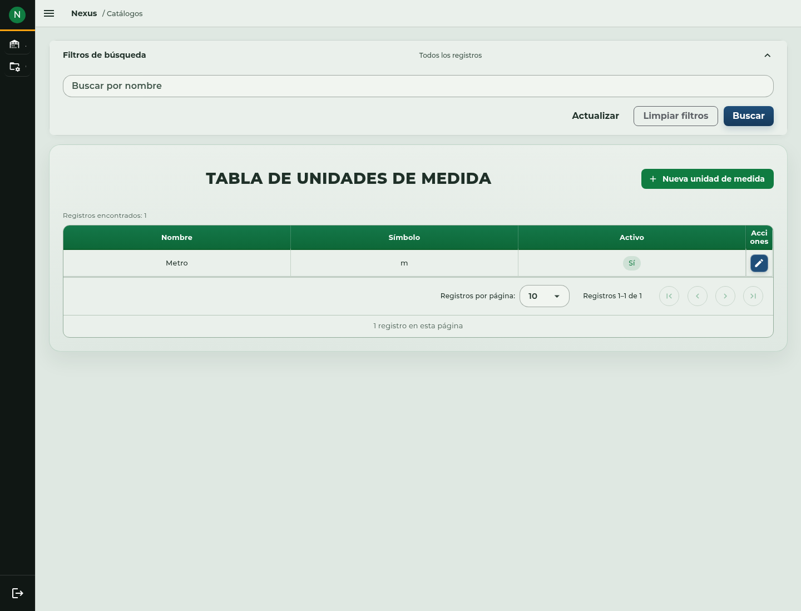
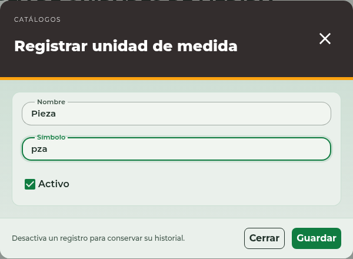

# 6. Catálogos

## Elegir el catálogo

Abra **Catálogos** y elija el dato que necesita administrar. Sus registros se usan
en los selectores del sistema.

| Catálogo | Uso principal | Acción de alta |
| --- | --- | --- |
| Áreas | Organización y asignaciones de personas o solicitudes. | Nueva área |
| Roles | Responsabilidad o rol asignado. | Nuevo rol |
| Presentaciones | Forma en que se maneja el artículo. | Nueva presentación |
| Unidades de medida | Nombre y símbolo de la unidad de control. | Nueva unidad de medida |
| Motivos de ajuste | Explicación clasificada de las correcciones de stock. | Nuevo motivo de ajuste |
| Estados de cumplimiento | Clasificación disponible en los flujos que la utilizan. | Nuevo estado de cumplimiento |

## Crear un registro

1. Busque primero el nombre para evitar duplicados.
2. Pulse la acción de alta del catálogo.
3. Escriba **Nombre**. En Unidades de medida, complete también **Símbolo**.
4. Revise **Activo** y pulse **Guardar**.
5. Compruebe el registro en la tabla y, cuando lo utilice, en el selector correspondiente.

Use nombres y símbolos claros. Renombrar conserva saldos y medidas existentes.
Si aparece un duplicado, revise el registro encontrado.

## Editar o desactivar

1. Localice el registro y abra su acción de edición.
2. Corrija los campos habilitados.
3. Si deja de utilizarse para nuevas capturas, desmarque **Activo**.
4. Pulse **Actualizar** y compruebe el resultado.

Desactivar retira el registro de nuevas selecciones y conserva los documentos que ya lo usan.

## Resolver un rechazo

Corrija los campos señalados. Si el registro cambió, use **Cerrar y actualizar listado**
y vuelva a abrirlo. Consulte [Errores y recuperación](15-errors-and-recovery.md) ante otros fallos.
