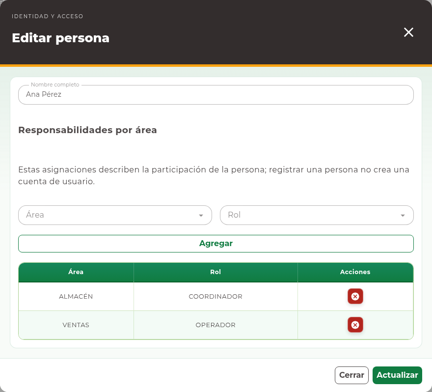

# 7. Personas

## Consultar personas

Abra **Identidad y acceso → Personas**. La **Tabla de Personas** muestra el nombre
y las responsabilidades de cada persona. Una persona representa a alguien que
participa en la operación; su registro no implica por sí mismo una cuenta de ingreso.

<!-- manual:any persons:write -->
## Registrar una persona

**Antes de empezar.** Identifique el nombre completo y las áreas y roles que
corresponden a esa persona. Los catálogos deben estar disponibles.

1. Pulse **Nueva persona**.
2. En **Registrar persona**, capture **Nombre completo**.
3. Seleccione **Área** y **Rol**, y pulse **Agregar**.
4. Revise la asignación en la lista. Repita para otras áreas cuando corresponda.
5. Para corregir una asignación preparada, quítela y agregue la correcta.
6. Con al menos una asignación válida, pulse **Guardar**.
7. Compruebe el nombre y las responsabilidades en el listado.

Cada área puede aparecer una sola vez en la lista de responsabilidades de la
persona. **Agregar** prepara una asignación dentro del formulario; las
asignaciones se guardan con **Guardar** o **Actualizar**, no individualmente.
<!-- manual:end -->

<!-- manual:any persons:write -->
## Editar responsabilidades

1. Busque la persona y pulse **Editar registro**.
2. Revise todas las asignaciones cargadas, no sólo la primera.
3. Cambie el nombre, quite una asignación con su control o agregue la que falta.
4. Mantenga al menos una responsabilidad válida y pulse **Actualizar**.
5. Compruebe que se conservaron las asignaciones que no debía retirar.

Cambiar responsabilidades debe responder a la organización real del trabajo.
Si un usuario tiene datos de acceso que deben modificarse, revíselos también en
**Usuarios**; no asuma que editar una persona sustituye esa administración.
<!-- manual:end -->

<!-- manual:any person:reports-read -->
## Filtrar y exportar

Utilice **Filtrar por área** y **Filtrar por rol**, seleccione sus opciones y
pulse **Buscar**. Si no aparece una persona, limpie los filtros y revise su nombre.
Con permiso de reporte puede usar **Exportar Excel**. Si el filtro por rol está
aplicado, la exportación de Personas queda deshabilitada: quite ese filtro o use
**Limpiar filtros** y, si lo necesita, aplique sólo el área antes de exportar.
<!-- manual:end -->

## Incidencias

Un aviso de área repetida exige corregir la lista de responsabilidades. Si el
registro cambió mientras lo editaba, conserve una referencia de su corrección,
cierre y actualice el listado, y vuelva a revisar las asignaciones actuales.
